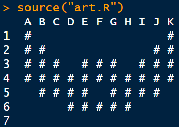
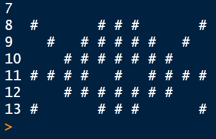

<div align="center">

# 🦇🕷️ `art.frame`

### ASCII Art with Data Frames in R

<p>
  A creative implementation of the <strong>CS50R Problem Set 1</strong><br>
  featuring a <strong>bat symbol</strong> and a <strong>spider symbol</strong>.
</p>

[](https://cs50.harvard.edu/r/)
[](https://cs50.harvard.edu/r/psets/1/)
[](https://cs50.harvard.edu/r/psets/1/art.frame/)
[](https://www.r-project.org/)

---

*Transforming rows and columns into console artwork.*

</div>

## 📖 Table of Contents

- [About the Assignment](#-about-the-assignment)
- [Project Overview](#-project-overview)
- [Selected Artwork](#-selected-artwork)
- [Assignment Requirements](#-assignment-requirements)
- [Implementation](#-implementation)
- [How It Works](#-how-it-works)
- [Project Structure](#-project-structure)
- [Demonstration](#-demonstration)
- [What I Learned](#-what-i-learned)

---

## 🎯 About the Assignment

[`art.frame`](https://cs50.harvard.edu/r/psets/1/art.frame/) is an assignment from **Problem Set 1** of [CS50’s Introduction to Programming with R](https://cs50.harvard.edu/r/).

The objective of the assignment is to practise creating and manipulating an R data frame by turning it into a canvas for text-based artwork.

Instead of using a traditional graphics library, the image is constructed from characters stored inside rows and columns of a data frame.

> [!NOTE]
> This project focuses on representing visual patterns through structured tabular data.

---

## ✨ Project Overview

For my implementation, I created two pieces of console artwork:

<table>
  <tr>
    <td align="center" width="50%">
      <h3>🦇 Bat Symbol</h3>
      <p>
        A text-based representation of a bat, created by carefully arranging characters across a data-frame grid.
      </p>
    </td>
    <td align="center" width="50%">
      <h3>🕷️ Spider Symbol</h3>
      <p>
        A symmetrical spider design represented through rows, columns, spaces, and printable characters.
      </p>
    </td>
  </tr>
</table>

Both designs demonstrate how a data frame can be used for more than conventional datasets: each cell acts as an individual pixel of an ASCII-style image.

---

## 🎨 Selected Artwork

### 🦇 Bat

The bat was chosen because its wings and central body create an interesting symmetrical pattern.

Building the symbol required attention to:

- Horizontal alignment;
- Left-to-right symmetry;
- Spacing between individual characters;
- Consistent row lengths;
- The overall silhouette of the wings and body.

### 🕷️ Spider

The spider was selected as the second design because its body and multiple legs work well with grid-based artwork.

Its construction focuses on:

- A clearly defined central body;
- Symmetrical placement of the legs;
- Balanced spacing;
- Readability in console output;
- Consistent proportions across the data frame.

---

## 📋 Assignment Requirements

The completed solution follows the core requirements of the assignment:

- [x] The artwork is stored in an object named `art`;
- [x] The object is implemented as an R data frame;
- [x] The data frame contains at least **3 rows** and **3 columns**;
- [x] The data frame is printed at the end of the program;
- [x] The program can be executed from the R console;
- [x] The output forms recognisable text-based artwork;
- [x] The artwork includes the selected bat and spider designs.

> [!IMPORTANT]
> The arrangement of characters and empty spaces is intentional. Changing their positions may distort the final artwork.

---

## 🛠️ Implementation

The artwork is constructed using R’s `data.frame()` function.

Each named argument represents a column, while each vector contains the characters displayed in that column.

```r
art <- data.frame(
  # Character vectors forming the artwork
)

print(art)
```

The complete implementation is available in [`art.R`](./art.R).

> [!TIP]
> Empty strings and spaces are used as part of the composition. They create negative space and preserve the shapes of the bat and spider.

---

## ⚙️ How It Works

```text
Characters
    │
    ▼
Character vectors
    │
    ▼
Data-frame columns
    │
    ▼
Rows and columns form a visual grid
    │
    ▼
The data frame is printed as console artwork
```

The process can be summarised in four stages:

1. **Choose the artwork**  
   Two recognisable symbols were selected: a bat and a spider.

2. **Plan the grid**  
   Each design was divided into individual character positions.

3. **Create the data frame**  
   The characters and spaces were stored inside vectors and organised as columns.

4. **Print the result**  
   Printing the completed `art` object displays the final artwork in the R console.

---

## 📁 Project Structure

```text
art.frame/
│
├── art.R
├── README.md
│
└── assets/
    ├── bat-art.png
    ├── spider-art.png
    └── check50-result.png
```

| File | Description |
|---|---|
| `art.R` | Contains the R data frame and artwork implementation |
| `README.md` | Documents the assignment and demonstrates the result |
| `assets/bat-art.png` | Screenshot of the completed bat artwork |
| `assets/spider-art.png` | Screenshot of the completed spider artwork |

---

## 📸 Demonstration

### 🦇 Bat Symbol

<div align="center">



<br>

<sub><strong>Figure 1.</strong> Bat symbol rendered from the completed R data frame.</sub>

</div>

<br>

### 🕷️ Spider Symbol

<div align="center">



<br>

<sub><strong>Figure 2.</strong> Spider symbol rendered from the completed R data frame.</sub>

</div>

<br>

---

## 🧠 What I Learned

By completing this assignment, I practised:

- Creating data frames from scratch in R;
- Building vectors with the `c()` function;
- Organising values into rows and columns;
- Understanding how tabular data is represented;
- Working with whitespace and character alignment;
- Testing an R script through the console;
- Using structured data in a creative and unconventional way.

This assignment demonstrated that a data frame is not limited to numerical analysis: it can also serve as a structured canvas for text-based visual designs.

---

<div align="center">

### 🦇 Data Meets Creativity 🕷️

**Created with R, data frames, and imagination.**

<br>

[](https://www.r-project.org/)
[](https://cs50.harvard.edu/r/)

</div>