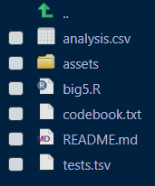
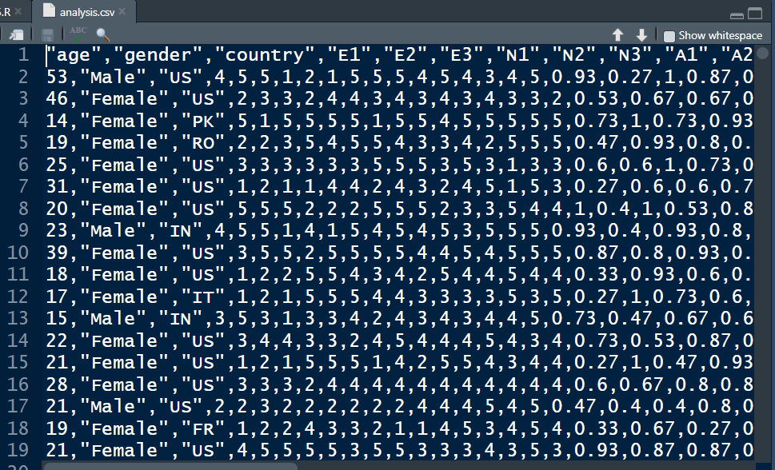

<div align="center">

# 🧠 Big 5 Personality Analysis

### Processing Personality-Test Data with R

<p>
  A data-analysis project completed as part of<br>
  <strong>CS50’s Introduction to Programming with R</strong>.
</p>

[](https://cs50.harvard.edu/r/)
[](https://cs50.harvard.edu/r/psets/1/)
[](https://cs50.harvard.edu/r/psets/1/big5/)
[](https://www.r-project.org/)
[](./analysis.csv)

---

### 🔍 From raw questionnaire responses to meaningful personality metrics

</div>

## 📖 Table of Contents

- [About the Assignment](#-about-the-assignment)
- [Project Objective](#-project-objective)
- [The Big Five Traits](#-the-big-five-traits)
- [Assignment Requirements](#-assignment-requirements)
- [Data Processing Workflow](#-data-processing-workflow)
- [Personality Score Calculation](#-personality-score-calculation)
- [Output Dataset](#-output-dataset)
- [Result Preview](#-result-preview)
- [Demonstration](#-demonstration)
- [Project Structure](#-project-structure)
- [Testing and Validation](#-testing-and-validation)
- [What I Learned](#-what-i-learned)

---

## 🎯 About the Assignment

[`Big 5`](https://cs50.harvard.edu/r/psets/1/big5/) is an assignment from **Problem Set 1** of [CS50’s Introduction to Programming with R](https://cs50.harvard.edu/r/).

The objective is to write an R program called `big5.R` that analyses thousands of personality-test responses stored in a tab-separated file named `tests.tsv`.

The program reads the original dataset, transforms demographic information, calculates five personality-trait scores, and writes the completed analysis to a new file:

```text
analysis.csv
```

> [!NOTE]
> The generated `analysis.csv` file serves as the main result of the completed assignment.

---

## 🚀 Project Objective

The purpose of this project is to transform raw questionnaire data into a structured dataset containing calculated personality scores.

The completed program performs the following operations:

1. Reads the raw data from `tests.tsv`;
2. Preserves the original demographic and questionnaire columns;
3. Converts numeric gender values into readable text labels;
4. Calculates a score for each of the five personality traits;
5. Rounds every calculated score to two decimal places;
6. Stores the transformed data in `analysis.csv`.

```text
tests.tsv
    │
    ▼
Read and process the raw data
    │
    ▼
Convert demographic values
    │
    ▼
Calculate the Big Five scores
    │
    ▼
Round the results
    │
    ▼
analysis.csv
```

---

## 🧩 The Big Five Traits

The **Big Five** model describes personality using five broad dimensions:

<table>
  <tr>
    <th align="center">Symbol</th>
    <th align="left">Trait</th>
    <th align="left">Description</th>
    <th align="center">Source Columns</th>
  </tr>
  <tr>
    <td align="center">🗣️</td>
    <td><strong>Extroversion</strong></td>
    <td>Social engagement, energy, and outgoing behaviour</td>
    <td align="center"><code>E1</code>–<code>E3</code></td>
  </tr>
  <tr>
    <td align="center">🌊</td>
    <td><strong>Neuroticism</strong></td>
    <td>Emotional sensitivity and tendency to experience emotional changes</td>
    <td align="center"><code>N1</code>–<code>N3</code></td>
  </tr>
  <tr>
    <td align="center">🤝</td>
    <td><strong>Agreeableness</strong></td>
    <td>Cooperation, empathy, and consideration for others</td>
    <td align="center"><code>A1</code>–<code>A3</code></td>
  </tr>
  <tr>
    <td align="center">🎯</td>
    <td><strong>Conscientiousness</strong></td>
    <td>Organisation, responsibility, and self-discipline</td>
    <td align="center"><code>C1</code>–<code>C3</code></td>
  </tr>
  <tr>
    <td align="center">💡</td>
    <td><strong>Openness</strong></td>
    <td>Curiosity, creativity, and openness to new experiences</td>
    <td align="center"><code>O1</code>–<code>O3</code></td>
  </tr>
</table>

---

## 📋 Assignment Requirements

The completed solution follows the principal requirements of the assignment:

- [x] The program is implemented in `big5.R`;
- [x] The source dataset is read from `tests.tsv`;
- [x] The accompanying `codebook.txt` is used to interpret the data;
- [x] All original columns from `tests.tsv` are retained;
- [x] Numeric gender values are converted to textual labels;
- [x] An `extroversion` column is added;
- [x] A `neuroticism` column is added;
- [x] An `agreeableness` column is added;
- [x] A `conscientiousness` column is added;
- [x] An `openness` column is added;
- [x] Each personality score is normalised using a maximum possible sum of `15`;
- [x] Calculated values are rounded to two decimal places;
- [x] The completed analysis is written to `analysis.csv`.

> [!IMPORTANT]
> The original dataset is tab-separated. Therefore, the input must be read using the correct tab delimiter rather than as a conventional comma-separated file.

---

## 🔄 Data Processing Workflow

### 1. Reading the dataset

The source file, `tests.tsv`, contains values separated by tab characters.

```r
tests <- read.table(
  "tests.tsv",
  header = TRUE,
  sep = "\t"
)
```

### 2. Converting demographic information

The original numeric values in the `gender` column are converted into readable text labels according to the mappings defined in `codebook.txt`.

The resulting output contains labels such as:

```text
Male
Female
```

### 3. Calculating personality scores

Three questionnaire responses are combined for each personality trait.

The sum is divided by the maximum possible value of `15`, producing a normalised score between `0` and `1`.

### 4. Rounding the calculated values

Each calculated personality score is rounded to two decimal places using R’s `round()` function.

### 5. Exporting the result

After processing, the completed data frame is exported as:

```text
analysis.csv
```

---

## 🧮 Personality Score Calculation

Each participant answers three questions for every personality category. Each answer has a maximum value of `5`.

Therefore, the maximum possible total for one category is:

```text
3 questions × 5 points = 15 points
```

The general calculation is:

```text
Personality score = Sum of the three relevant answers ÷ 15
```

The resulting value is then rounded to two decimal places:

```text
Final score = round(Personality score, 2)
```

### Trait formulas

| Result Column | Calculation |
|---|---|
| `extroversion` | `(E1 + E2 + E3) / 15` |
| `neuroticism` | `(N1 + N2 + N3) / 15` |
| `agreeableness` | `(A1 + A2 + A3) / 15` |
| `conscientiousness` | `(C1 + C2 + C3) / 15` |
| `openness` | `(O1 + O2 + O3) / 15` |

> [!TIP]
> Normalising the values makes all five traits comparable on the same scale from `0` to `1`.

---

## 📦 Output Dataset

The finished `analysis.csv` file contains the original demographic and questionnaire data together with five newly calculated personality scores.

### Demographic columns

| Column | Description |
|---|---|
| `age` | Age of the participant |
| `gender` | Textual gender label |
| `country` | Participant’s country code |

### Questionnaire columns

| Group | Columns |
|---|---|
| Extroversion responses | `E1`, `E2`, `E3` |
| Neuroticism responses | `N1`, `N2`, `N3` |
| Agreeableness responses | `A1`, `A2`, `A3` |
| Conscientiousness responses | `C1`, `C2`, `C3` |
| Openness responses | `O1`, `O2`, `O3` |

### Calculated columns

| Column | Value Range | Description |
|---|:---:|---|
| `extroversion` | `0–1` | Normalised extroversion score |
| `neuroticism` | `0–1` | Normalised neuroticism score |
| `agreeableness` | `0–1` | Normalised agreeableness score |
| `conscientiousness` | `0–1` | Normalised conscientiousness score |
| `openness` | `0–1` | Normalised openness score |

---

## 📊 Result Preview

The following rows are taken from the generated [`analysis.csv`](./analysis.csv) file and demonstrate the successful result of the program:

| age | gender | country | E1 | E2 | E3 | N1 | N2 | N3 | A1 | A2 | A3 | C1 | C2 | C3 | O1 | O2 | O3 | extroversion | neuroticism | agreeableness | conscientiousness | openness |
| --- | ------ | ------- | -- | -- | -- | -- | -- | -- | -- | -- | -- | -- | -- | -- | -- | -- | -- | ------------ | ----------- | ------------- | ----------------- | -------- |
| 53  | Male   | US      | 4  | 5  | 5  | 1  | 2  | 1  | 5  | 5  | 5  | 4  | 5  | 4  | 3  | 4  | 5  | 0.93         | 0.27        | 1             | 0.87              | 0.8      |
| 46  | Female | US      | 2  | 3  | 3  | 2  | 4  | 4  | 3  | 4  | 3  | 4  | 3  | 4  | 3  | 3  | 2  | 0.53         | 0.67        | 0.67          | 0.73              | 0.53     |
| 14  | Female | PK      | 5  | 1  | 5  | 5  | 5  | 5  | 1  | 5  | 5  | 4  | 5  | 5  | 5  | 5  | 5  | 0.73         | 1           | 0.73          | 0.93              | 1        |
| 19  | Female | RO      | 2  | 2  | 3  | 5  | 4  | 5  | 5  | 4  | 3  | 3  | 4  | 2  | 5  | 5  | 5  | 0.47         | 0.93        | 0.8           | 0.6               | 1        |
| 25  | Female | US      | 3  | 3  | 3  | 3  | 3  | 3  | 5  | 5  | 5  | 3  | 5  | 3  | 1  | 3  | 3  | 0.6          | 0.6         | 1             | 0.73              | 0.47     |
| 31  | Female | US      | 1  | 2  | 1  | 1  | 4  | 4  | 2  | 4  | 3  | 2  | 4  | 5  | 1  | 5  | 3  | 0.27         | 0.6         | 0.6           | 0.73              | 0.6      |

> [!NOTE]
> This preview confirms that the demographic transformation and all five personality-score calculations were successfully written to the output file.

---

## 📸 Demonstration

### 1️⃣ Creating the Project Files

<div align="center">



<br>

<sub>
  <strong>Figure 1.</strong>
  Creating and verifying the files required for the Big 5 project.
</sub>

</div>

<br>

### 2️⃣ Generated Analysis Table

<div align="center">



<br>

<sub>
  <strong>Figure 2.</strong>
  The generated <code>analysis.csv</code> table with the calculated personality scores.
</sub>

</div>

---

## 📁 Project Structure

```text
big5/
│
├── big5.R
├── tests.tsv
├── codebook.txt
├── analysis.csv
├── README.md
│
└── assets/
    ├── file-creation.png
    └── analysis-table.png
```

| File | Description |
|---|---|
| [`big5.R`](./big5.R) | R program that performs the complete data analysis |
| [`tests.tsv`](./tests.tsv) | Original tab-separated personality-test dataset |
| [`codebook.txt`](./codebook.txt) | Description of the dataset’s variables and encoded values |
| [`analysis.csv`](./analysis.csv) | Generated dataset containing the calculated Big Five scores |
| `README.md` | Project documentation and result demonstration |
| `assets/file-creation.png` | Screenshot demonstrating the project files |
| `assets/analysis-table.png` | Screenshot demonstrating the generated analysis table |

---

## ✅ Testing and Validation

The solution can be validated manually by checking that:

- The script executes without errors;
- `tests.tsv` is read with the correct tab separator;
- All original columns are retained;
- The `gender` column contains readable text labels;
- Five new personality-trait columns are present;
- The calculated scores are normalised;
- The calculated scores are rounded to two decimal places;
- The output file is named `analysis.csv`;
- The generated values match the expected results.

---

## 🧠 What I Learned

By completing this assignment, I practised:

- Reading tab-separated data in R;
- Working with structured datasets;
- Interpreting variables using a codebook;
- Accessing and modifying data-frame columns;
- Converting encoded numeric values into readable labels;
- Performing vectorised calculations;
- Normalising numerical results;
- Rounding calculated values;
- Exporting processed data to a CSV file;
- Verifying generated output against expected results.

This project demonstrates a complete introductory data-analysis workflow:

```text
Import → Inspect → Transform → Calculate → Validate → Export
```

---

<div align="center">

### 🧠 Turning Questionnaire Responses into Structured Insights

**Created with R, data frames, and analytical thinking.**

<br>

[](https://www.r-project.org/)
[](./tests.tsv)
[](./analysis.csv)
[](https://cs50.harvard.edu/r/)

</div>