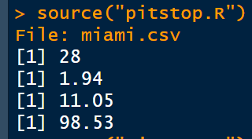
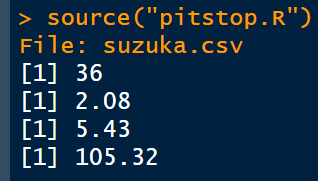

# CS50 R — Problem Set 1: Pit Stop

## Task Description

The goal of this task is to create `pitstop.R`, an R program that analyzes Formula One pit-stop data stored in CSV files.

The program must:

1. Ask the user to enter a CSV filename.
2. Read the selected file.
3. Print:
   - The total number of pit stops
   - The shortest pit-stop duration
   - The longest pit-stop duration
   - The total time spent on pit stops

Assignment: [CS50 Pit Stop](https://cs50.harvard.edu/r/psets/1/pitstop/)

## Results

### Miami Grand Prix

Input:

```text
miami.csv
```

## Expected Output

```text
Total pit stops: 28
Shortest pit stop: 1.94 seconds
Longest pit stop: 11.05 seconds
Total pit-stop time: 98.53 seconds
```



### Suzuka Grand Prix

Input:

```text
suzuka.csv
```

## Expected Output

```text
Total pit stops: 36
Shortest pit stop: 2.08 seconds
Longest pit stop: 5.43 seconds
Total pit-stop time: 105.32 seconds
```

