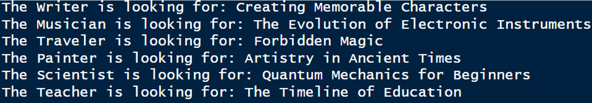
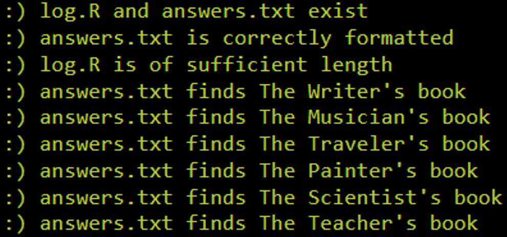
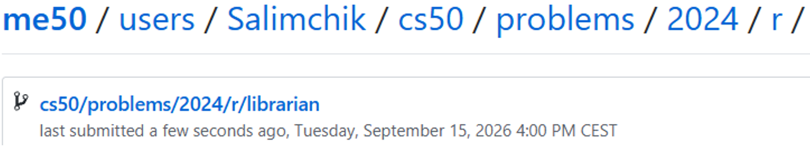

<div align="center">

# 📚 Librarian

### Finding the Right Books by Transforming and Filtering Data in R

<p>
  <strong>CS50’s Introduction to Programming with R</strong><br>
  Week 2 — Transforming Data
</p>

[](https://cs50.harvard.edu/r/)
[](https://cs50.harvard.edu/r/weeks/2/)
[](https://cs50.harvard.edu/r/psets/2/)
[](https://cs50.harvard.edu/r/psets/2/librarian/)
[](https://www.r-project.org/)
[](#-completion-status)

---

### 🔍 Six readers. Two datasets. One vast library.

*Using logical conditions, pattern matching, and relational thinking to locate exactly the right books.*

</div>

## 📖 Table of Contents

- [About the Assignment](#-about-the-assignment)
- [Project Objective](#-project-objective)
- [The Library Scenario](#-the-library-scenario)
- [Provided Data](#-provided-data)
- [Assignment Requirements](#-assignment-requirements)
- [Search Strategy](#-search-strategy)
- [Readers and Their Requests](#-readers-and-their-requests)
- [Completed answers.txt](#-completed-answerstxt)
- [Results Table](#-results-table)
- [Data-Transformation Techniques](#-data-transformation-techniques)
- [Project Structure](#-project-structure)
- [Result Demonstration](#-result-demonstration)
- [Completion Status](#-completion-status)
- [What I Learned](#-what-i-learned)

---

## 🎯 About the Assignment

[`Librarian`](https://cs50.harvard.edu/r/psets/2/librarian/) is the first assignment from **Week 2: Transforming Data** of [CS50’s Introduction to Programming with R](https://cs50.harvard.edu/r/).

The assignment presents a fictional library containing a large collection of books and information about their authors.

Six readers visit the library, each providing a different set of clues about the book they need. The objective is to analyse the provided datasets, apply the appropriate filters, and identify the correct book for every reader.

The investigation is documented in:

```text
log.R
```

The final book titles are recorded in:

```text
answers.txt
```

> [!NOTE]
> In this assignment, the process used to discover each book is just as important as the final answers.

---

## 🚀 Project Objective

The primary objective is to practise transforming, filtering, and searching structured data with R.

The completed solution:

1. Loads the information from `books.csv` and `authors.csv`;
2. Examines the structure and columns of both datasets;
3. Translates each reader’s request into logical conditions;
4. Filters the data using multiple criteria;
5. Searches book titles for a specific text pattern;
6. Cross-references books with author information;
7. Documents every investigation in `log.R`;
8. Records the six discovered titles in `answers.txt`.

```text
Reader’s request
       │
       ▼
Extract relevant clues
       │
       ▼
Select the appropriate dataset
       │
       ▼
Apply filtering conditions
       │
       ▼
Cross-reference data when required
       │
       ▼
Identify the matching title
       │
       ▼
Record the result in answers.txt
```

---

## 🏛️ The Library Scenario

The project takes place in a vast fictional library at the edge of the woods.

Throughout the day, six readers ask the librarian for help:

<table>
  <tr>
    <td align="center" width="16.66%">
      <h3>✍️</h3>
      <strong>The Writer</strong>
    </td>
    <td align="center" width="16.66%">
      <h3>🎵</h3>
      <strong>The Musician</strong>
    </td>
    <td align="center" width="16.66%">
      <h3>🧭</h3>
      <strong>The Traveler</strong>
    </td>
    <td align="center" width="16.66%">
      <h3>🎨</h3>
      <strong>The Painter</strong>
    </td>
    <td align="center" width="16.66%">
      <h3>🔬</h3>
      <strong>The Scientist</strong>
    </td>
    <td align="center" width="16.66%">
      <h3>🏫</h3>
      <strong>The Teacher</strong>
    </td>
  </tr>
</table>

Each reader remembers different details about their book. Some provide an author, while others remember a topic, publication year, page range, title fragment, or the author’s hometown.

These clues must be converted into precise data-filtering conditions.

---

## 🗃️ Provided Data

The assignment provides two CSV datasets.

### 📘 `books.csv`

Each row represents one book in the library.

| Column | Description | Example Type |
|---|---|:---:|
| `title` | Title of the book | Character |
| `author` | Name of the book’s author | Character |
| `topic` | Subject or category of the book | Character |
| `year` | Year in which the book was published | Numeric |
| `pages` | Number of pages in the book | Numeric |

### 👤 `authors.csv`

Each row represents an author in the library catalogue.

| Column | Description | Example Type |
|---|---|:---:|
| `author` | Name of the author | Character |
| `hometown` | Author’s hometown | Character |

> [!IMPORTANT]
> The `author` column connects the two datasets and makes it possible to identify books using information about an author’s hometown.

---

## 📋 Assignment Requirements

The completed solution follows the principal requirements of the assignment:

- [x] The investigation is documented in `log.R`;
- [x] The final titles are recorded in `answers.txt`;
- [x] Both `books.csv` and `authors.csv` are analysed;
- [x] Each reader’s request is translated into appropriate conditions;
- [x] The code used to find every answer is preserved;
- [x] Every section of `log.R` contains explanatory comments;
- [x] Exact-value filtering is used where appropriate;
- [x] Multiple logical conditions are combined when required;
- [x] Pattern matching is used to search within book titles;
- [x] Author information is cross-referenced with book information;
- [x] The existing structure of `answers.txt` is preserved;
- [x] No additional lines are added to `answers.txt`;
- [x] All six requested books are successfully identified.

---

## 🧭 Search Strategy

Each request requires a different combination of data-transformation techniques.

| Stage | Action | Purpose |
|:---:|---|---|
| **01** | Inspect the request | Identify every useful clue |
| **02** | Select columns | Determine which variables are relevant |
| **03** | Build conditions | Translate clues into logical expressions |
| **04** | Filter rows | Remove books that do not match |
| **05** | Cross-reference data | Connect books and authors when necessary |
| **06** | Inspect the result | Confirm that one correct title remains |
| **07** | Record the answer | Add the title to `answers.txt` |

> [!TIP]
> Combining several precise conditions is more reliable than searching with one broad condition.

---

## 🕵️ Readers and Their Requests

### ✍️ The Writer

The Writer is searching for the only book written by **Mia Morgan**.

**Relevant clues:**

- Author: `Mia Morgan`;
- The requested title is the author’s sole book.

**Result:** `Creating Memorable Characters`

---

### 🎵 The Musician

The Musician wants a classic book about music that was published in **1613**.

**Relevant clues:**

- Topic: `music`;
- Publication year: `1613`.

**Result:** `The Evolution of Electronic Instruments`

---

### 🧭 The Traveler

The Traveler provides two possible author names and one exact publication year.

**Relevant clues:**

- Possible author: `Lysandra Silverleaf`;
- Possible author: `Elena Petrova`;
- Publication year: `1775`.

**Result:** `Forbidden Magic`

---

### 🎨 The Painter

The Painter remembers a book about art with a medium page count and an approximate publication year.

**Relevant clues:**

- Topic: `art`;
- Page count: between `200` and `300`;
- Publication year: either `1990` or `1992`;
- Publication year is not `1991`.

**Result:** `Artistry in Ancient Times`

---

### 🔬 The Scientist

The Scientist remembers a distinctive phrase from the title.

**Relevant clue:**

- The title contains `Quantum Mechanics`.

This request is solved through text-pattern matching.

**Result:** `Quantum Mechanics for Beginners`

---

### 🏫 The Teacher

The Teacher is searching for an education book published during the eighteenth century, written by an author from **Zenthia**.

**Relevant clues:**

- Topic: `education`;
- Publication period: the `1700s`;
- Author’s hometown: `Zenthia`.

This request requires information from both `books.csv` and `authors.csv`.

**Result:** `The Timeline of Education`

---

## 📄 Completed `answers.txt`

The completed [`answers.txt`](./answers.txt) file contains the following text:

```text
The Writer is looking for: Creating Memorable Characters

The Musician is looking for: The Evolution of Electronic Instruments

The Traveler is looking for: Forbidden Magic

The Painter is looking for: Artistry in Ancient Times

The Scientist is looking for: Quantum Mechanics for Beginners

The Teacher is looking for: The Timeline of Education
```

> [!IMPORTANT]
> The original wording and line structure of `answers.txt` were preserved. Only the requested book titles were added.

---

## ✨ Results Table

<div align="center">

| # | Reader | Role | Book Found | Status |
|:---:|---|:---:|---|:---:|
| 1 | **The Writer** | ✍️ | `Creating Memorable Characters` | ✅ Found |
| 2 | **The Musician** | 🎵 | `The Evolution of Electronic Instruments` | ✅ Found |
| 3 | **The Traveler** | 🧭 | `Forbidden Magic` | ✅ Found |
| 4 | **The Painter** | 🎨 | `Artistry in Ancient Times` | ✅ Found |
| 5 | **The Scientist** | 🔬 | `Quantum Mechanics for Beginners` | ✅ Found |
| 6 | **The Teacher** | 🏫 | `The Timeline of Education` | ✅ Found |

</div>

### 📊 Investigation summary

```text
╔══════════════════════════════════════════════════════╗
║                 LIBRARY SEARCH REPORT                ║
╠══════════════════════════════════════════════════════╣
║ Readers assisted                              6      ║
║ Books successfully identified                 6      ║
║ Unresolved requests                           0      ║
║ Completion rate                             100%     ║
╚══════════════════════════════════════════════════════╝
```

---

## 🧰 Data-Transformation Techniques

### 🔎 Exact-value filtering

Exact filtering is used when the reader provides a specific value, such as:

- An author’s name;
- A publication year;
- A topic;
- An author’s hometown.

Conceptually:

```r
data[data$column == value, ]
```

### 🔗 Combining logical conditions

Some books can only be identified by applying several conditions simultaneously.

```r
condition_one & condition_two
```

The logical **AND** operator ensures that every required clue matches.

### 🔀 Matching alternative values

When multiple possible values are provided, the logical **OR** operator can be used:

```r
condition_one | condition_two
```

The `%in%` operator can also determine whether values belong to a specified collection:

```r
value %in% possible_values
```

### 🔤 Pattern matching

The Scientist’s request requires searching for a phrase inside the `title` column.

The `grepl()` function returns `TRUE` when a given pattern is present:

```r
grepl("search pattern", character_vector)
```

### 🧩 Cross-referencing datasets

The Teacher’s request requires information from both datasets:

```text
authors.csv                         books.csv
┌──────────────┬──────────┐        ┌─────────────┬────────────┐
│ author       │ hometown │        │ author      │ title      │
├──────────────┼──────────┤        ├─────────────┼────────────┤
│ Matching     │ Zenthia  │───────▶│ Same author │ Book title │
└──────────────┴──────────┘        └─────────────┴────────────┘
```

The author is first identified using `authors.csv`. That author is then used to locate the corresponding education book in `books.csv`.

---

## 📁 Project Structure

```text
librarian/
│
├── log.R
├── answers.txt
├── books.csv
├── authors.csv
├── README.md
│
└── assets/
    ├── answers-result.png
    ├── check50-result.png
    └── submit50-result.png
```

| File | Purpose |
|---|---|
| [`log.R`](./log.R) | Documents the R code and reasoning used to find each book |
| [`answers.txt`](./answers.txt) | Contains the six identified book titles |
| [`books.csv`](./books.csv) | Stores the library’s book catalogue |
| [`authors.csv`](./authors.csv) | Stores author names and hometowns |
| `README.md` | Describes the assignment, approach, and completed results |
| `assets/answers-result.png` | Screenshot of the completed `answers.txt` |
| `assets/check50-result.png` | Screenshot of the successful `check50` result |
| `assets/submit50-result.png` | Screenshot of the successful `submit50` result |

---

## 📸 Result Demonstration

### 1️⃣ Result of `answers.txt`

<div align="center">

<!--
Add the first screenshot to:

assets/answers-result.png

The screenshot should show the completed answers.txt file
with all six book titles.
-->



<br>

<sub>
  <strong>Figure 1.</strong>
  Completed <code>answers.txt</code> containing the correct book for every reader.
</sub>

</div>

<br>

### 2️⃣ `check50` Result

<div align="center">

<!--
Add the second screenshot to:

assets/check50-result.png

The screenshot should show the completed CS50 check50 validation.
-->



<br>

<sub>
  <strong>Figure 2.</strong>
  Automated validation of the completed Librarian assignment with <code>check50</code>.
</sub>

</div>

<br>

### 3️⃣ `submit50` Result

<div align="center">

<!--
Add the third screenshot to:

assets/submit50-result.png

The screenshot should show the successful assignment submission.
-->



<br>

<sub>
  <strong>Figure 3.</strong>
  Successful submission of the completed assignment with <code>submit50</code>.
</sub>

</div>

---

## ✅ Completion Status

| Component | Status |
|---|:---:|
| `books.csv` inspected | ✅ |
| `authors.csv` inspected | ✅ |
| Writer’s book identified | ✅ |
| Musician’s book identified | ✅ |
| Traveler’s book identified | ✅ |
| Painter’s book identified | ✅ |
| Scientist’s book identified | ✅ |
| Teacher’s book identified | ✅ |
| Investigation documented in `log.R` | ✅ |
| Results recorded in `answers.txt` | ✅ |
| Final output verified | ✅ |
| Assignment submitted | ✅ |

<div align="center">

### 🎉 Assignment Completed Successfully

**6 of 6 books identified**


</div>

---

## 🧠 What I Learned

By completing this assignment, I practised:

- Reading CSV datasets in R;
- Inspecting data-frame schemas;
- Selecting relevant columns;
- Filtering rows using exact values;
- Combining multiple logical conditions;
- Working with `&` and `|`;
- Matching values with `%in%`;
- Searching text with `grepl()`;
- Applying numeric ranges;
- Cross-referencing related datasets;
- Converting natural-language clues into logical expressions;
- Documenting an analytical process with meaningful comments;
- Separating investigative code from final results.

The assignment demonstrates how data transformation can be used to solve a practical search problem:

```text
Clues → Conditions → Filters → Matches → Verified Answers
```

---

<div align="center">

## 📚 Every Clue Leads to a Book

**Six readers assisted. Six mysteries solved. One library successfully searched.**

<br>

[](https://www.r-project.org/)
[](https://cs50.harvard.edu/r/weeks/2/)
[](#️-provided-data)
[](./answers.txt)
[](#-completion-status)

</div>