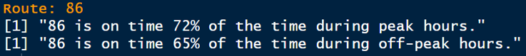
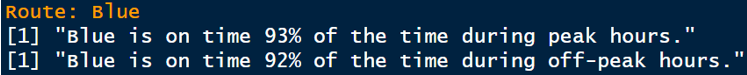
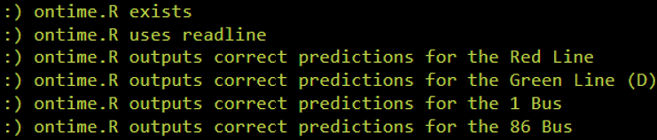
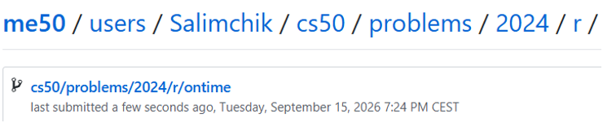

<div align="center">

# 🚇 On Time 🚌

### Analysing MBTA Service Reliability with R

<p>
  <strong>CS50’s Introduction to Programming with R</strong><br>
  Week 2 — Transforming Data
</p>

[](https://cs50.harvard.edu/r/)
[](https://cs50.harvard.edu/r/weeks/2/)
[](https://cs50.harvard.edu/r/psets/2/)
[](https://cs50.harvard.edu/r/psets/2/ontime/)
[](https://www.mbta.com/)
[](https://www.r-project.org/)
[](#-completion-status)

---

### ⏱️ Turning public-transportation data into meaningful reliability estimates

</div>

## 📖 Table of Contents

- [About the Assignment](#-about-the-assignment)
- [Project Objective](#-project-objective)
- [The MBTA](#-the-mbta)
- [Provided Data](#-provided-data)
- [Dataset Schema](#-dataset-schema)
- [Assignment Requirements](#-assignment-requirements)
- [Service Reliability](#-service-reliability)
- [Data-Transformation Workflow](#-data-transformation-workflow)
- [Route Validation](#-route-validation)
- [Peak and Off-Peak Analysis](#-peak-and-off-peak-analysis)
- [Expected Results](#-expected-results)
- [Test Scenarios](#-test-scenarios)
- [Project Structure](#-project-structure)
- [Result Demonstration](#-result-demonstration)
- [Completion Status](#-completion-status)
- [What I Learned](#-what-i-learned)

---

## 🎯 About the Assignment

[`On Time`](https://cs50.harvard.edu/r/psets/2/ontime/) is an assignment from **Week 2: Transforming Data** of [CS50’s Introduction to Programming with R](https://cs50.harvard.edu/r/).

The assignment uses public-transportation data from the **Massachusetts Bay Transportation Authority**, commonly known as the **MBTA**.

The objective is to create an interactive R program that tells users how likely they are to arrive on time when travelling on a selected MBTA route.

The program must report separate reliability estimates for:

- 🚨 **Peak hours** — the busiest travel periods;
- 🌙 **Off-peak hours** — less busy travel periods.

The completed solution is implemented in:

```text
ontime.R
```

---

## 🚀 Project Objective

The program performs the following operations:

1. Reads bus reliability data from `bus.csv`;
2. Reads rail reliability data from `rail.csv`;
3. Combines the datasets into one collection of MBTA services;
4. Calculates the reliability of every observation;
5. Prompts the user to enter a route;
6. Verifies that the route exists;
7. Filters the dataset to the selected route;
8. Separates peak and off-peak observations;
9. Calculates the mean reliability for both periods;
10. Converts the results into whole-number percentages;
11. Displays a clear reliability summary.

```text
bus.csv ───┐
           ├──▶ Combined services data
rail.csv ──┘             │
                         ▼
                  Calculate reliability
                         │
                         ▼
                  Request a route
                         │
                         ▼
                   Validate input
                         │
             ┌───────────┴───────────┐
             ▼                       ▼
       Valid route              Invalid route
             │                       │
             ▼                       ▼
     Filter observations      Display an error
             │
             ▼
    Separate PEAK / OFF_PEAK
             │
             ▼
      Calculate mean values
             │
             ▼
      Display percentages
```

---

## 🏙️ The MBTA

The **MBTA** manages public transportation throughout the Greater Boston area.

Its services include:

<table>
  <tr>
    <td align="center" width="25%">
      <h2>🚌</h2>
      <strong>Bus</strong>
    </td>
    <td align="center" width="25%">
      <h2>🚇</h2>
      <strong>Subway</strong>
    </td>
    <td align="center" width="25%">
      <h2>🚆</h2>
      <strong>Railroad</strong>
    </td>
    <td align="center" width="25%">
      <h2>⛴️</h2>
      <strong>Ferry</strong>
    </td>
  </tr>
</table>

In this project, the supplied data focuses on:

- Bus routes;
- Rail routes;
- Peak-hour services;
- Off-peak services;
- Observed service reliability.

---

## 🗃️ Provided Data

The assignment includes two CSV files containing MBTA reliability observations.

### 🚌 `bus.csv`

Contains reliability data for MBTA bus routes, including the route:

```text
86
```

### 🚇 `rail.csv`

Contains reliability data for MBTA rail services, including the route:

```text
Blue
```

The two datasets share the same structure and can therefore be combined for analysis.

> [!NOTE]
> Each row represents an observation of an MBTA service operating on a particular route, date, and service period.

---

## 🧾 Dataset Schema

| Column | Description | Example |
|---|---|---|
| `year` | Year in which the service operated | `2023` |
| `month` | Month in which the service operated | `7` |
| `day` | Day on which the service operated | `15` |
| `mode` | Mode of public transportation | `Bus`, `Rail` |
| `route` | MBTA route identifier | `86`, `Blue` |
| `peak` | Indicates peak or off-peak service | `PEAK`, `OFF_PEAK` |
| `numerator` | Number of services considered on time | Numeric value |
| `denominator` | Total number of measured services | Numeric value |

### Relationship between the columns

```text
Date information
├── year
├── month
└── day

Service information
├── mode
├── route
└── peak

Reliability information
├── numerator
└── denominator
```

---

## 📋 Assignment Requirements

The completed solution follows the principal requirements of the assignment:

- [x] The program is implemented in `ontime.R`;
- [x] Bus data is read from `bus.csv`;
- [x] Rail data is read from `rail.csv`;
- [x] The two datasets are combined;
- [x] Reliability is calculated for every observation;
- [x] The user is prompted to enter an MBTA route;
- [x] The entered route is validated;
- [x] Invalid routes produce a helpful message;
- [x] The selected route is filtered from the complete dataset;
- [x] Peak-hour observations are analysed separately;
- [x] Off-peak observations are analysed separately;
- [x] Mean reliability is calculated for both service periods;
- [x] Results are converted into percentages;
- [x] Percentages are rounded to the nearest whole number;
- [x] The final results are displayed clearly to the user.

---

## 📐 Service Reliability

The MBTA represents service reliability using two values:

- `numerator` — the number of services considered on time;
- `denominator` — the total number of measured services.

The reliability of one observation is calculated as:

```text
                  numerator
reliability = ─────────────────
                 denominator
```

Or mathematically:

<div align="center">

### Reliability = Numerator ÷ Denominator

</div>

### Example

If `93` services out of `100` were on time:

```text
93 ÷ 100 = 0.93
```

The decimal value can then be converted into a percentage:

```text
0.93 × 100 = 93%
```

---

## 🔄 Data-Transformation Workflow

### 1️⃣ Import the datasets

The program reads both supplied CSV files:

```text
bus.csv
rail.csv
```

### 2️⃣ Combine bus and rail observations

Because both files contain the same columns, their rows are combined into one data frame.

```text
bus data
    │
    ├──────▶ complete MBTA services data
    │
rail data
```

### 3️⃣ Calculate reliability

A new reliability value is calculated for every row:

```text
numerator ÷ denominator
```

### 4️⃣ Collect the route

The program asks the user which MBTA route they intend to take.

### 5️⃣ Validate the route

The input is compared with the available values in the `route` column.

### 6️⃣ Filter the selected route

Only observations belonging to the requested route are retained.

### 7️⃣ Separate service periods

The filtered observations are divided into:

```text
PEAK
OFF_PEAK
```

### 8️⃣ Calculate mean reliability

The program calculates the arithmetic mean for each group.

### 9️⃣ Format the result

The mean is:

1. Multiplied by `100`;
2. Rounded to the nearest whole number;
3. Displayed with a percentage sign.

---

## 🛡️ Route Validation

Before analysing a route, the program checks whether the user’s input exists in the combined dataset.

Conceptually:

```r
route %in% services$route
```

The `%in%` operator returns:

```text
TRUE  — the route exists
FALSE — the route is invalid
```

### Validation outcomes

| Input | Validity | Program behaviour |
|---|:---:|---|
| `86` | ✅ Valid | Calculate bus reliability |
| `Blue` | ✅ Valid | Calculate rail reliability |
| `Purple` | ❌ Invalid | Display a valid-route reminder |

> [!IMPORTANT]
> The program must not calculate or display reliability percentages for an invalid route.

---

## ⏰ Peak and Off-Peak Analysis

The selected route is analysed separately for the two service periods.

<table>
  <tr>
    <th width="50%">🚨 Peak</th>
    <th width="50%">🌙 Off-Peak</th>
  </tr>
  <tr>
    <td valign="top">
      <strong>Dataset value:</strong> <code>PEAK</code>
      <br><br>
      Represents service during the busiest travel periods.
    </td>
    <td valign="top">
      <strong>Dataset value:</strong> <code>OFF_PEAK</code>
      <br><br>
      Represents service outside the busiest travel periods.
    </td>
  </tr>
</table>

The general calculation for each period is:

```text
                           Sum of reliability values
Mean reliability = ─────────────────────────────────────
                          Number of observations
```

The final displayed value is:

```text
round(mean reliability × 100)
```

---

## 📊 Expected Results

### 🚌 Route `86`

| Route | Mode | Service period | Mean reliability |
|:---:|:---:|---|:---:|
| `86` | Bus | 🚨 Peak | **72%** |
| `86` | Bus | 🌙 Off-Peak | **65%** |

```text
Route 86
├── Peak reliability:      72%
└── Off-peak reliability: 65%
```

### 🚇 Route `Blue`

| Route | Mode | Service period | Mean reliability |
|:---:|:---:|---|:---:|
| `Blue` | Rail | 🚨 Peak | **93%** |
| `Blue` | Rail | 🌙 Off-Peak | **92%** |

```text
Blue Line
├── Peak reliability:      93%
└── Off-peak reliability: 92%
```

### Reliability comparison

| Route | Peak | Off-Peak | Difference |
|:---:|:---:|:---:|:---:|
| 🚌 `86` | 72% | 65% | 7 percentage points |
| 🚇 `Blue` | 93% | 92% | 1 percentage point |

```text
Peak reliability

Route 86   ████████████████████████████████████              72%
Blue Line  ██████████████████████████████████████████████    93%


Off-peak reliability

Route 86   ████████████████████████████████                  65%
Blue Line  ██████████████████████████████████████████████    92%
```

> [!NOTE]
> Based on these results, the Blue Line has higher mean reliability than Route 86 during both peak and off-peak hours.

---

## 🧪 Test Scenarios

| # | User input | Expected peak result | Expected off-peak result | Expected behaviour |
|:---:|:---:|:---:|:---:|---|
| 1 | `86` | `72%` | `65%` | Display two reliability values |
| 2 | `Blue` | `93%` | `92%` | Display two reliability values |
| 3 | `Purple` | — | — | Display an invalid-route message |

### Test summary

```text
╔══════════════════════════════════════════════════════╗
║                 ROUTE TEST SUMMARY                   ║
╠══════════════════════════════════════════════════════╣
║ Valid bus route tested                        86     ║
║ Valid rail route tested                     Blue    ║
║ Invalid route tested                      Purple    ║
║ Reliability periods analysed                  2     ║
║ Expected route results confirmed              4     ║
╚══════════════════════════════════════════════════════╝
```

---

## 📁 Project Structure

```text
ontime/
│
├── ontime.R
├── bus.csv
├── rail.csv
├── README.md
│
└── assets/
    ├── route-86-result.png
    ├── route-blue-result.png
    ├── check50-result.png
    └── submit50-result.png
```

| File | Purpose |
|---|---|
| [`ontime.R`](./ontime.R) | Reads, transforms, filters, and analyses MBTA reliability data |
| [`bus.csv`](./bus.csv) | Contains service-reliability observations for bus routes |
| [`rail.csv`](./rail.csv) | Contains service-reliability observations for rail routes |
| `README.md` | Describes the assignment, methodology, and results |
| `assets/route-86-result.png` | Screenshot showing the result for Route 86 |
| `assets/route-blue-result.png` | Screenshot showing the result for the Blue Line |
| `assets/check50-result.png` | Screenshot of the successful `check50` validation |
| `assets/submit50-result.png` | Screenshot of the successful `submit50` submission |

---

## 📸 Result Demonstration

### 1️⃣ Result of Route `86`

<div align="center">

<!--
Add the first screenshot to:

assets/route-86-result.png

The screenshot should show:
- User input: 86
- Peak reliability: 72%
- Off-peak reliability: 65%
-->



<br>

<sub>
  <strong>Figure 1.</strong>
  Mean peak and off-peak reliability for MBTA bus Route <code>86</code>.
</sub>

</div>

<br>

### 2️⃣ Result of Route `Blue`

<div align="center">

<!--
Add the second screenshot to:

assets/route-blue-result.png

The screenshot should show:
- User input: Blue
- Peak reliability: 93%
- Off-peak reliability: 92%
-->



<br>

<sub>
  <strong>Figure 2.</strong>
  Mean peak and off-peak reliability for the MBTA <code>Blue</code> Line.
</sub>

</div>

<br>

### 3️⃣ `check50` Result

<div align="center">

<!--
Add the third screenshot to:

assets/check50-result.png

The screenshot should show the successful check50 validation.
-->



<br>

<sub>
  <strong>Figure 3.</strong>
  Automated validation of the completed <code>ontime.R</code> program with <code>check50</code>.
</sub>

</div>

<br>

### 4️⃣ `submit50` Result

<div align="center">

<!--
Add the fourth screenshot to:

assets/submit50-result.png

The screenshot should show the successful submit50 result.
-->



<br>

<sub>
  <strong>Figure 4.</strong>
  Successful submission of the completed assignment with <code>submit50</code>.
</sub>

</div>

---

## ✅ Completion Status

| Component | Status |
|---|:---:|
| `bus.csv` imported | ✅ |
| `rail.csv` imported | ✅ |
| Datasets combined | ✅ |
| Row-level reliability calculated | ✅ |
| Interactive route input implemented | ✅ |
| Route validation implemented | ✅ |
| Peak observations filtered | ✅ |
| Off-peak observations filtered | ✅ |
| Mean reliability calculated | ✅ |
| Percentages rounded | ✅ |
| Route `86` result verified | ✅ |
| Route `Blue` result verified | ✅ |
| Invalid-route behaviour tested | ✅ |
| `check50` validation completed | ✅ |
| Assignment submitted | ✅ |

<div align="center">

### 🎉 Assignment Completed Successfully


</div>

---

## 🧠 What I Learned

By completing this assignment, I practised:

- Reading multiple CSV files in R;
- Combining data frames with matching schemas;
- Creating calculated columns;
- Dividing numerical columns element by element;
- Filtering observations by route;
- Separating data by categorical values;
- Calculating arithmetic means;
- Converting decimal values into percentages;
- Rounding numbers to whole percentage points;
- Collecting interactive user input;
- Validating input with `%in%`;
- Handling invalid values;
- Translating transportation data into understandable results.

The project demonstrates a complete data-transformation workflow:

```text
Import → Combine → Calculate → Validate → Filter → Summarise → Report
```

---

<div align="center">

## 🚇 Reliable Data for More Reliable Journeys 🚌

**Choose a route. Compare its reliability. Plan to be on time.**

<br>

[](https://www.r-project.org/)
[](https://www.mbta.com/)
[](#-peak-and-off-peak-analysis)
[](#-route-86)
[](#-route-blue)
[](#-completion-status)

</div>