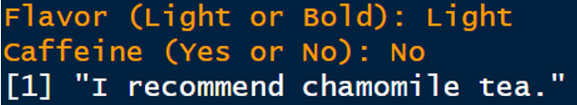
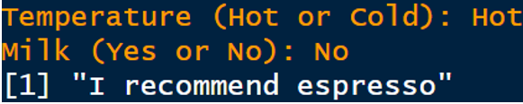
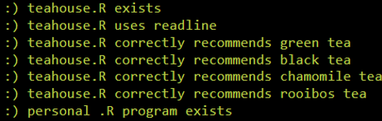
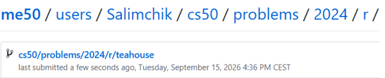

<div align="center">

# 🍵 Tea House & Coffeehouse ☕

### An Interactive Beverage Recommendation System in R

<p>
  <strong>CS50’s Introduction to Programming with R</strong><br>
  Week 2 — Transforming Data
</p>

[](https://cs50.harvard.edu/r/)
[](https://cs50.harvard.edu/r/weeks/2/)
[](https://cs50.harvard.edu/r/psets/2/)
[](https://cs50.harvard.edu/r/psets/2/teahouse/)
[](#-part-2-coffeehouser)
[](https://www.r-project.org/)
[](#-completion-status)

---

### 🍵 Choose your flavour. ☕ Choose your coffee. ✨ Receive your recommendation.

</div>

## 📖 Table of Contents

- [About the Assignment](#-about-the-assignment)
- [Project Objective](#-project-objective)
- [Project Overview](#-project-overview)
- [Assignment Requirements](#-assignment-requirements)
- [Part 1: teahouse.R](#-part-1-teahouser)
- [Tea Recommendation Table](#-tea-recommendation-table)
- [Part 2: coffeehouse.R](#-part-2-coffeehouser)
- [Coffeehouse Questions](#-coffeehouse-questions)
- [Coffee Recommendation Table](#-coffee-recommendation-table)
- [Program Logic](#-program-logic)
- [Input Validation](#-input-validation)
- [Test Scenarios](#-test-scenarios)
- [Project Structure](#-project-structure)
- [Result Demonstration](#-result-demonstration)
- [Completion Status](#-completion-status)
- [What I Learned](#-what-i-learned)

---

## 🎯 About the Assignment

[`Tea House`](https://cs50.harvard.edu/r/psets/2/teahouse/) is an assignment from **Week 2: Transforming Data** of [CS50’s Introduction to Programming with R](https://cs50.harvard.edu/r/).

The assignment focuses on transforming user input into a personalised recommendation through conditional logic.

It consists of two parts:

1. **Tea House** — a required program that recommends a type of tea;
2. **Setting Up Shop** — an individual program that recommends a beverage or food selected by the student.

For the individual project, I created a program called:

```text
coffeehouse.R
```

The custom program recommends one of four coffee drinks according to the user’s preferred temperature and choice of milk.

---

## 🚀 Project Objective

The main objective is to build interactive R programs that:

- Ask the user a sequence of questions;
- Store the user’s answers;
- Compare the answers with supported options;
- Combine multiple logical conditions;
- Select the appropriate recommendation;
- Display a clear result;
- Handle unsupported input safely.

```text
User input
    │
    ▼
Validate the answers
    │
    ├── Invalid ──▶ Display valid options
    │
    ▼
Combine the selected preferences
    │
    ▼
Evaluate conditional branches
    │
    ▼
Display a beverage recommendation
```

---

## 🧩 Project Overview

<table>
  <tr>
    <th width="50%">🍵 Tea House</th>
    <th width="50%">☕ Coffeehouse</th>
  </tr>
  <tr>
    <td valign="top">
      <strong>Required assignment</strong>
      <br><br>
      Recommends tea based on:
      <ul>
        <li>Flavour preference;</li>
        <li>Caffeine preference.</li>
      </ul>
      <strong>Program:</strong> <code>teahouse.R</code>
    </td>
    <td valign="top">
      <strong>Individual project</strong>
      <br><br>
      Recommends coffee based on:
      <ul>
        <li>Preferred temperature;</li>
        <li>Milk preference.</li>
      </ul>
      <strong>Program:</strong> <code>coffeehouse.R</code>
    </td>
  </tr>
</table>

---

## 📋 Assignment Requirements

### Part 1 requirements

- [x] Create a program named `teahouse.R`;
- [x] Ask the user for a flavour preference;
- [x] Accept `Light` or `Bold` as flavour options;
- [x] Ask whether the user prefers caffeine;
- [x] Accept `Yes` or `No` as caffeine options;
- [x] Recommend one of four teas;
- [x] Handle an invalid flavour input;
- [x] Handle an invalid caffeine input;
- [x] Avoid recommending tea when the input is invalid.

### Part 2 requirements

- [x] Create a second recommendation program;
- [x] Choose an original beverage or food theme;
- [x] Ask the user relevant questions;
- [x] Evaluate multiple combinations of answers;
- [x] Provide an appropriate recommendation;
- [x] Make the second program distinct from the required tea program.

### Individual implementation

- [x] The selected theme is **coffee**;
- [x] The custom program is named `coffeehouse.R`;
- [x] The program asks whether the coffee should be hot or cold;
- [x] The program asks whether the drink should contain milk;
- [x] Four preference combinations are supported;
- [x] Each valid combination produces a different coffee recommendation.

---

# 🍵 Part 1: `teahouse.R`

The required program asks the user two questions.

### Question 1 — Flavour

```text
Do you prefer a Light or Bold flavour?
```

Supported answers:

```text
Light
Bold
```

### Question 2 — Caffeine

```text
Would you like caffeine? Yes or No?
```

Supported answers:

```text
Yes
No
```

After collecting both answers, the program evaluates the selected flavour and caffeine preferences and recommends a suitable tea.

---

## 🍃 Tea Recommendation Table

<div align="center">

| Flavour | Caffeine | Recommendation | Profile |
|:---:|:---:|---|---|
| `Light` | `Yes` | 🍵 **Green tea** | Light and refreshing with caffeine |
| `Bold` | `Yes` | 🫖 **Black tea** | Strong and full-bodied with caffeine |
| `Light` | `No` | 🌼 **Chamomile tea** | Light, floral, and caffeine-free |
| `Bold` | `No` | 🌿 **Rooibos tea** | Rich, distinctive, and caffeine-free |

</div>

### Tea decision map

```text
                          ┌───────────────────┐
                          │ Flavour preference │
                          └─────────┬─────────┘
                                    │
                       ┌────────────┴────────────┐
                       ▼                         ▼
                    LIGHT                      BOLD
                       │                         │
               ┌───────┴───────┐         ┌───────┴───────┐
               ▼               ▼         ▼               ▼
           Caffeine?       Caffeine?   Caffeine?       Caffeine?
              YES              NO         YES              NO
               │               │           │               │
               ▼               ▼           ▼               ▼
          Green tea      Chamomile tea  Black tea      Rooibos tea
```

> [!IMPORTANT]
> If either answer is invalid, the program does not recommend a tea and instead reminds the user of the supported options.

---

# ☕ Part 2: `coffeehouse.R`

For the individual part of the assignment, I designed a coffee recommendation program.

The program uses two practical preferences:

1. Whether the user wants a **hot or cold** drink;
2. Whether the user wants the drink **with or without milk**.

Based on the selected combination, the program recommends:

- A latte;
- An espresso;
- An iced latte;
- A cold brew.

```text
Temperature + Milk preference = Coffee recommendation
```

---

## 💬 Coffeehouse Questions

### Question 1 — Temperature

```text
Would you like your coffee Hot or Cold?
```

Supported answers:

```text
Hot
Cold
```

### Question 2 — Milk

```text
Would you like milk? Yes or No?
```

Supported answers:

```text
Yes
No
```

> [!NOTE]
> Together, the two questions produce four distinct preference combinations and four corresponding recommendations.

---

## ☕ Coffee Recommendation Table

<div align="center">

| Temperature | Milk | Recommendation | Description |
|:---:|:---:|---|---|
| 🔥 `Hot` | 🥛 `Yes` | **Latte** | Hot espresso combined with steamed milk |
| 🔥 `Hot` | 🚫 `No` | **Espresso** | A concentrated hot coffee without milk |
| ❄️ `Cold` | 🥛 `Yes` | **Iced latte** | Chilled espresso served with cold milk |
| ❄️ `Cold` | 🚫 `No` | **Cold brew** | Smooth cold coffee served without milk |

</div>

### Coffeehouse decision map

```text
                         ┌──────────────────────┐
                         │ Coffee temperature?  │
                         └──────────┬───────────┘
                                    │
                         ┌──────────┴──────────┐
                         ▼                     ▼
                        HOT                   COLD
                         │                     │
                  ┌──────┴──────┐       ┌──────┴──────┐
                  ▼             ▼       ▼             ▼
                Milk?         Milk?   Milk?         Milk?
                 YES            NO      YES            NO
                  │             │        │             │
                  ▼             ▼        ▼             ▼
                Latte       Espresso  Iced latte    Cold brew
```

---

## ⚙️ Program Logic

Both programs follow the same general decision-making process.

```text
┌─────────────────────────────────────┐
│ 1. Ask the first preference         │
├─────────────────────────────────────┤
│ 2. Ask the second preference        │
├─────────────────────────────────────┤
│ 3. Validate both answers            │
├─────────────────────────────────────┤
│ 4. Compare the answer combination   │
├─────────────────────────────────────┤
│ 5. Select one recommendation        │
├─────────────────────────────────────┤
│ 6. Display the final message        │
└─────────────────────────────────────┘
```

The conditional structure can be represented conceptually as:

```r
if (first_condition && second_condition) {
  # First recommendation
} else if (first_condition && alternative_condition) {
  # Second recommendation
} else if (alternative_condition && second_condition) {
  # Third recommendation
} else if (alternative_condition && alternative_condition) {
  # Fourth recommendation
} else {
  # Invalid-input message
}
```

### Core R concepts

| Concept | Purpose |
|---|---|
| `readline()` | Collects an answer from the user |
| Assignment operator `<-` | Stores user input in a variable |
| `if` | Evaluates the first condition |
| `else if` | Evaluates additional combinations |
| `else` | Handles unsupported input |
| `==` | Compares the answer with an expected value |
| `&&` | Requires two conditions to be true |
| `print()` or `cat()` | Displays the recommendation |

---

## 🛡️ Input Validation

Input validation prevents the programs from returning a recommendation for unsupported answers.

### Valid Tea House inputs

| Question | Accepted values |
|---|---|
| Flavour | `Light`, `Bold` |
| Caffeine | `Yes`, `No` |

### Valid Coffeehouse inputs

| Question | Accepted values |
|---|---|
| Temperature | `Hot`, `Cold` |
| Milk | `Yes`, `No` |

### Invalid-input behaviour

If the user enters an unsupported value, the program should:

1. Avoid selecting a beverage;
2. Explain which answer was invalid;
3. Remind the user of the accepted options.

Example invalid values include:

```text
Medium
Warm
Maybe
Sometimes
```

> [!WARNING]
> Text comparison in R is case-sensitive unless the program normalises the input. For example, `Hot` and `hot` are different character values by default.

---

## 🧪 Test Scenarios

### Tea House tests

| # | Flavour | Caffeine | Expected result |
|:---:|:---:|:---:|---|
| 1 | `Light` | `Yes` | Green tea |
| 2 | `Bold` | `Yes` | Black tea |
| 3 | `Light` | `No` | Chamomile tea |
| 4 | `Bold` | `No` | Rooibos tea |
| 5 | `Medium` | `Yes` | Invalid flavour message |
| 6 | `Light` | `Maybe` | Invalid caffeine message |

### Coffeehouse tests

| # | Temperature | Milk | Expected result |
|:---:|:---:|---|
| 1 | `Hot` | `Yes` | Latte |
| 2 | `Hot` | `No` | Espresso |
| 3 | `Cold` | `Yes` | Iced latte |
| 4 | `Cold` | `No` | Cold brew |
| 5 | `Warm` | `Yes` | Invalid temperature message |
| 6 | `Hot` | `Maybe` | Invalid milk message |

### Test summary

```text
╔══════════════════════════════════════════════════════╗
║             BEVERAGE RECOMMENDATION TESTS            ║
╠══════════════════════════════════════════════════════╣
║ Tea combinations tested                       4      ║
║ Coffee combinations tested                    4      ║
║ Tea invalid-input scenarios                   2      ║
║ Coffee invalid-input scenarios                2      ║
║ Total documented scenarios                   12      ║
╚══════════════════════════════════════════════════════╝
```

---

## 📁 Project Structure

```text
teahouse/
│
├── teahouse.R
├── coffeehouse.R
├── README.md
│
└── assets/
    ├── teahouse-result.png
    ├── coffeehouse-result.png
    ├── check50-result.png
    └── submit50-result.png
```

| File | Purpose |
|---|---|
| [`teahouse.R`](./teahouse.R) | Required tea recommendation program |
| [`coffeehouse.R`](./coffeehouse.R) | Individual coffee recommendation project |
| `README.md` | Project description and demonstration |
| `assets/teahouse-result.png` | Screenshot of the Tea House result |
| `assets/coffeehouse-result.png` | Screenshot of the Coffeehouse result |
| `assets/check50-result.png` | Screenshot of the successful `check50` validation |
| `assets/submit50-result.png` | Screenshot of the successful `submit50` submission |

---

## 📸 Result Demonstration

### 1️⃣ Tea House Result

<div align="center">

<!--
Add the first screenshot to:

assets/teahouse-result.png

The screenshot should demonstrate the output of teahouse.R.
-->



<br>

<sub>
  <strong>Figure 1.</strong>
  Result produced by the required <code>teahouse.R</code> program.
</sub>

</div>

<br>

### 2️⃣ Coffeehouse Result

<div align="center">

<!--
Add the second screenshot to:

assets/coffeehouse-result.png

The screenshot should demonstrate the output of coffeehouse.R.
-->



<br>

<sub>
  <strong>Figure 2.</strong>
  Coffee recommendation produced by the custom <code>coffeehouse.R</code> program.
</sub>

</div>

<br>

### 3️⃣ `check50` Result

<div align="center">

<!--
Add the third screenshot to:

assets/check50-result.png

The screenshot should show the successful check50 result.
-->



<br>

<sub>
  <strong>Figure 3.</strong>
  Automated validation of <code>teahouse.R</code> with <code>check50</code>.
</sub>

</div>

<br>

### 4️⃣ `submit50` Result

<div align="center">

<!--
Add the fourth screenshot to:

assets/submit50-result.png

The screenshot should show the successful submit50 result.
-->



<br>

<sub>
  <strong>Figure 4.</strong>
  Successful submission of the completed assignment with <code>submit50</code>.
</sub>

</div>

---

## ✅ Completion Status

| Component | Status |
|---|:---:|
| `teahouse.R` created | ✅ |
| Flavour question implemented | ✅ |
| Caffeine question implemented | ✅ |
| Four tea recommendations implemented | ✅ |
| Invalid tea input handled | ✅ |
| Individual project selected | ✅ |
| `coffeehouse.R` created | ✅ |
| Temperature question implemented | ✅ |
| Milk question implemented | ✅ |
| Four coffee recommendations implemented | ✅ |
| Coffeehouse scenarios tested | ✅ |
| `check50` validation completed | ✅ |
| Assignment submitted | ✅ |

<div align="center">

### 🎉 Both Recommendation Systems Completed


</div>

---

## 🧠 What I Learned

By completing this assignment, I practised:

- Collecting interactive user input in R;
- Storing character values in variables;
- Comparing text values;
- Writing `if`, `else if`, and `else` branches;
- Combining conditions with logical operators;
- Translating a decision table into program logic;
- Handling invalid user input;
- Designing clear prompts and output messages;
- Testing all possible decision branches;
- Extending an existing programming concept into an original project;
- Creating a simple rule-based recommendation system.

The assignment demonstrates how a small number of user preferences can be transformed into a useful personalised result:

```text
Ask → Validate → Compare → Decide → Recommend
```

---

<div align="center">

## 🍵 One Assignment — Two Beverage Experiences ☕

**From tea preferences to a personalised coffee recommendation.**

<br>

[](https://www.r-project.org/)
[](https://cs50.harvard.edu/r/psets/2/teahouse/)
[](#-part-2-coffeehouser)
[](#️-program-logic)
[](#-completion-status)

</div>