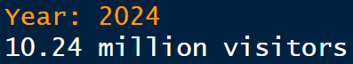
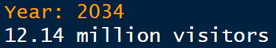
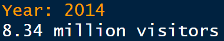
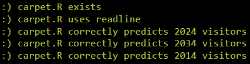
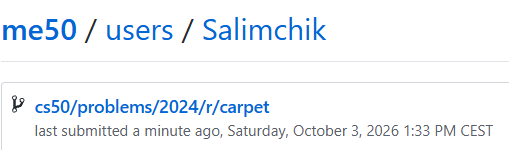

<div align="center">

# 🟦 PDX Carpet ✈️

### Predicting Airport Visitors with Functions in R

<p>
  <strong>CS50’s Introduction to Programming with R</strong><br>
  Week 3 — Applying Functions
</p>

[](https://cs50.harvard.edu/r/)
[](https://cs50.harvard.edu/r/weeks/3/)
[](https://cs50.harvard.edu/r/psets/3/)
[](https://cs50.harvard.edu/r/psets/3/carpet/)
[](https://www.r-project.org/)
[](#-completion-status)

---

### 📈 Historical airport data transformed into future visitor predictions

</div>

## 📖 Table of Contents

- [About the Assignment](#-about-the-assignment)
- [The Story Behind the Carpet](#-the-story-behind-the-carpet)
- [Project Objective](#-project-objective)
- [Provided Data](#-provided-data)
- [Dataset Schema](#-dataset-schema)
- [Assignment Requirements](#-assignment-requirements)
- [Program Architecture](#️-program-architecture)
- [Function 1: calculate_growth_rate](#-function-1-calculate_growth_rate)
- [Function 2: predict_visitors](#-function-2-predict_visitors)
- [Prediction Model](#-prediction-model)
- [Calculated Results](#-calculated-results)
- [Test Scenarios](#-test-scenarios)
- [Project Structure](#-project-structure)
- [Result Demonstration](#-result-demonstration)
- [Completion Status](#-completion-status)
- [What I Learned](#-what-i-learned)

---

## 🎯 About the Assignment

[`PDX Carpet`](https://cs50.harvard.edu/r/psets/3/carpet/) is an assignment from **Week 3: Applying Functions** of [CS50’s Introduction to Programming with R](https://cs50.harvard.edu/r/).

The assignment uses historical visitor data from **Portland International Airport**, commonly identified by the airport code **PDX**.

The objective is to implement two reusable R functions capable of:

1. Calculating the average yearly increase in airport visitors;
2. Predicting the number of visitors in a selected year.

The completed solution is implemented in:

```text
carpet.R
```

The historical observations used by the program are stored in:

```text
visitors.csv
```

> [!NOTE]
> Visitor counts in the dataset and the program output are expressed in millions.

---

## 🟦 The Story Behind the Carpet

The original carpet at Portland International Airport became an iconic part of Portland’s visual identity.

Installed during the early 1990s, its distinctive geometric pattern became strongly associated with the airport and the city. After years of heavy passenger traffic, the carpet eventually had to be replaced.

This assignment uses that story as the basis for a programming problem:

> How many travellers might walk across the PDX carpet in a given year?

The prediction is created using historical annual visitor data and a calculated average growth rate.

<table>
  <tr>
    <td align="center" width="33%">
      <h2>✈️</h2>
      <strong>Airport</strong>
      <br>
      Portland International Airport
    </td>
    <td align="center" width="33%">
      <h2>🟦</h2>
      <strong>Carpet</strong>
      <br>
      A distinctive Portland icon
    </td>
    <td align="center" width="33%">
      <h2>📈</h2>
      <strong>Prediction</strong>
      <br>
      Future annual visitor traffic
    </td>
  </tr>
</table>

---

## 🚀 Project Objective

The program performs the following operations:

1. Reads historical airport data from `visitors.csv`;
2. Extracts the `year` and `visitors` columns;
3. Passes the corresponding vectors to reusable functions;
4. Calculates the average yearly increase in visitors;
5. Prompts the user to enter a year;
6. Calculates the difference between the requested year and the latest recorded year;
7. Projects visitor traffic using the calculated growth rate;
8. Returns the predicted number of visitors in millions;
9. Displays the result in a readable sentence.

```text
visitors.csv
     │
     ▼
Read historical observations
     │
     ▼
Extract years and visitor counts
     │
     ▼
calculate_growth_rate()
     │
     ▼
Average yearly growth
     │
     ▼
User enters a target year
     │
     ▼
predict_visitors()
     │
     ▼
Predicted number of visitors
     │
     ▼
Formatted program output
```

---

## 🗃️ Provided Data

The supplied `visitors.csv` file contains annual visitor information from **2002 through 2014**.

### Historical range

| Measurement | Value |
|---|---:|
| First recorded year | `2002` |
| Latest recorded year | `2014` |
| Number of yearly observations | `13` |
| Visitors in 2002 | `6.06 million` |
| Visitors in 2014 | `8.34 million` |
| Total increase | `2.28 million` |
| Time interval | `12 years` |

### Historical observations

| Year | Visitors, millions |
|:---:|---:|
| 2002 | 6.06 |
| 2003 | 6.38 |
| 2004 | 6.79 |
| 2005 | 6.95 |
| 2006 | 7.28 |
| 2007 | 7.08 |
| 2008 | 6.42 |
| 2009 | 6.58 |
| 2010 | 6.80 |
| 2011 | 7.13 |
| 2012 | 7.45 |
| 2013 | 7.87 |
| 2014 | 8.34 |

> [!IMPORTANT]
> The yearly observations do not increase uniformly. The program uses the change between the first and latest observations to calculate an average yearly growth rate.

---

## 🧾 Dataset Schema

The dataset contains two columns:

| Column | Data type | Description | Example |
|---|:---:|---|:---:|
| `year` | Numeric | Calendar year of the observation | `2014` |
| `visitors` | Numeric | Number of annual visitors in millions | `8.34` |

The correspondence between the vectors is positional:

```text
years:     2002   2003   2004   ...   2014
             │      │      │             │
             ▼      ▼      ▼             ▼
visitors:  6.06   6.38   6.79   ...   8.34
```

The first year corresponds to the first visitor value, the second year corresponds to the second visitor value, and so forth.

---

## 📋 Assignment Requirements

The completed solution follows the principal requirements of the assignment:

- [x] The program is implemented in `carpet.R`;
- [x] Historical information is read from `visitors.csv`;
- [x] The existing program structure is preserved;
- [x] A function named `calculate_growth_rate` is implemented;
- [x] `calculate_growth_rate` accepts vectors of years and visitors;
- [x] The average yearly visitor increase is calculated;
- [x] A function named `predict_visitors` is implemented;
- [x] `predict_visitors` accepts years, visitors, and a target year;
- [x] The growth-rate function is reused inside the prediction process;
- [x] The latest known observation is used as the projection baseline;
- [x] Predictions work for the latest year and future years;
- [x] The requested year is collected from the user;
- [x] The final result is expressed in millions of visitors;
- [x] The program produces the expected output for all required tests.

---

## ⚙️ Program Architecture

The program is organised around two functions with separate responsibilities.

```r
calculate_growth_rate <- function(years, visitors) {
  # Calculates the average yearly increase in visitors
}

predict_visitors <- function(years, visitors, year) {
  # Predicts the visitor count for the requested year
}
```

### Separation of responsibilities

<table>
  <tr>
    <th width="50%">📈 Growth Calculation</th>
    <th width="50%">🔮 Visitor Prediction</th>
  </tr>
  <tr>
    <td valign="top">
      <code>calculate_growth_rate()</code>
      <br><br>
      Determines how many millions of additional visitors PDX receives during an average year.
    </td>
    <td valign="top">
      <code>predict_visitors()</code>
      <br><br>
      Uses the calculated growth rate and the latest observation to predict traffic for a requested year.
    </td>
  </tr>
</table>

### Function relationship

```text
predict_visitors()
       │
       ├── receives years
       ├── receives visitors
       ├── receives target year
       │
       ▼
calculate_growth_rate()
       │
       ▼
returns yearly growth
       │
       ▼
prediction is calculated
       │
       ▼
predicted visitor count is returned
```

> [!TIP]
> Keeping the calculations in separate functions makes the program easier to read, test, reuse, and maintain.

---

## 📈 Function 1: `calculate_growth_rate`

### Purpose

The `calculate_growth_rate` function calculates the average yearly increase in airport visitors.

### Parameters

| Parameter | Description |
|---|---|
| `years` | Vector containing the recorded years |
| `visitors` | Vector containing the corresponding visitor counts |

### Calculation steps

1. Identify the first visitor value;
2. Identify the latest visitor value;
3. Calculate the total increase in visitors;
4. Identify the first recorded year;
5. Identify the latest recorded year;
6. Calculate the number of years between them;
7. Divide the visitor increase by the year difference.

### General formula

```text
                 latest visitors − first visitors
growth rate = ─────────────────────────────────────
                    latest year − first year
```

### Calculation with the supplied data

```text
First year:        2002
Latest year:       2014

Visitors in 2002:  6.06 million
Visitors in 2014:  8.34 million
```

Therefore:

```text
Visitor difference = 8.34 − 6.06
                   = 2.28 million
```

```text
Year difference = 2014 − 2002
                = 12 years
```

```text
Average yearly growth = 2.28 ÷ 12
                      = 0.19 million visitors per year
```

<div align="center">

### 📊 Average Growth Rate: `0.19 million visitors per year`

</div>

---

## 🔮 Function 2: `predict_visitors`

### Purpose

The `predict_visitors` function estimates the number of airport visitors for a requested year.

### Parameters

| Parameter | Description |
|---|---|
| `years` | Vector containing the recorded years |
| `visitors` | Vector containing the corresponding visitor counts |
| `year` | Target year for the prediction |

### Prediction steps

1. Identify the latest recorded year;
2. Identify the latest recorded visitor count;
3. Obtain the average growth rate;
4. Calculate the distance between the target year and the latest recorded year;
5. Multiply the year distance by the growth rate;
6. Add the projected increase to the latest visitor count;
7. Return the predicted number of visitors.

### General formula

```text
prediction =
latest visitors +
(growth rate × (target year − latest year))
```

Using the supplied data:

```text
prediction =
8.34 +
(0.19 × (target year − 2014))
```

---

## 📐 Prediction Model

The program uses a straightforward linear projection.

```text
P(y) = 8.34 + 0.19 × (y − 2014)
```

Where:

| Symbol | Meaning |
|:---:|---|
| `P(y)` | Predicted visitors in year `y`, in millions |
| `8.34` | Latest known visitor count |
| `0.19` | Average yearly increase |
| `y` | User-selected target year |
| `2014` | Latest year in the dataset |

### Model characteristics

- Uses the latest observation as the baseline;
- Applies a constant yearly growth rate;
- Produces deterministic predictions;
- Can reproduce the latest recorded value;
- Can extrapolate beyond the historical dataset.

> [!NOTE]
> This is a learning-oriented linear projection, not a complete statistical forecasting model. It assumes that the historical average growth continues at the same rate.

---

## 📊 Calculated Results

### Year `2024`

The requested year is ten years after the latest observation:

```text
2024 − 2014 = 10 years
```

```text
8.34 + (0.19 × 10)
= 8.34 + 1.90
= 10.24
```

<div align="center">

### ✈️ `10.24 million visitors`

</div>

---

### Year `2034`

The requested year is twenty years after the latest observation:

```text
2034 − 2014 = 20 years
```

```text
8.34 + (0.19 × 20)
= 8.34 + 3.80
= 12.14
```

<div align="center">

### ✈️ `12.14 million visitors`

</div>

---

### Year `2014`

The requested year is the same as the latest observation:

```text
2014 − 2014 = 0 years
```

```text
8.34 + (0.19 × 0)
= 8.34 + 0
= 8.34
```

<div align="center">

### ✈️ `8.34 million visitors`

</div>

---

### Results summary

| Target year | Years from 2014 | Projected increase | Predicted visitors |
|:---:|---:|---:|---:|
| `2014` | 0 | 0.00 million | **8.34 million** |
| `2024` | 10 | 1.90 million | **10.24 million** |
| `2034` | 20 | 3.80 million | **12.14 million** |

### Visual comparison

```text
2014  █████████████████████████████████         8.34 million
2024  ████████████████████████████████████████  10.24 million
2034  ███████████████████████████████████████████████  12.14 million
```

### Expected console output

```text
Year: 2024
10.24 million visitors
```

```text
Year: 2034
12.14 million visitors
```

```text
Year: 2014
8.34 million visitors
```

---

## 🧪 Test Scenarios

| # | Input year | Expected output | Scenario |
|:---:|:---:|---|---|
| 1 | `2024` | `10.24 million visitors` | Ten-year projection |
| 2 | `2034` | `12.14 million visitors` | Twenty-year projection |
| 3 | `2014` | `8.34 million visitors` | Latest known observation |

### Function-level testing

| Function | Test objective | Expected behaviour |
|---|---|---|
| `calculate_growth_rate()` | Calculate the average yearly increase | Returns `0.19` |
| `predict_visitors()` | Predict visitors for 2024 | Returns `10.24` |
| `predict_visitors()` | Predict visitors for 2034 | Returns `12.14` |
| `predict_visitors()` | Reproduce the 2014 value | Returns `8.34` |

### Test summary

```text
╔══════════════════════════════════════════════════════╗
║                 PDX PREDICTION TESTS                 ║
╠══════════════════════════════════════════════════════╣
║ Historical observations                       13    ║
║ Average yearly growth                 0.19 million   ║
║ Required years tested                           3    ║
║ Function-level calculations                     4    ║
║ Expected results confirmed                      3    ║
╚══════════════════════════════════════════════════════╝
```

---

## 📁 Project Structure

```text
carpet/
│
├── carpet.R
├── visitors.csv
├── README.md
│
└── assets/
    ├── year-2024-result.png
    ├── year-2034-result.png
    ├── year-2014-result.png
    ├── check50-result.png
    └── submit50-result.png
```

| File | Purpose |
|---|---|
| [`carpet.R`](./carpet.R) | Contains the growth-rate and visitor-prediction functions |
| [`visitors.csv`](./visitors.csv) | Contains historical annual visitor data |
| `README.md` | Describes the assignment, implementation, and results |
| `assets/year-2024-result.png` | Screenshot of the prediction for 2024 |
| `assets/year-2034-result.png` | Screenshot of the prediction for 2034 |
| `assets/year-2014-result.png` | Screenshot of the result for 2014 |
| `assets/check50-result.png` | Screenshot of the successful `check50` validation |
| `assets/submit50-result.png` | Screenshot of the successful `submit50` submission |

---

## 📸 Result Demonstration

### 1️⃣ Result for Year `2024`

<div align="center">

<!--
Add the first screenshot to:

assets/year-2024-result.png

The screenshot should show:
- User input: 2024
- Output: 10.24 million visitors
-->



<br>

<sub>
  <strong>Figure 1.</strong>
  PDX visitor prediction for <code>2024</code>: <strong>10.24 million visitors</strong>.
</sub>

</div>

<br>

### 2️⃣ Result for Year `2034`

<div align="center">

<!--
Add the second screenshot to:

assets/year-2034-result.png

The screenshot should show:
- User input: 2034
- Output: 12.14 million visitors
-->



<br>

<sub>
  <strong>Figure 2.</strong>
  PDX visitor prediction for <code>2034</code>: <strong>12.14 million visitors</strong>.
</sub>

</div>

<br>

### 3️⃣ Result for Year `2014`

<div align="center">

<!--
Add the third screenshot to:

assets/year-2014-result.png

The screenshot should show:
- User input: 2014
- Output: 8.34 million visitors
-->



<br>

<sub>
  <strong>Figure 3.</strong>
  PDX visitor result for <code>2014</code>: <strong>8.34 million visitors</strong>.
</sub>

</div>

<br>

### 4️⃣ `check50` Result

<div align="center">

<!--
Add the fourth screenshot to:

assets/check50-result.png

The screenshot should show the successful check50 validation.
-->



<br>

<sub>
  <strong>Figure 4.</strong>
  Automated validation of the completed <code>carpet.R</code> program with <code>check50</code>.
</sub>

</div>

<br>

### 5️⃣ `submit50` Result

<div align="center">

<!--
Add the fifth screenshot to:

assets/submit50-result.png

The screenshot should show the successful submit50 submission.
-->



<br>

<sub>
  <strong>Figure 5.</strong>
  Successful submission of the completed assignment with <code>submit50</code>.
</sub>

</div>

---

## ✅ Completion Status

| Component | Status |
|---|:---:|
| `visitors.csv` imported | ✅ |
| Historical vectors extracted | ✅ |
| `calculate_growth_rate()` implemented | ✅ |
| Average yearly growth calculated | ✅ |
| `predict_visitors()` implemented | ✅ |
| Latest observation used as baseline | ✅ |
| User-selected year processed | ✅ |
| Result for 2024 verified | ✅ |
| Result for 2034 verified | ✅ |
| Result for 2014 verified | ✅ |
| Function outputs tested | ✅ |
| `check50` validation completed | ✅ |
| Assignment submitted | ✅ |

<div align="center">

### 🎉 Assignment Completed Successfully


</div>

---

## 🧠 What I Learned

By completing this assignment, I practised:

- Defining reusable functions in R;
- Working with function parameters;
- Returning calculated values;
- Passing vectors into functions;
- Accessing the first and last elements of a vector;
- Calculating differences between numerical values;
- Reusing one function inside another function;
- Separating a program into smaller responsibilities;
- Reading structured data from a CSV file;
- Converting interactive input to an integer;
- Applying a linear-growth formula;
- Producing projections from historical data;
- Formatting numerical output for users;
- Testing functions with known expected values.

The assignment demonstrates how reusable functions transform historical information into a practical prediction:

```text
Historical Data
      ↓
Reusable Functions
      ↓
Average Growth Rate
      ↓
Year Difference
      ↓
Visitor Projection
      ↓
Formatted Result
```

---

<div align="center">

## 🟦 A Portland Icon, Modelled with R ✈️

**From historical airport traffic to future visitor predictions.**

<br>

[](https://www.r-project.org/)
[](https://cs50.harvard.edu/r/weeks/3/)
[](#️-program-architecture)
[](./visitors.csv)
[](https://www.flypdx.com/)
[](#-completion-status)

</div>