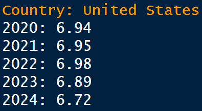
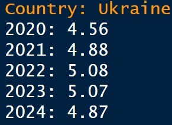
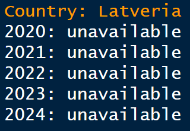
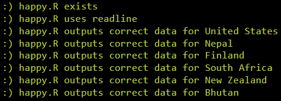
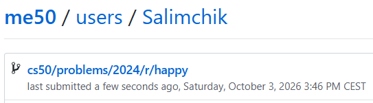

<div align="center">

# 😊 Happy

### Exploring Global Happiness Data with R

<p>
  <strong>CS50’s Introduction to Programming with R</strong><br>
  Week 3 — Applying Functions
</p>

[](https://cs50.harvard.edu/r/)
[](https://cs50.harvard.edu/r/weeks/3/)
[](https://cs50.harvard.edu/r/psets/3/)
[](https://cs50.harvard.edu/r/psets/3/happy/)
[](https://worldhappiness.report/)
[](https://www.r-project.org/)
[](#-completion-status)

---

### 🌍 Transforming multiple years of global data into country-level happiness scores

</div>

## 📖 Table of Contents

- [About the Assignment](#-about-the-assignment)
- [Project Objective](#-project-objective)
- [About the World Happiness Report](#-about-the-world-happiness-report)
- [Provided Data](#-provided-data)
- [Dataset Schema](#-dataset-schema)
- [Happiness Factors](#-happiness-factors)
- [Assignment Requirements](#-assignment-requirements)
- [Program Workflow](#️-program-workflow)
- [Applying Functions](#-applying-functions)
- [Country Validation](#-country-validation)
- [Handling Unavailable Data](#-handling-unavailable-data)
- [Calculated Results](#-calculated-results)
- [Country Comparison](#-country-comparison)
- [Test Scenarios](#-test-scenarios)
- [Project Structure](#-project-structure)
- [Result Demonstration](#-result-demonstration)
- [Completion Status](#-completion-status)
- [What I Learned](#-what-i-learned)

---

## 🎯 About the Assignment

[`Happy`](https://cs50.harvard.edu/r/psets/3/happy/) is an assignment from **Week 3: Applying Functions** of [CS50’s Introduction to Programming with R](https://cs50.harvard.edu/r/).

The assignment uses data from several editions of the **World Happiness Report** to calculate and display a selected country’s self-reported happiness score.

The completed solution is implemented in:

```text
happy.R
```

The program processes five annual datasets:

```text
2020.csv
2021.csv
2022.csv
2023.csv
2024.csv
```

For every available year, the program calculates the selected country’s total happiness score and rounds the result to two decimal places.

> [!NOTE]
> The maximum possible happiness score is `10`.

---

## 🚀 Project Objective

The program performs the following operations:

1. Prompts the user to enter a country name;
2. Iterates through the available years;
3. Reads the corresponding CSV file for each year;
4. Checks whether the country exists in that year’s dataset;
5. Selects the row belonging to the requested country;
6. Excludes the non-numeric country column;
7. Adds all happiness-factor values;
8. Rounds the total score to two decimal places;
9. Prints the score together with its year;
10. Displays `unavailable` when the country is missing from a dataset.

```text
User enters a country
          │
          ▼
Create a sequence of years
          │
          ▼
Loop through annual CSV files
          │
          ▼
Read the current year’s dataset
          │
          ▼
Check whether the country exists
          │
     ┌────┴────┐
     ▼         ▼
  Available  Unavailable
     │         │
     ▼         ▼
Select row   Print unavailable
     │
     ▼
Apply sum across happiness factors
     │
     ▼
Round to two decimal places
     │
     ▼
Print score and year
```

---

## 🌍 About the World Happiness Report

The **World Happiness Report** examines self-reported well-being across countries around the world.

Participants evaluate their lives, while researchers analyse several factors commonly associated with differences in reported happiness.

<table>
  <tr>
    <td align="center" width="25%">
      <h2>🌍</h2>
      <strong>Global Coverage</strong>
      <br>
      Data from more than 140 countries
    </td>
    <td align="center" width="25%">
      <h2>📅</h2>
      <strong>Multiple Years</strong>
      <br>
      Annual observations from 2020–2024
    </td>
    <td align="center" width="25%">
      <h2>🧩</h2>
      <strong>Seven Factors</strong>
      <br>
      Components contributing to each score
    </td>
    <td align="center" width="25%">
      <h2>🔟</h2>
      <strong>Score</strong>
      <br>
      Maximum total value of 10
    </td>
  </tr>
</table>

> [!IMPORTANT]
> A single numerical score cannot describe the complete emotional or social condition of a country. The data should be understood as a summary of self-reported survey results.

---

## 🗃️ Provided Data

Each CSV file represents one year of World Happiness Report data.

| File | Reporting year | Purpose |
|---|:---:|---|
| `2020.csv` | 2020 | Country happiness factors for 2020 |
| `2021.csv` | 2021 | Country happiness factors for 2021 |
| `2022.csv` | 2022 | Country happiness factors for 2022 |
| `2023.csv` | 2023 | Country happiness factors for 2023 |
| `2024.csv` | 2024 | Country happiness factors for 2024 |

Each row represents one country.

Each year is processed independently because a country may be present in one dataset and absent from another.

```text
2020.csv ──┐
2021.csv ──┤
2022.csv ──┼──▶ happy.R ──▶ Country scores by year
2023.csv ──┤
2024.csv ──┘
```

---

## 🧾 Dataset Schema

Every annual dataset contains the following columns:

| Column | Data type | Description |
|---|:---:|---|
| `country` | Character | Name of the country |
| `gdp` | Numeric | Happiness associated with economic prosperity |
| `support` | Numeric | Happiness associated with perceived social support |
| `life_expectancy` | Numeric | Happiness associated with life expectancy |
| `freedom` | Numeric | Happiness associated with freedom of life choices |
| `generosity` | Numeric | Happiness associated with perceived generosity |
| `corruption` | Numeric | Happiness associated with lower perceived corruption |
| `residual` | Numeric | Happiness associated with additional factors |

### Row structure

```text
Country
  │
  ├── GDP
  ├── Social support
  ├── Life expectancy
  ├── Freedom
  ├── Generosity
  ├── Corruption
  └── Residual factors
```

The `country` column identifies the observation. The remaining columns contain the numerical components used to calculate the total score.

---

## 🧩 Happiness Factors

### 💰 GDP

Represents the portion of reported happiness associated with a country’s economic prosperity.

### 🤝 Social support

Represents the contribution of perceived support from family, friends, and society.

### ❤️ Life expectancy

Represents the happiness contribution associated with health and expected lifespan.

### 🕊️ Freedom

Represents the contribution of perceived freedom when making life choices.

### 🎁 Generosity

Represents the happiness contribution associated with generosity and helping others.

### 🏛️ Corruption

Represents the contribution associated with lower perceptions of governmental corruption.

### ✨ Residual

Represents the portion of the score explained by factors outside the other listed categories.

---

## 📋 Assignment Requirements

The completed solution follows the principal requirements of the assignment:

- [x] The program is implemented in `happy.R`;
- [x] The user is prompted to enter a country name;
- [x] Five annual CSV datasets are processed;
- [x] A loop is used to iterate through the years;
- [x] The correct file is loaded for every year;
- [x] Country availability is checked independently for every dataset;
- [x] `%in%` is used to validate the country name;
- [x] The matching country row is selected;
- [x] The character column is excluded from the calculation;
- [x] `apply()` is used to calculate row totals;
- [x] All seven happiness factors are included;
- [x] Every available score is rounded to two decimal places;
- [x] The score is displayed together with the corresponding year;
- [x] Missing observations are reported as `unavailable`;
- [x] Processing continues even when data is missing for one year.

---

## ⚙️ Program Workflow

### 1️⃣ Collect the country name

The program begins by requesting a country:

```text
Country:
```

Example inputs:

```text
United States
Ukraine
Latveria
```

### 2️⃣ Iterate through the years

The program processes each year from 2020 through 2024.

Conceptually:

```r
for (year in years) {
  # Process the dataset for the current year
}
```

### 3️⃣ Construct or select the filename

Each loop iteration corresponds to an annual file:

```text
2020 → 2020.csv
2021 → 2021.csv
2022 → 2022.csv
2023 → 2023.csv
2024 → 2024.csv
```

### 4️⃣ Read the annual dataset

The current CSV file is loaded into a data frame.

### 5️⃣ Check country availability

The program determines whether the user’s country exists in the `country` column.

### 6️⃣ Calculate the score

When the country exists:

- Its row is selected;
- The `country` column is excluded;
- The seven numeric factors are added;
- The result is rounded to two decimal places.

### 7️⃣ Handle missing data

When the country is absent, the program reports:

```text
unavailable
```

The loop then continues to the next year.

---

## 🧮 Applying Functions

The total happiness score is calculated by summing every numeric factor in the selected row.

### General formula

```text
Happiness score =
GDP
+ social support
+ life expectancy
+ freedom
+ generosity
+ corruption
+ residual
```

### Function-based calculation

The `apply()` function can apply `sum` to rows of numeric data:

```r
apply(numeric_data, 1, sum)
```

Arguments:

| Argument | Meaning |
|---|---|
| `numeric_data` | Data containing the seven score factors |
| `1` | Apply the function across rows |
| `sum` | Add the values in each row |

### Rounding

The resulting score is rounded to two decimal places:

```r
round(score, 2)
```

### Calculation pipeline

```text
Country row
    │
    ▼
Remove the country-name column
    │
    ▼
Keep seven numeric factors
    │
    ▼
apply(..., 1, sum)
    │
    ▼
Total happiness score
    │
    ▼
round(..., 2)
    │
    ▼
Final displayed value
```

---

## 🛡️ Country Validation

The `%in%` operator determines whether a country appears in the annual dataset.

Conceptually:

```r
country %in% data$country
```

### Possible outcomes

| Result | Meaning | Program behaviour |
|:---:|---|---|
| `TRUE` | Country is present | Calculate and display the score |
| `FALSE` | Country is absent | Display `unavailable` |

### Example validation

| Country | Expected status |
|---|:---:|
| `United States` | ✅ Available |
| `Ukraine` | ✅ Available |
| `Latveria` | ❌ Unavailable |

> [!WARNING]
> Country names should match the spelling and capitalisation used in the datasets.

---

## 🚫 Handling Unavailable Data

A country may be missing from one annual dataset or from every dataset.

The program handles each year independently:

```text
Country available?
       │
   ┌───┴───┐
   ▼       ▼
  Yes      No
   │       │
   ▼       ▼
Calculate  Print
 score     unavailable
   │       │
   └───┬───┘
       ▼
Continue to next year
```

This behaviour ensures that one missing observation does not prevent the remaining years from being processed.

For the fictional country `Latveria`, the result is unavailable for all five years.

---

## 📊 Calculated Results

### 🇺🇸 United States

| Year | Happiness score | Availability |
|:---:|---:|:---:|
| 2020 | **6.94** | ✅ Available |
| 2021 | **6.95** | ✅ Available |
| 2022 | **6.98** | ✅ Available |
| 2023 | **6.89** | ✅ Available |
| 2024 | **6.72** | ✅ Available |

Expected values:

```text
United States

2020: 6.94
2021: 6.95
2022: 6.98
2023: 6.89
2024: 6.72
```

### 🇺🇦 Ukraine

| Year | Happiness score | Availability |
|:---:|---:|:---:|
| 2020 | **4.56** | ✅ Available |
| 2021 | **4.88** | ✅ Available |
| 2022 | **5.08** | ✅ Available |
| 2023 | **5.07** | ✅ Available |
| 2024 | **4.87** | ✅ Available |

Expected values:

```text
Ukraine

2020: 4.56
2021: 4.88
2022: 5.08
2023: 5.07
2024: 4.87
```

### 🏰 Latveria

| Year | Happiness score | Availability |
|:---:|:---:|:---:|
| 2020 | — | ❌ Unavailable |
| 2021 | — | ❌ Unavailable |
| 2022 | — | ❌ Unavailable |
| 2023 | — | ❌ Unavailable |
| 2024 | — | ❌ Unavailable |

Expected values:

```text
Latveria

2020: unavailable
2021: unavailable
2022: unavailable
2023: unavailable
2024: unavailable
```

---

## 📈 Country Comparison

### United States and Ukraine

| Year | United States | Ukraine | Difference |
|:---:|---:|---:|---:|
| 2020 | 6.94 | 4.56 | 2.38 |
| 2021 | 6.95 | 4.88 | 2.07 |
| 2022 | 6.98 | 5.08 | 1.90 |
| 2023 | 6.89 | 5.07 | 1.82 |
| 2024 | 6.72 | 4.87 | 1.85 |

### Text-based comparison

```text
2020
United States  ███████████████████████████████████  6.94
Ukraine        ███████████████████████              4.56

2021
United States  ███████████████████████████████████  6.95
Ukraine        ████████████████████████             4.88

2022
United States  ███████████████████████████████████  6.98
Ukraine        █████████████████████████            5.08

2023
United States  ██████████████████████████████████   6.89
Ukraine        █████████████████████████            5.07

2024
United States  ██████████████████████████████████   6.72
Ukraine        ████████████████████████             4.87
```

### Five-year summary

| Country | Highest score | Highest year | Lowest score | Lowest year |
|---|---:|:---:|---:|:---:|
| United States | 6.98 | 2022 | 6.72 | 2024 |
| Ukraine | 5.08 | 2022 | 4.56 | 2020 |
| Latveria | — | — | — | — |

> [!NOTE]
> These values represent results from the provided World Happiness Report datasets and should not be interpreted as a complete description of either country.

---

## 🧪 Test Scenarios

| # | Country input | Expected result |
|:---:|---|---|
| 1 | `United States` | Five numerical scores from 2020–2024 |
| 2 | `Ukraine` | Five numerical scores from 2020–2024 |
| 3 | `Latveria` | `unavailable` for all five years |

### Required behaviour

| Scenario | Expected behaviour |
|---|---|
| Country exists in every dataset | Display five rounded scores |
| Country exists in some datasets | Display scores where available and `unavailable` elsewhere |
| Country exists in no datasets | Display `unavailable` for every year |
| Score contains additional decimals | Round to two decimal places |
| One year has no data | Continue processing the remaining years |

### Test summary

```text
╔══════════════════════════════════════════════════════╗
║               HAPPINESS PROGRAM TESTS                ║
╠══════════════════════════════════════════════════════╣
║ Annual datasets processed                      5     ║
║ Happiness factors per country                  7     ║
║ Available countries tested                     2     ║
║ Unavailable countries tested                   1     ║
║ Country-year results verified                 15     ║
╚══════════════════════════════════════════════════════╝
```

---

## 📁 Project Structure

```text
happy/
│
├── happy.R
├── 2020.csv
├── 2021.csv
├── 2022.csv
├── 2023.csv
├── 2024.csv
├── README.md
│
└── assets/
    ├── united-states-result.png
    ├── ukraine-result.png
    ├── latveria-result.png
    ├── check50-result.png
    └── submit50-result.png
```

| File | Purpose |
|---|---|
| [`happy.R`](./happy.R) | Processes the datasets and calculates country scores |
| [`2020.csv`](./2020.csv) | World Happiness Report data for 2020 |
| [`2021.csv`](./2021.csv) | World Happiness Report data for 2021 |
| [`2022.csv`](./2022.csv) | World Happiness Report data for 2022 |
| [`2023.csv`](./2023.csv) | World Happiness Report data for 2023 |
| [`2024.csv`](./2024.csv) | World Happiness Report data for 2024 |
| `README.md` | Describes the assignment, methodology, and results |
| `assets/united-states-result.png` | Screenshot of the United States result |
| `assets/ukraine-result.png` | Screenshot of the Ukraine result |
| `assets/latveria-result.png` | Screenshot of the unavailable-country result |
| `assets/check50-result.png` | Screenshot of the successful `check50` validation |
| `assets/submit50-result.png` | Screenshot of the successful `submit50` submission |

---

## 📸 Result Demonstration

### 1️⃣ Result for `United States`

<div align="center">

<!--
Add the first screenshot to:

assets/united-states-result.png

The screenshot should show the scores:
2020: 6.94
2021: 6.95
2022: 6.98
2023: 6.89
2024: 6.72
-->



<br>

<sub>
  <strong>Figure 1.</strong>
  Self-reported happiness scores for the <strong>United States</strong> from 2020 through 2024.
</sub>

</div>

<br>

### 2️⃣ Result for `Ukraine`

<div align="center">

<!--
Add the second screenshot to:

assets/ukraine-result.png

The screenshot should show the scores:
2020: 4.56
2021: 4.88
2022: 5.08
2023: 5.07
2024: 4.87
-->



<br>

<sub>
  <strong>Figure 2.</strong>
  Self-reported happiness scores for <strong>Ukraine</strong> from 2020 through 2024.
</sub>

</div>

<br>

### 3️⃣ Result for `Latveria`

<div align="center">

<!--
Add the third screenshot to:

assets/latveria-result.png

The screenshot should demonstrate that data is unavailable
for every year from 2020 through 2024.
-->



<br>

<sub>
  <strong>Figure 3.</strong>
  Graceful handling of unavailable data for the fictional country <strong>Latveria</strong>.
</sub>

</div>

<br>

### 4️⃣ `check50` Result

<div align="center">

<!--
Add the fourth screenshot to:

assets/check50-result.png

The screenshot should show the successful check50 validation.
-->



<br>

<sub>
  <strong>Figure 4.</strong>
  Automated validation of the completed <code>happy.R</code> program with <code>check50</code>.
</sub>

</div>

<br>

### 5️⃣ `submit50` Result

<div align="center">

<!--
Add the fifth screenshot to:

assets/submit50-result.png

The screenshot should show the successful submit50 submission.
-->



<br>

<sub>
  <strong>Figure 5.</strong>
  Successful submission of the completed assignment with <code>submit50</code>.
</sub>

</div>

---

## ✅ Completion Status

| Component | Status |
|---|:---:|
| Five annual CSV files processed | ✅ |
| Interactive country input implemented | ✅ |
| Loop over years implemented | ✅ |
| Dynamic annual file processing implemented | ✅ |
| Country validation implemented | ✅ |
| Numeric factor columns selected | ✅ |
| Row-wise `apply()` calculation implemented | ✅ |
| All seven happiness factors included | ✅ |
| Scores rounded to two decimal places | ✅ |
| Unavailable data handled | ✅ |
| United States results verified | ✅ |
| Ukraine results verified | ✅ |
| Latveria behaviour verified | ✅ |
| `check50` validation completed | ✅ |
| Assignment submitted | ✅ |

<div align="center">

### 🎉 Assignment Completed Successfully


</div>

---

## 🧠 What I Learned

By completing this assignment, I practised:

- Processing multiple CSV files;
- Iterating through a sequence with a `for` loop;
- Dynamically selecting files by year;
- Working with data frames;
- Selecting rows by country name;
- Excluding non-numeric columns;
- Applying a function across rows;
- Using `apply()` with `sum`;
- Validating values with `%in%`;
- Handling missing observations;
- Continuing execution after unavailable data;
- Rounding numerical results;
- Formatting year-by-year output;
- Comparing results across multiple datasets.

The assignment demonstrates a reusable multi-file analysis workflow:

```text
Country Input
      ↓
Loop Through Years
      ↓
Load Annual Dataset
      ↓
Validate Country
      ↓
Select Numeric Factors
      ↓
Apply Row Sum
      ↓
Round Result
      ↓
Display Score or Unavailable
```

---

<div align="center">

## 😊 Five Years — Seven Factors — One Happiness Score 🌍

**Applying functions to understand country-level data across time.**

<br>

[](https://www.r-project.org/)
[](https://cs50.harvard.edu/r/weeks/3/)
[](#-applying-functions)
[](#-provided-data)
[](https://worldhappiness.report/)
[](#-completion-status)

</div>