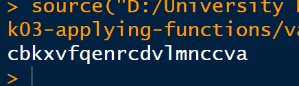
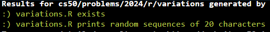
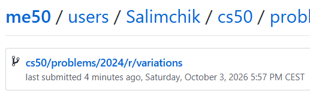

<div align="center">

# 🔤 Variations

### Generating Random Character Sequences with Functions in R

<p>
  <strong>CS50’s Introduction to Programming with R</strong><br>
  Week 3 — Applying Functions
</p>

[](https://cs50.harvard.edu/r/)
[](https://cs50.harvard.edu/r/weeks/3/)
[](https://cs50.harvard.edu/r/psets/3/)
[](https://cs50.harvard.edu/r/psets/3/variations/)
[](#-expected-output)
[](https://www.r-project.org/)
[](#-completion-status)

---

### 📚 Twenty characters. Twenty random choices. Countless possible variations.

</div>

## 📖 Table of Contents

- [About the Assignment](#-about-the-assignment)
- [The Library of Babel](#-the-library-of-babel)
- [Project Objective](#-project-objective)
- [Assignment Requirements](#-assignment-requirements)
- [Program Architecture](#️-program-architecture)
- [Function 1: random_character](#-function-1-random_character)
- [Function 2: print_sequence](#-function-2-print_sequence)
- [The Built-in letters Vector](#-the-built-in-letters-vector)
- [Random Character Selection](#-random-character-selection)
- [Sequence Generation](#-sequence-generation)
- [Timed Output](#️-timed-output)
- [Expected Output](#-expected-output)
- [Test Scenarios](#-test-scenarios)
- [Project Structure](#-project-structure)
- [Result Demonstration](#-result-demonstration)
- [Completion Status](#-completion-status)
- [What I Learned](#-what-i-learned)

---

## 🎯 About the Assignment

[`Variations`](https://cs50.harvard.edu/r/psets/3/variations/) is an assignment from **Week 3: Applying Functions** of [CS50’s Introduction to Programming with R](https://cs50.harvard.edu/r/).

The objective is to create an R program that generates random sequences using the 26 lowercase letters of the English alphabet.

The completed program is implemented in:

```text
variations.R
```

The program must generate a sequence that:

- Contains exactly **20 characters**;
- Uses only lowercase letters from `a` through `z`;
- Selects every character randomly;
- Prints one character at a time;
- Pauses for `0.25` seconds between characters.

> [!NOTE]
> Because the characters are selected randomly, the program normally produces a different sequence every time it runs.

---

## 📚 The Library of Babel

The assignment is inspired by **The Library of Babel**, a short story written by Jorge Luis Borges.

The story imagines an enormous library containing every possible variation of letters. If every combination existed, the library would theoretically contain:

- Every book ever written;
- Every book that could be written;
- Every person’s biography;
- Every possible prediction;
- Vast quantities of meaningless text.

The challenge is not generating the text—it is finding meaning within the randomness.

```text
Letters
   │
   ▼
Random combinations
   │
   ▼
Sequences
   │
   ▼
Pages
   │
   ▼
Books
   │
   ▼
An almost infinite library
```

This R program creates a small computational approximation of that idea by generating one random 20-character sequence.

---

## 🚀 Project Objective

The program performs the following operations:

1. Accesses R’s built-in lowercase alphabet;
2. Selects one letter randomly;
3. Returns the selected character;
4. Repeats the process a specified number of times;
5. Prints every character without separating spaces;
6. Waits a quarter of a second after each character;
7. Produces a complete 20-character sequence.

```text
Start the program
       │
       ▼
Request a sequence of length 20
       │
       ▼
Call random_character()
       │
       ▼
Select one letter from a–z
       │
       ▼
Print the selected letter
       │
       ▼
Wait 0.25 seconds
       │
       ▼
Repeat until 20 characters are printed
       │
       ▼
Complete the sequence
```

---

## 📋 Assignment Requirements

The completed solution follows the principal requirements of the assignment:

- [x] The program is implemented in `variations.R`;
- [x] The provided program structure is preserved;
- [x] A function named `random_character` is completed;
- [x] `random_character()` returns one randomly selected letter;
- [x] A function named `print_sequence` is completed;
- [x] `print_sequence()` accepts a sequence length;
- [x] The built-in `letters` vector is used;
- [x] The generated characters are lowercase;
- [x] Only letters from `a` through `z` are generated;
- [x] Exactly 20 characters are printed;
- [x] Characters are printed as one continuous sequence;
- [x] The program waits `0.25` seconds between characters;
- [x] The result changes across independent executions;
- [x] The final sequence is displayed in the R console.

---

## ⚙️ Program Architecture

The program is organised around two reusable functions:

```r
random_character <- function() {
  # Return one random lowercase letter
}

print_sequence <- function(length) {
  # Print a random sequence of the specified length
}
```

### Separation of responsibilities

<table>
  <tr>
    <th width="50%">🎲 Character Selection</th>
    <th width="50%">🔤 Sequence Generation</th>
  </tr>
  <tr>
    <td valign="top">
      <code>random_character()</code>
      <br><br>
      Selects and returns one random lowercase letter from the alphabet.
    </td>
    <td valign="top">
      <code>print_sequence(length)</code>
      <br><br>
      Repeatedly requests random characters and prints a sequence of the specified length.
    </td>
  </tr>
</table>

### Function relationship

```text
print_sequence(20)
        │
        ▼
Begin repeating 20 times
        │
        ▼
random_character()
        │
        ▼
Return one lowercase letter
        │
        ▼
Print the letter
        │
        ▼
Wait 0.25 seconds
        │
        ▼
Continue to the next iteration
```

> [!TIP]
> Separating character selection from sequence generation makes each function responsible for one clearly defined task.

---

## 🎲 Function 1: `random_character`

### Purpose

The `random_character()` function generates one random lowercase letter.

### Function signature

```r
random_character <- function() {
  # Return one random letter
}
```

### Input

The function does not require arguments.

```text
Arguments: none
```

### Output

The function returns one character from:

```text
a b c d e f g h i j k l m
n o p q r s t u v w x y z
```

### Possible examples

```text
a
f
m
q
z
```

Every call is an independent random selection.

```text
random_character() → "q"
random_character() → "b"
random_character() → "b"
random_character() → "x"
```

Repeated characters are valid because each character is sampled independently.

---

## 🔤 Function 2: `print_sequence`

### Purpose

The `print_sequence()` function generates and prints a complete random sequence.

### Function signature

```r
print_sequence <- function(length) {
  # Print a random sequence of the specified length
}
```

### Parameter

| Parameter | Type | Description |
|---|:---:|---|
| `length` | Numeric | Number of random characters to print |

For this assignment, the required call produces:

```text
20 characters
```

### Responsibilities

The function:

1. Repeats the generation process `length` times;
2. Calls `random_character()` during every iteration;
3. Prints the returned character;
4. Keeps all characters on the same output line;
5. Waits `0.25` seconds;
6. Stops when the specified length is reached.

### Iteration model

```text
Iteration 01 → random letter
Iteration 02 → random letter
Iteration 03 → random letter
      ...
Iteration 18 → random letter
Iteration 19 → random letter
Iteration 20 → random letter
```

---

## 🔡 The Built-in `letters` Vector

R contains a built-in object named `letters`.

It stores all 26 lowercase letters:

```r
letters
```

Conceptually, its contents are:

```text
Index:   1  2  3  4  5  6  7  8  9  ...  24 25 26
Letter:  a  b  c  d  e  f  g  h  i  ...  x  y  z
```

### Properties

| Property | Value |
|---|---|
| Object name | `letters` |
| Object type | Character vector |
| Number of elements | `26` |
| First element | `"a"` |
| Last element | `"z"` |
| Character case | Lowercase |

Using this built-in vector avoids manually creating the alphabet.

---

## 🎯 Random Character Selection

The `sample()` function selects elements randomly from a vector.

Conceptually:

```r
sample(source, size)
```

For this assignment:

| Argument | Meaning |
|---|---|
| `source` | The built-in `letters` vector |
| `size` | One character |

### Selection process

```text
letters
  │
  ├── a
  ├── b
  ├── c
  ├── ...
  ├── x
  ├── y
  └── z
       │
       ▼
Random selection
       │
       ▼
One returned character
```

Every letter has an opportunity to be selected during each function call.

> [!NOTE]
> Random selection does not guarantee that every sequence contains unique characters. Repeated letters are expected and valid.

---

## 🔁 Sequence Generation

The 20-character result is constructed one letter at a time.

```text
Character 01 ─┐
Character 02  │
Character 03  │
Character 04  │
      ...     ├──▶ One continuous sequence
Character 17  │
Character 18  │
Character 19  │
Character 20 ─┘
```

### Required output properties

| Property | Requirement |
|---|---|
| Sequence length | Exactly `20` |
| Allowed characters | `a`–`z` |
| Character case | Lowercase |
| Spaces | None |
| Randomness | New independent selections |
| Printing style | One character at a time |
| Delay | `0.25` seconds |

### Number of possible sequences

Each of the 20 positions can contain one of 26 letters.

```text
Possible sequences = 26²⁰
```

This produces:

```text
19,928,148,895,209,409,152,340,197,376
```

possible 20-character sequences.

That is approximately:

```text
1.99 × 10²⁸ possible sequences
```

---

## ⏱️ Timed Output

The program pauses between printed characters using:

```r
Sys.sleep(0.25)
```

### Timing calculation

```text
20 characters × 0.25 seconds
≈ 5 seconds
```

The result appears gradually in the console, creating a typing effect:

```text
q
qm
qms
qmsx
qmsxj
...
```

The characters remain on the same line until the sequence is complete.

### Timeline

```text
0.00s  → character 1
0.25s  → character 2
0.50s  → character 3
0.75s  → character 4
   ...
4.50s  → character 19
4.75s  → character 20
≈5.00s → sequence completed
```

> [!IMPORTANT]
> The delay is part of the required program behaviour, not merely a visual enhancement.

---

## 🖥️ Expected Output

Every execution should produce one lowercase sequence containing exactly 20 characters.

Illustrative example:

```text
qmsxjvatrnpkzebwufhy
```

Character validation:

```text
q m s x j v a t r n p k z e b w u f h y
│ │ │ │ │ │ │ │ │ │ │ │ │ │ │ │ │ │ │ │
1 2 3 4 5 6 7 8 9 10       ...          20
```

> [!NOTE]
> The example above demonstrates the expected format only. The actual sequence will vary because it is randomly generated.

### Output summary

| Measurement | Result |
|---|:---:|
| Total characters | `20` |
| Character set | `a`–`z` |
| Number of possible letters | `26` |
| Delay per character | `0.25 seconds` |
| Approximate total duration | `5 seconds` |
| Spaces in sequence | `0` |

---

## 🧪 Test Scenarios

### Functional tests

| # | Test | Expected result |
|:---:|---|---|
| 1 | Call `random_character()` | One lowercase character |
| 2 | Call `random_character()` repeatedly | Characters may differ |
| 3 | Generate a 20-character sequence | Exactly 20 characters |
| 4 | Inspect every character | Every value belongs to `a`–`z` |
| 5 | Observe the output | Characters appear gradually |
| 6 | Measure the delay | Approximately 0.25 seconds per character |

### Sequence validation

A valid generated result must satisfy:

```text
Length = 20
```

```text
Every character ∈ {a, b, c, ..., x, y, z}
```

```text
Uppercase characters = 0
Digits = 0
Spaces = 0
Special characters = 0
```

### Randomness test

Running the program several times should normally produce different output:

```text
Run 1: qmsxjvatrnpkzebwufhy
Run 2: dlawqoytxcmrigskpvne
Run 3: zhfbbnquycjtseaxwmko
```

These examples demonstrate the expected format and are not fixed program output.

### Test summary

```text
╔══════════════════════════════════════════════════════╗
║               VARIATIONS TEST SUMMARY                ║
╠══════════════════════════════════════════════════════╣
║ Required sequence length                      20     ║
║ Available lowercase letters                   26     ║
║ Delay between characters              0.25 seconds   ║
║ Approximate sequence duration           5 seconds    ║
║ Possible 20-character sequences      ≈ 1.99 × 10²⁸   ║
╚══════════════════════════════════════════════════════╝
```

---

## 📁 Project Structure

```text
variations/
│
├── variations.R
├── README.md
│
└── assets/
    ├── random-sequence-20.png
    ├── check50-result.png
    └── submit50-result.png
```

| File | Purpose |
|---|---|
| [`variations.R`](./variations.R) | Contains the random-character and sequence functions |
| `README.md` | Describes the assignment, functions, and completed result |
| `assets/random-sequence-20.png` | Screenshot of a generated 20-character sequence |
| `assets/check50-result.png` | Screenshot of the successful `check50` validation |
| `assets/submit50-result.png` | Screenshot of the successful `submit50` submission |

---

## 📸 Result Demonstration

### 1️⃣ A Random Sequence of 20 Characters

<div align="center">

<!--
Add the first screenshot to:

assets/random-sequence-20.png

The screenshot should show:
- Execution of variations.R
- One continuous sequence
- Exactly 20 lowercase characters
-->



<br>

<sub>
  <strong>Figure 1.</strong>
  A randomly generated sequence containing exactly <strong>20 lowercase characters</strong>.
</sub>

</div>

<br>

### 2️⃣ `check50` Result

<div align="center">

<!--
Add the second screenshot to:

assets/check50-result.png

The screenshot should show the successful check50 validation.
-->



<br>

<sub>
  <strong>Figure 2.</strong>
  Automated validation of the completed <code>variations.R</code> program with <code>check50</code>.
</sub>

</div>

<br>

### 3️⃣ `submit50` Result

<div align="center">

<!--
Add the third screenshot to:

assets/submit50-result.png

The screenshot should show the successful submit50 submission.
-->



<br>

<sub>
  <strong>Figure 3.</strong>
  Successful submission of the completed assignment with <code>submit50</code>.
</sub>

</div>

---

## ✅ Completion Status

| Component | Status |
|---|:---:|
| `variations.R` prepared | ✅ |
| `random_character()` implemented | ✅ |
| `print_sequence()` implemented | ✅ |
| Built-in `letters` vector used | ✅ |
| Random sampling implemented | ✅ |
| Function reuse implemented | ✅ |
| 20-character length configured | ✅ |
| Lowercase-only output verified | ✅ |
| Continuous sequence output verified | ✅ |
| 0.25-second delay implemented | ✅ |
| Multiple executions tested | ✅ |
| `check50` validation completed | ✅ |
| Assignment submitted | ✅ |

<div align="center">

### 🎉 Assignment Completed Successfully


</div>

---

## 🧠 What I Learned

By completing this assignment, I practised:

- Defining reusable functions in R;
- Writing functions without parameters;
- Writing functions with parameters;
- Returning values from functions;
- Calling one function from another;
- Working with R’s built-in `letters` vector;
- Selecting random vector elements;
- Using `sample()` for randomisation;
- Repeating operations with loops;
- Controlling the number of iterations;
- Printing characters without unwanted separators;
- Adding timed delays with `Sys.sleep()`;
- Constructing an output sequence incrementally;
- Testing random program behaviour;
- Validating character count and character range.

The assignment demonstrates how small reusable functions can be combined to produce more complex behaviour:

```text
Alphabet
    ↓
Random Selection
    ↓
Single Character
    ↓
Function Repetition
    ↓
Timed Printing
    ↓
20-Character Sequence
```

---

<div align="center">

## 📚 From Twenty Random Letters to Countless Possibilities 🔤

**Generated one character—and one function call—at a time.**

<br>

[](https://www.r-project.org/)
[](https://cs50.harvard.edu/r/weeks/3/)
[](#️-program-architecture)
[](#-expected-output)
[-F39C12?style=flat-square)](#-random-character-selection)
[](#-completion-status)

</div>