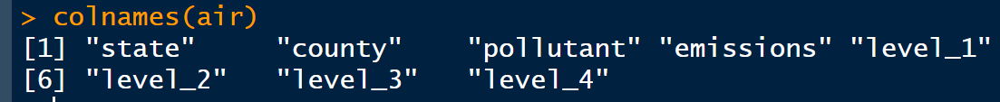
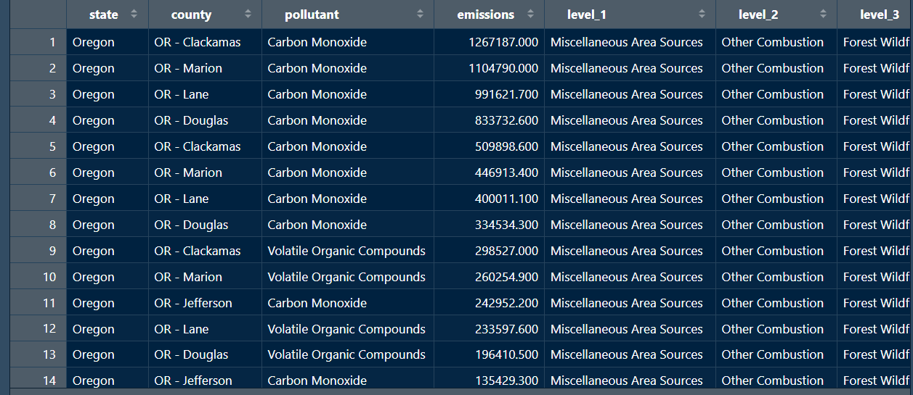
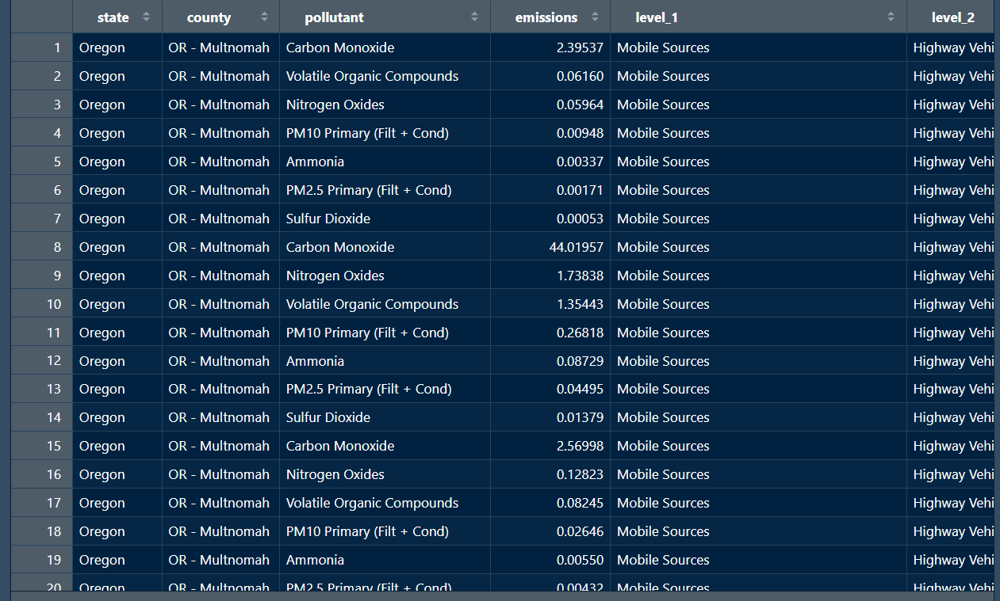
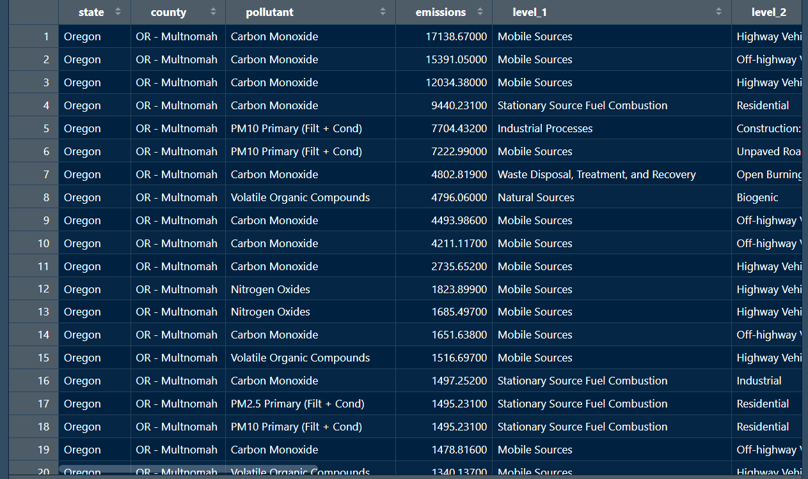
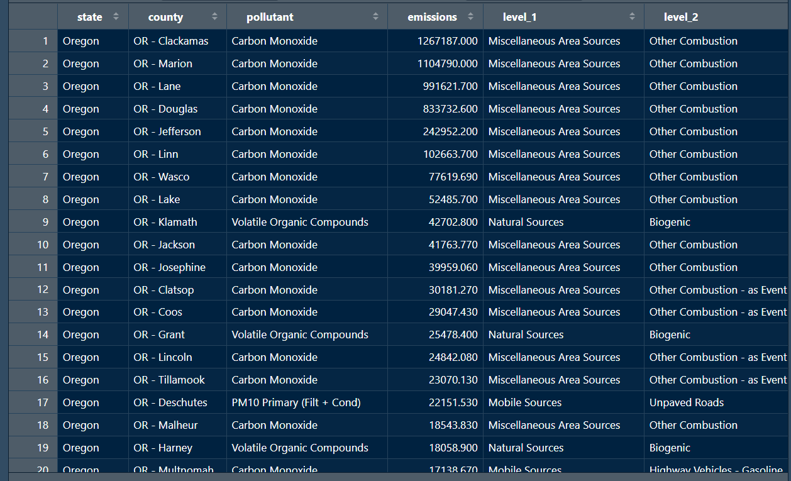
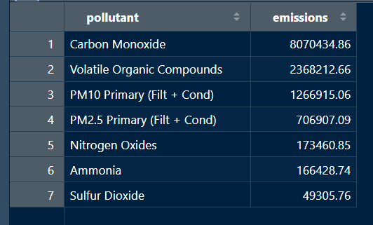
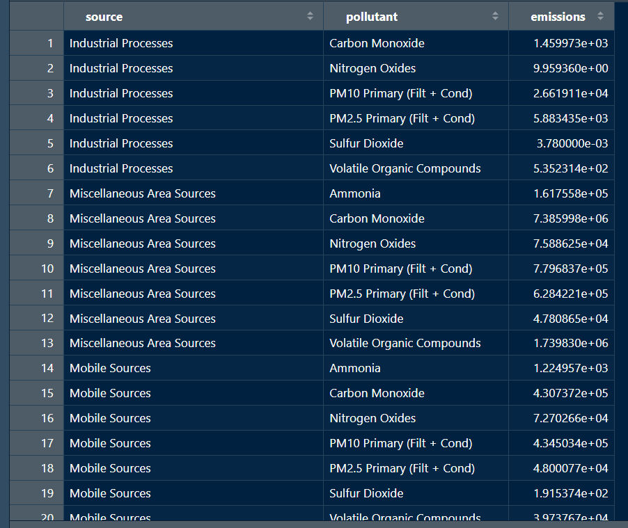
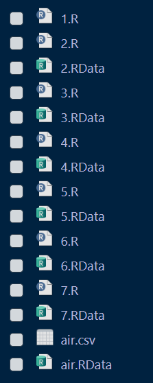
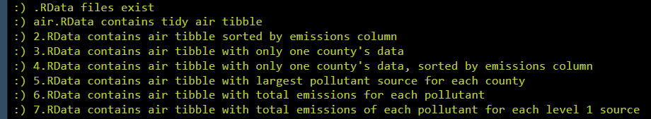
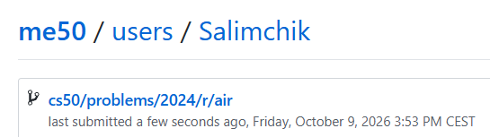

<div align="center">

# 🌲 Northwest Air

### Analysing Oregon Air Pollutant Emissions with R and the Tidyverse

<p>
  <strong>CS50’s Introduction to Programming with R</strong><br>
  Week 4 — Tidying Data
</p>

[](https://cs50.harvard.edu/r/)
[](https://cs50.harvard.edu/r/weeks/4/)
[](https://cs50.harvard.edu/r/psets/4/)
[](https://cs50.harvard.edu/r/psets/4/air/)
[](https://www.tidyverse.org/)
[](https://www.epa.gov/air-emissions-inventories/national-emissions-inventory-nei)
[](#-completion-status)

---

### 🌎 From 32,015 raw observations to structured environmental insights

</div>

## 📖 Table of Contents

- [About the Assignment](#-about-the-assignment)
- [Project Objective](#-project-objective)
- [Environmental Context](#-environmental-context)
- [Provided Dataset](#-provided-dataset)
- [Raw Data Schema](#-raw-data-schema)
- [Tidy Data Schema](#-tidy-data-schema)
- [Assignment Requirements](#-assignment-requirements)
- [Transformation Pipeline](#-transformation-pipeline)
- [Script 1.R — Import and Prepare](#-script-1r--import-and-prepare)
- [Script 2.R — Sort Statewide Emissions](#-script-2r--sort-statewide-emissions)
- [Script 3.R — Filter Multnomah County](#-script-3r--filter-multnomah-county)
- [Script 4.R — Rank Multnomah County Emissions](#-script-4r--rank-multnomah-county-emissions)
- [Script 5.R — Largest Source per County](#-script-5r--largest-source-per-county)
- [Script 6.R — Total Emissions per Pollutant](#-script-6r--total-emissions-per-pollutant)
- [Script 7.R — Emissions by Source Category](#-script-7r--emissions-by-source-category)
- [Tidyverse Operations](#-tidyverse-operations)
- [Expected Results](#-expected-results)
- [Project Structure](#-project-structure)
- [Result Demonstration](#-result-demonstration)
- [Completion Status](#-completion-status)
- [What I Learned](#-what-i-learned)

---

## 🎯 About the Assignment

[`Northwest Air`](https://cs50.harvard.edu/r/psets/4/air/) is an assignment from **Week 4: Tidying Data** of [CS50’s Introduction to Programming with R](https://cs50.harvard.edu/r/).

The assignment uses emissions data from the United States Environmental Protection Agency’s **National Emissions Inventory**.

The objective is to use R and the Tidyverse to clean, filter, arrange, group, and summarise information about air pollutants emitted across Oregon.

Instead of producing one final analysis, the project is divided into seven individual R scripts:

```text
1.R
2.R
3.R
4.R
5.R
6.R
7.R
```

Each script performs a distinct data-transformation task and saves its result as an `.RData` file.

---

## 🚀 Project Objective

The completed project transforms a detailed environmental dataset into several focused analyses.

The scripts collectively:

1. Import the raw CSV file;
2. Select only the required columns;
3. Rename columns consistently;
4. Create a reusable base tibble;
5. Rank emission sources across Oregon;
6. Filter observations for a selected county;
7. Identify the largest emission source in every county;
8. Calculate total emissions for every pollutant;
9. Calculate pollutant emissions by broad source category;
10. Save every completed result for automated validation.

```text
air.csv
   │
   ▼
1.R — Clean and select columns
   │
   ▼
air.RData
   │
   ├──▶ 2.R — Statewide ranking
   ├──▶ 3.R — Selected county
   ├──▶ 4.R — County ranking
   ├──▶ 5.R — Maximum per county
   ├──▶ 6.R — Totals per pollutant
   └──▶ 7.R — Totals by source and pollutant
```

> [!IMPORTANT]
> Scripts `2.R` through `7.R` independently load the original cleaned `air` tibble from `air.RData`. They do not depend on the transformed output of the preceding numbered script.

---

## 🌲 Environmental Context

The Pacific Northwest includes Oregon, Washington, and parts of Idaho.

The region is known for:

- Forests and mountains;
- Cool temperatures;
- Frequent cloudy weather;
- Outdoor recreation;
- Diverse natural ecosystems.

However, air quality can be affected by:

- Wildfires;
- Transportation;
- Industrial activity;
- Fuel combustion;
- Waste treatment;
- Residential and commercial activity.

This project analyses **criteria air pollutants**, which can affect human health, the environment, and property.

<table>
  <tr>
    <td align="center" width="25%">
      <h2>🔥</h2>
      <strong>Wildfires</strong>
      <br>
      Natural-source emissions
    </td>
    <td align="center" width="25%">
      <h2>🚗</h2>
      <strong>Transport</strong>
      <br>
      Cars, trucks and aircraft
    </td>
    <td align="center" width="25%">
      <h2>🏭</h2>
      <strong>Industry</strong>
      <br>
      Manufacturing and processing
    </td>
    <td align="center" width="25%">
      <h2>🏠</h2>
      <strong>Area Sources</strong>
      <br>
      Residential and commercial activity
    </td>
  </tr>
</table>

---

## 🗃️ Provided Dataset

The source file is:

```text
air.csv
```

It contains detailed information about criteria air pollutant emissions across Oregon.

Each row describes:

- A geographic location;
- A pollutant;
- The quantity emitted;
- The general emission source;
- Increasingly specific source classifications.

### Dataset scale

| Measurement | Value |
|---|---:|
| Raw observations used | `32,015` |
| Required tidy columns | `8` |
| Oregon counties represented | `36` |
| Pollutants represented | `7` |
| Broad source/pollutant combinations | `39` |

---

## 🧾 Raw Data Schema

The original dataset contains more columns than are required for the analysis.

The most relevant raw columns are:

| Original column | Description |
|---|---|
| `State` | State in which the emission occurred |
| `State-County` | County in which the emission occurred |
| `POLLUTANT` | Name of the emitted pollutant |
| `Emissions (Tons)` | Quantity of emissions in tons |
| `SCC LEVEL 1` | Broad source category |
| `SCC LEVEL 2` | More detailed source category |
| `SCC LEVEL 3` | More specific source description |
| `SCC LEVEL 4` | Most specific source description |

Other columns from the raw dataset are not required for the completed analyses.

---

## ✨ Tidy Data Schema

The first script transforms the original column names into a consistent lowercase format.

| Tidy column | Original column | Description |
|---|---|---|
| `state` | `State` | State name |
| `county` | `State-County` | County identifier |
| `pollutant` | `POLLUTANT` | Pollutant name |
| `emissions` | `Emissions (Tons)` | Emissions measured in tons |
| `level_1` | `SCC LEVEL 1` | Broad source category |
| `level_2` | `SCC LEVEL 2` | Secondary source category |
| `level_3` | `SCC LEVEL 3` | Detailed source category |
| `level_4` | `SCC LEVEL 4` | Most specific source category |

### Resulting tibble structure

```text
air
├── state
├── county
├── pollutant
├── emissions
├── level_1
├── level_2
├── level_3
└── level_4
```

The cleaned tibble contains:

```text
32,015 rows × 8 columns
```

---

## 📋 Assignment Requirements

The completed solution follows the principal requirements of the assignment:

- [x] All seven R scripts are completed;
- [x] `air.csv` is read into a tibble;
- [x] Only the eight required columns are retained;
- [x] Raw column names are renamed consistently;
- [x] The cleaned tibble is stored as `air`;
- [x] The base tibble is saved to `air.RData`;
- [x] Emissions are ranked from highest to lowest;
- [x] A single Oregon county is selected for analysis;
- [x] County data is filtered correctly;
- [x] The county data is ranked by emissions;
- [x] The largest pollutant source is identified for every county;
- [x] Total emissions are calculated for every pollutant;
- [x] Pollutants are ranked by statewide emissions;
- [x] Total emissions are calculated by source category and pollutant;
- [x] Every result is saved to its corresponding `.RData` file;
- [x] All output dimensions match the specification.

---

## 🔄 Transformation Pipeline

| Script | Input | Main transformation | Output |
|:---:|---|---|---|
| `1.R` | `air.csv` | Import, select and rename | `air.RData` |
| `2.R` | `air.RData` | Arrange emissions descending | `2.RData` |
| `3.R` | `air.RData` | Filter one county | `3.RData` |
| `4.R` | `air.RData` | Filter county and arrange emissions | `4.RData` |
| `5.R` | `air.RData` | Select maximum source per county | `5.RData` |
| `6.R` | `air.RData` | Sum emissions by pollutant | `6.RData` |
| `7.R` | `air.RData` | Sum by source category and pollutant | `7.RData` |

### Dependency structure

```text
                     ┌── 2.R ──▶ 2.RData
                     ├── 3.R ──▶ 3.RData
air.csv ─▶ 1.R ─▶ air.RData ───├── 4.R ──▶ 4.RData
                     ├── 5.R ──▶ 5.RData
                     ├── 6.R ──▶ 6.RData
                     └── 7.R ──▶ 7.RData
```

---

# 1️⃣ Script `1.R` — Import and Prepare

## Purpose

The first script creates the clean base tibble used by every remaining analysis.

## Transformations

`1.R`:

1. Loads the Tidyverse;
2. Reads `air.csv` as a tibble;
3. Selects the eight required columns;
4. Renames those columns;
5. Stores the result in an object named `air`;
6. Saves the object to `air.RData`.

### Conceptual workflow

```text
Raw air.csv
     │
     ▼
read_csv()
     │
     ▼
Select 8 required columns
     │
     ▼
Rename columns
     │
     ▼
Clean air tibble
     │
     ▼
save() → air.RData
```

### Expected result

| Property | Expected value |
|---|---:|
| Object name | `air` |
| Object type | Tibble |
| Rows | `32,015` |
| Columns | `8` |
| Saved file | `air.RData` |

---

# 2️⃣ Script `2.R` — Sort Statewide Emissions

## Purpose

The second script identifies the largest individual pollutant sources across Oregon.

## Transformations

`2.R`:

1. Loads `air` from `air.RData`;
2. Sorts every observation by `emissions`;
3. Places the largest emissions first;
4. Saves the result to `2.RData`.

### Conceptual transformation

```text
air
 │
 ▼
arrange(desc(emissions))
 │
 ▼
Statewide emission ranking
 │
 ▼
save() → 2.RData
```

### Expected result

| Property | Expected value |
|---|---:|
| Rows | `32,015` |
| Columns | `8` |
| Sort order | Highest to lowest emissions |
| Saved file | `2.RData` |

---

# 3️⃣ Script `3.R` — Filter Multnomah County

## Purpose

The third script focuses on pollutant sources located in one Oregon county.

The selected county for this implementation is:

```text
OR - Multnomah
```

Multnomah County includes Portland and is therefore especially relevant to the Pacific Northwest theme of the assignment.

## Transformations

`3.R`:

1. Loads the original cleaned tibble from `air.RData`;
2. Filters rows by the `county` column;
3. Retains only observations for `OR - Multnomah`;
4. Preserves all eight tidy columns;
5. Saves the result to `3.RData`.

### Conceptual transformation

```text
All Oregon observations
          │
          ▼
county == "OR - Multnomah"
          │
          ▼
Multnomah County observations
          │
          ▼
save() → 3.RData
```

### Expected result

| Property | Expected value |
|---|---:|
| County values | One unique county |
| Selected county | `OR - Multnomah` |
| Columns | `8` |
| Saved file | `3.RData` |

> [!NOTE]
> If a different Oregon county was selected in your implementation, replace `OR - Multnomah` throughout this README with the corresponding dataset value.

---

# 4️⃣ Script `4.R` — Rank Multnomah County Emissions

## Purpose

The fourth script combines the analyses from `2.R` and `3.R`.

It identifies all pollutant sources in Multnomah County and ranks them by emission quantity.

## Transformations

`4.R`:

1. Loads `air` from `air.RData`;
2. Filters observations for `OR - Multnomah`;
3. Sorts the filtered rows by `emissions`;
4. Places the highest-emission sources first;
5. Saves the result to `4.RData`.

### Conceptual transformation

```text
All Oregon observations
          │
          ▼
Filter OR - Multnomah
          │
          ▼
Arrange emissions descending
          │
          ▼
Ranked county observations
          │
          ▼
save() → 4.RData
```

### Expected result

| Property | Expected value |
|---|---:|
| County values | One unique county |
| Selected county | `OR - Multnomah` |
| Columns | `8` |
| Sort order | Highest to lowest emissions |
| Saved file | `4.RData` |

---

# 5️⃣ Script `5.R` — Largest Source per County

## Purpose

The fifth script identifies the single largest individual pollutant source in every Oregon county.

## Transformations

`5.R`:

1. Loads `air` from `air.RData`;
2. Groups observations by county;
3. Identifies the highest `emissions` value inside every group;
4. Retains one row for every county;
5. Orders the result from highest to lowest emissions;
6. Saves the result to `5.RData`.

### Conceptual transformation

```text
32,015 observations
        │
        ▼
Group by county
        │
        ▼
Find maximum emissions in each group
        │
        ▼
One observation per county
        │
        ▼
36 rows
        │
        ▼
save() → 5.RData
```

### Expected result

| Property | Expected value |
|---|---:|
| Rows | `36` |
| Columns | `8` |
| Rows per county | `1` |
| Sort order | Highest to lowest emissions |
| Saved file | `5.RData` |

---

# 6️⃣ Script `6.R` — Total Emissions per Pollutant

## Purpose

The sixth script calculates the total statewide emissions of every pollutant.

## Transformations

`6.R`:

1. Loads `air` from `air.RData`;
2. Groups observations by pollutant;
3. Sums the `emissions` values inside every group;
4. Produces one row per pollutant;
5. Sorts pollutants from highest to lowest total emissions;
6. Saves the result to `6.RData`.

### Conceptual transformation

```text
Individual sources
       │
       ▼
Group by pollutant
       │
       ▼
Sum emissions
       │
       ▼
One total per pollutant
       │
       ▼
Arrange totals descending
       │
       ▼
save() → 6.RData
```

### Expected schema

| Column | Description |
|---|---|
| `pollutant` | Name of the pollutant |
| `emissions` | Total emissions across Oregon |

### Expected result

| Property | Expected value |
|---|---:|
| Rows | `7` |
| Columns | `2` |
| Sort order | Highest to lowest emissions |
| Saved file | `6.RData` |

### Example result structure

| pollutant | emissions |
|---|---:|
| Carbon Monoxide | 8,070,435 |
| Volatile Organic Compounds | 2,368,213 |
| PM10 Primary (Filt + Cond) | 1,266,915 |
| … | … |

---

# 7️⃣ Script `7.R` — Emissions by Source Category

## Purpose

The seventh script calculates the total emissions of each pollutant within every broad source category.

The `level_1` column identifies categories such as:

- Industrial Processes;
- Miscellaneous Area Sources;
- Mobile Sources;
- Natural Sources;
- Solvent Utilization;
- Stationary Source Fuel Combustion;
- Storage and Transport;
- Waste Disposal, Treatment, and Recovery.

## Transformations

`7.R`:

1. Loads `air` from `air.RData`;
2. Uses `level_1` as the broad source category;
3. Groups observations by source category and pollutant;
4. Sums emissions inside every group;
5. Renames the source-category column to `source`;
6. Produces the required three-column result;
7. Organises the result by source and pollutant;
8. Saves the result to `7.RData`.

### Conceptual transformation

```text
Individual emission sources
           │
           ▼
Group by level_1 and pollutant
           │
           ▼
Sum emissions in each group
           │
           ▼
Rename level_1 → source
           │
           ▼
source + pollutant + emissions
           │
           ▼
save() → 7.RData
```

### Expected schema

| Column | Description |
|---|---|
| `source` | Broad source category from `level_1` |
| `pollutant` | Pollutant name |
| `emissions` | Total emissions for the combination |

### Expected result

| Property | Expected value |
|---|---:|
| Rows | `39` |
| Columns | `3` |
| Grouping | Source and pollutant |
| Saved file | `7.RData` |

### Example result structure

| source | pollutant | emissions |
|---|---|---:|
| Industrial Processes | Carbon Monoxide | 1,460 |
| Industrial Processes | Nitrogen Oxides | 9.96 |
| Miscellaneous Area Sources | Ammonia | 161,756 |
| Miscellaneous Area Sources | Carbon Monoxide | 7,385,998 |
| … | … | … |

---

## 🧰 Tidyverse Operations

The project applies several core Tidyverse functions.

| Function | Purpose in the project |
|---|---|
| `read_csv()` | Reads `air.csv` directly into a tibble |
| `select()` | Retains only required columns |
| `rename()` | Creates consistent column names |
| `filter()` | Selects observations from one county |
| `arrange()` | Orders rows by emissions or names |
| `desc()` | Reverses numerical sorting order |
| `group_by()` | Creates county, pollutant, or source groups |
| `slice_max()` | Selects the largest observation from a group |
| `summarize()` | Produces aggregated emission totals |
| `sum()` | Adds emissions inside each group |
| `ungroup()` | Removes grouping after a summary |
| `save()` | Stores the completed tibble in an `.RData` file |
| `load()` | Restores the base tibble for another analysis |

### Transformation vocabulary

```text
select    → choose columns
rename    → standardise names
filter    → choose rows
arrange   → change row order
group_by  → define analytical groups
summarize → reduce groups to summary values
save      → preserve the completed result
```

---

## 📊 Expected Results

| Script | Rows | Columns | Main result |
|:---:|---:|---:|---|
| `1.R` | 32,015 | 8 | Cleaned base tibble |
| `2.R` | 32,015 | 8 | Statewide emissions ranked |
| `3.R` | County-dependent | 8 | One selected county |
| `4.R` | County-dependent | 8 | Selected county ranked |
| `5.R` | 36 | 8 | Largest source per county |
| `6.R` | 7 | 2 | Total emissions per pollutant |
| `7.R` | 39 | 3 | Totals by source and pollutant |

### Output files

```text
1.R → air.RData
2.R → 2.RData
3.R → 3.RData
4.R → 4.RData
5.R → 5.RData
6.R → 6.RData
7.R → 7.RData
```

> [!IMPORTANT]
> The `.RData` files are essential results of the assignment. `check50` validates these saved data objects, not only the source code.

---

## 📁 Project Structure

```text
air/
│
├── air.csv
│
├── 1.R
├── 2.R
├── 3.R
├── 4.R
├── 5.R
├── 6.R
├── 7.R
│
├── air.RData
├── 2.RData
├── 3.RData
├── 4.RData
├── 5.RData
├── 6.RData
├── 7.RData
│
├── README.md
│
└── assets/
    ├── result-1-r.png
    ├── result-2-r.png
    ├── result-3-r.png
    ├── result-4-r.png
    ├── result-5-r.png
    ├── result-6-r.png
    ├── result-7-r.png
    ├── folder-structure.png
    ├── check50-result.png
    └── submit50-result.png
```

---

## 📸 Result Demonstration

### 1️⃣ Result for `1.R`

<div align="center">

<!--
Add the first screenshot to:

assets/result-1-r.png

The screenshot should demonstrate:
- The cleaned air tibble
- 32,015 rows
- 8 renamed columns
-->



<br>

<sub>
  <strong>Figure 1.</strong>
  Cleaned <code>air</code> tibble created by <code>1.R</code>.
</sub>

</div>

<br>

### 2️⃣ Result for `2.R`

<div align="center">

<!--
Add the second screenshot to:

assets/result-2-r.png

The screenshot should demonstrate that emissions
are ordered from highest to lowest.
-->



<br>

<sub>
  <strong>Figure 2.</strong>
  Oregon pollutant sources ranked from highest to lowest emissions.
</sub>

</div>

<br>

### 3️⃣ Result for `3.R`

<div align="center">

<!--
Add the third screenshot to:

assets/result-3-r.png

The screenshot should demonstrate that only
OR - Multnomah observations remain.
-->



<br>

<sub>
  <strong>Figure 3.</strong>
  Pollutant observations filtered for <code>OR - Multnomah</code>.
</sub>

</div>

<br>

### 4️⃣ Result for `4.R`

<div align="center">

<!--
Add the fourth screenshot to:

assets/result-4-r.png

The screenshot should demonstrate:
- Only OR - Multnomah observations
- Emissions sorted from highest to lowest
-->



<br>

<sub>
  <strong>Figure 4.</strong>
  Multnomah County pollutant sources ranked by emissions.
</sub>

</div>

<br>

### 5️⃣ Result for `5.R`

<div align="center">

<!--
Add the fifth screenshot to:

assets/result-5-r.png

The screenshot should demonstrate:
- 36 rows
- 8 columns
- One maximum-emission source per county
-->



<br>

<sub>
  <strong>Figure 5.</strong>
  The single largest individual pollutant source in each Oregon county.
</sub>

</div>

<br>

### 6️⃣ Result for `6.R`

<div align="center">

<!--
Add the sixth screenshot to:

assets/result-6-r.png

The screenshot should demonstrate:
- 7 rows
- pollutant and emissions columns
- Totals sorted from highest to lowest
-->



<br>

<sub>
  <strong>Figure 6.</strong>
  Total statewide emissions calculated for each pollutant.
</sub>

</div>

<br>

### 7️⃣ Result for `7.R`

<div align="center">

<!--
Add the seventh screenshot to:

assets/result-7-r.png

The screenshot should demonstrate:
- 39 rows
- source, pollutant and emissions columns
- Emissions grouped by broad source category and pollutant
-->



<br>

<sub>
  <strong>Figure 7.</strong>
  Total emissions for every pollutant within each broad source category.
</sub>

</div>

<br>

### 8️⃣ Project Folder Structure

<div align="center">

<!--
Add the eighth screenshot to:

assets/folder-structure.png

The screenshot should show:
- air.csv
- 1.R through 7.R
- air.RData
- 2.RData through 7.RData
-->



<br>

<sub>
  <strong>Figure 8.</strong>
  Completed project structure containing all scripts and generated <code>.RData</code> files.
</sub>

</div>

<br>

### 9️⃣ `check50` Result

<div align="center">

<!--
Add the ninth screenshot to:

assets/check50-result.png

The screenshot should show the successful check50 validation.
-->



<br>

<sub>
  <strong>Figure 9.</strong>
  Automated validation of all generated <code>.RData</code> files with <code>check50</code>.
</sub>

</div>

<br>

### 🔟 `submit50` Result

<div align="center">

<!--
Add the tenth screenshot to:

assets/submit50-result.png

The screenshot should show the successful submit50 submission.
-->



<br>

<sub>
  <strong>Figure 10.</strong>
  Successful submission of the completed Northwest Air assignment with <code>submit50</code>.
</sub>

</div>

---

## ✅ Completion Status

| Component | Status |
|---|:---:|
| `air.csv` imported | ✅ |
| Required columns selected | ✅ |
| Columns renamed | ✅ |
| `air.RData` created | ✅ |
| Statewide emissions ranked | ✅ |
| Multnomah County filtered | ✅ |
| Multnomah County emissions ranked | ✅ |
| Largest source per county identified | ✅ |
| Statewide pollutant totals calculated | ✅ |
| Source-category totals calculated | ✅ |
| All seven scripts completed | ✅ |
| All seven `.RData` files created | ✅ |
| Folder structure verified | ✅ |
| `check50` validation completed | ✅ |
| Assignment submitted | ✅ |

<div align="center">

### 🎉 Assignment Completed Successfully


</div>

---

## 🧠 What I Learned

By completing this assignment, I practised:

- Importing CSV files as tibbles;
- Working with the Tidyverse;
- Selecting relevant variables;
- Renaming columns consistently;
- Filtering observations by geographic location;
- Sorting numerical data;
- Grouping observations;
- Selecting maximum values within groups;
- Calculating grouped totals;
- Creating multi-variable summaries;
- Renaming summarised columns;
- Saving R objects to `.RData` files;
- Loading saved objects into independent scripts;
- Dividing a large analysis into focused stages;
- Validating dimensions and sort order;
- Transforming raw environmental data into interpretable summaries.

The assignment demonstrates a complete tidy-data workflow:

```text
Import
  ↓
Select
  ↓
Rename
  ↓
Filter
  ↓
Arrange
  ↓
Group
  ↓
Summarize
  ↓
Save
```

---

<div align="center">

## 🌲 Cleaner Data for a Clearer View of Oregon’s Air 🌎

**Seven scripts. Thirty-six counties. One structured environmental analysis.**

<br>

[](https://www.r-project.org/)
[](https://cs50.harvard.edu/r/weeks/4/)
[](#-transformation-pipeline)
[](#-tidyverse-operations)
[](#-provided-dataset)
[](#-completion-status)

</div>