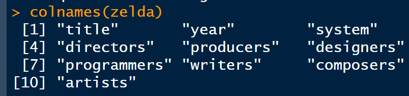
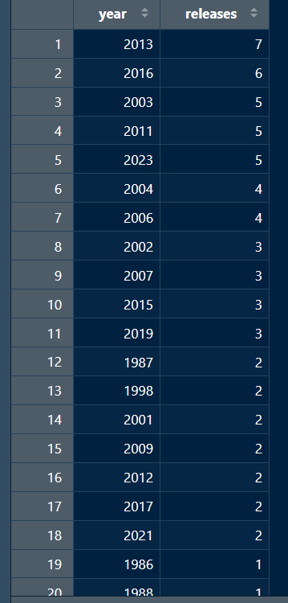
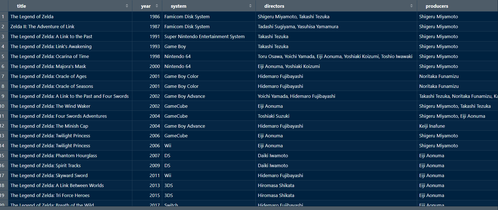
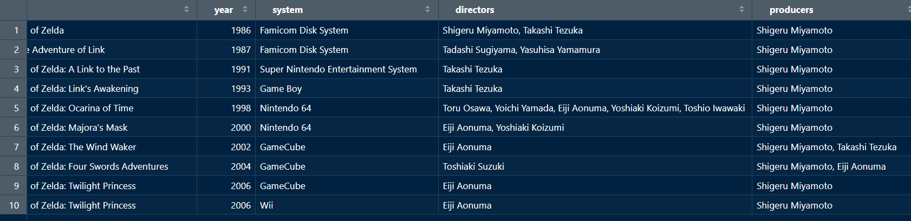
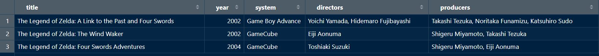
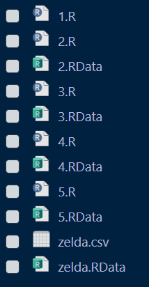
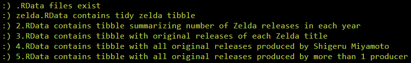
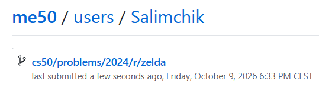

<div align="center">

# 🗡️ Zeruda no Densetsu 🛡️

### Tidying the History of The Legend of Zelda with R

<p>
  <strong>CS50’s Introduction to Programming with R</strong><br>
  Week 4 — Tidying Data
</p>

[](https://cs50.harvard.edu/r/)
[](https://cs50.harvard.edu/r/weeks/4/)
[](https://cs50.harvard.edu/r/psets/4/)
[](https://cs50.harvard.edu/r/psets/4/zelda/)
[](https://www.tidyverse.org/)
[](#-project-structure)
[](#-completion-status)

---

### 🔺 One release per row • One variable per column • One value per cell

</div>

## 📖 Table of Contents

- [About the Assignment](#-about-the-assignment)
- [Project Objective](#-project-objective)
- [The Dataset](#-the-dataset)
- [Why the Original Data Is Untidy](#-why-the-original-data-is-untidy)
- [Tidy Data Principles](#-tidy-data-principles)
- [Final Dataset Schema](#-final-dataset-schema)
- [Assignment Requirements](#-assignment-requirements)
- [Transformation Pipeline](#-transformation-pipeline)
- [Script 1.R — Tidy the Dataset](#-script-1r--tidy-the-dataset)
- [Script 2.R — Releases by Year](#-script-2r--releases-by-year)
- [Script 3.R — Original Releases](#-script-3r--original-releases)
- [Script 4.R — Shigeru Miyamoto](#-script-4r--shigeru-miyamoto)
- [Script 5.R — Multiple Producers](#-script-5r--multiple-producers)
- [Tidyverse Operations](#-tidyverse-operations)
- [Expected Results](#-expected-results)
- [Project Structure](#-project-structure)
- [Result Demonstration](#-result-demonstration)
- [Completion Status](#-completion-status)
- [What I Learned](#-what-i-learned)

---

## 🎯 About the Assignment

[`Zeruda no Densetsu`](https://cs50.harvard.edu/r/psets/4/zelda/) is an assignment from **Week 4: Tidying Data** of [CS50’s Introduction to Programming with R](https://cs50.harvard.edu/r/).

The title *Zeruda no Densetsu* is the Japanese name of **The Legend of Zelda**, one of Nintendo’s most recognisable video-game series.

In this project, the student takes the role of a game historian tasked with reorganising an old dataset containing information about:

- Game titles;
- Release years;
- Gaming systems;
- Directors;
- Producers;
- Designers;
- Programmers;
- Writers;
- Composers;
- Artists.

The project consists of five R scripts:

```text
1.R
2.R
3.R
4.R
5.R
```

Each script performs one stage of the data-cleaning or historical-analysis process.

---

## 🚀 Project Objective

The project has two main objectives:

1. Transform the original `zelda.csv` into a tidy dataset;
2. Use the tidy dataset to answer questions about the history of the series.

The completed scripts:

1. Separate release years from gaming systems;
2. Convert development roles into individual columns;
3. Create one row for every game release;
4. Count releases by year;
5. Identify the original release of every title;
6. Find original releases produced by Shigeru Miyamoto;
7. Identify original releases with multiple producers;
8. Save every result as an `.RData` file.

```text
zelda.csv
    │
    ▼
1.R — Tidy the raw data
    │
    ▼
zelda.RData
    │
    ├──▶ 2.R — Count releases by year
    ├──▶ 3.R — Find original releases
    ├──▶ 4.R — Find Miyamoto-produced originals
    └──▶ 5.R — Find originals with multiple producers
```

> [!IMPORTANT]
> Scripts `2.R` through `5.R` independently load the original tidy `zelda` tibble from `zelda.RData`. They do not rely on the transformed result of the previous numbered script.

---

## 🗃️ The Dataset

The source file is:

```text
zelda.csv
```

The original dataset contains four columns:

| Column | Description |
|---|---|
| `title` | Title of a game in The Legend of Zelda series |
| `release` | Release year and gaming system stored together |
| `role` | Development role associated with the game |
| `names` | People who held the specified role |

### Raw-data example

| title | release | role | names |
|---|---|---|---|
| The Legend of Zelda | 1986 - Famicom Disk System | Directors | Shigeru Miyamoto, Takashi Tezuka |
| The Legend of Zelda | 1986 - Famicom Disk System | Producers | Shigeru Miyamoto |
| The Legend of Zelda | 1986 - Famicom Disk System | Designers | Shigeru Miyamoto, Takashi Tezuka |
| The Legend of Zelda | 1986 - Famicom Disk System | Programmers | Toshihiko Nakago, Yasunari Soejima, I. Marui |
| The Legend of Zelda | 1986 - Famicom Disk System | Writers | Takashi Tezuka, Keiji Terui |
| The Legend of Zelda | 1986 - Famicom Disk System | Composers | Koji Kondo |

The same release appears across several rows because each development role is stored as a separate observation.

---

## 🧹 Why the Original Data Is Untidy

The original dataset violates several tidy-data principles.

### Problem 1 — Multiple variables in one column

The `release` column contains both:

```text
1986 - Famicom Disk System
```

This cell stores two variables:

- Release year: `1986`;
- System: `Famicom Disk System`.

### Problem 2 — Variables stored as row values

Development roles are stored inside the `role` column:

```text
Directors
Producers
Designers
Programmers
Writers
Composers
Artists
```

These roles should instead become separate columns.

### Problem 3 — One release appears across multiple rows

A single game release is repeated for every development role.

```text
One release
├── Directors row
├── Producers row
├── Designers row
├── Programmers row
├── Writers row
├── Composers row
└── Artists row
```

The required tidy representation stores all of that information in one row.

---

## ✨ Tidy Data Principles

The cleaned dataset follows three fundamental rules.

<table>
  <tr>
    <th width="33%">📄 One Row</th>
    <th width="33%">📊 One Column</th>
    <th width="33%">🔹 One Cell</th>
  </tr>
  <tr>
    <td valign="top">
      Each row represents one release of one game.
    </td>
    <td valign="top">
      Each column represents one variable that can differ between releases.
    </td>
    <td valign="top">
      Each cell contains one piece of information.
    </td>
  </tr>
</table>

For this assignment, a comma-separated list of people is considered one piece of information.

### Before tidying

```text
title + combined release + role + names
```

### After tidying

```text
title + year + system + directors + producers
+ designers + programmers + writers + composers + artists
```

---

## 🧾 Final Dataset Schema

The cleaned `zelda` tibble contains exactly ten columns.

| Column | Description |
|---|---|
| `title` | Game title |
| `year` | Release year |
| `system` | Platform or gaming system |
| `directors` | Director or list of directors |
| `producers` | Producer or list of producers |
| `designers` | Designer or list of designers |
| `programmers` | Programmer or list of programmers |
| `writers` | Writer or list of writers |
| `composers` | Composer or list of composers |
| `artists` | Artist or list of artists |

### Final structure

```text
zelda
├── title
├── year
├── system
├── directors
├── producers
├── designers
├── programmers
├── writers
├── composers
└── artists
```

### First release examples

| title | year | system | producers | composers |
|---|:---:|---|---|---|
| The Legend of Zelda | 1986 | Famicom Disk System | Shigeru Miyamoto | Koji Kondo |
| The Legend of Zelda | 1987 | Nintendo Entertainment System | Shigeru Miyamoto | Koji Kondo |
| The Legend of Zelda | 2003 | GameCube | Shigeru Miyamoto | Koji Kondo |

Missing information, such as an unavailable artist name, is represented as:

```text
NA
```

---

## 📋 Assignment Requirements

The completed solution follows the principal requirements of the assignment:

- [x] All five R scripts are completed;
- [x] `zelda.csv` is imported as a tibble;
- [x] Release years and systems are separated;
- [x] The `role` values are transformed into columns;
- [x] The final dataset contains one row per release;
- [x] The tidy tibble contains exactly ten columns;
- [x] Column names use the required spelling and capitalisation;
- [x] The cleaned object is named `zelda`;
- [x] The base tibble is saved to `zelda.RData`;
- [x] Releases are counted by year;
- [x] Release counts are sorted from highest to lowest;
- [x] Original releases are identified for every title;
- [x] Multiple systems in the original release year are retained;
- [x] Original releases involving Shigeru Miyamoto as producer are identified;
- [x] Original releases with multiple producers are identified;
- [x] Results are sorted by year, title, and system;
- [x] Every result is saved to its corresponding `.RData` file.

---

## 🔄 Transformation Pipeline

| Script | Input | Transformation | Output |
|:---:|---|---|---|
| `1.R` | `zelda.csv` | Separate, reshape and tidy | `zelda.RData` |
| `2.R` | `zelda.RData` | Count releases by year | `2.RData` |
| `3.R` | `zelda.RData` | Select original releases | `3.RData` |
| `4.R` | `zelda.RData` | Select Miyamoto-produced originals | `4.RData` |
| `5.R` | `zelda.RData` | Select originals with multiple producers | `5.RData` |

### Dependency structure

```text
                       ┌── 2.R ──▶ 2.RData
zelda.csv ─▶ 1.R ─▶ zelda.RData ├── 3.R ──▶ 3.RData
                       ├── 4.R ──▶ 4.RData
                       └── 5.R ──▶ 5.RData
```

---

# 1️⃣ Script `1.R` — Tidy the Dataset

## Purpose

The first script converts the raw long-format data into a clean, wide-format tibble.

## Transformations

`1.R`:

1. Reads `zelda.csv`;
2. Separates the combined `release` column;
3. Creates individual `year` and `system` columns;
4. Converts the year to a numeric value;
5. Uses values from `role` as new column names;
6. Uses values from `names` as the corresponding cell values;
7. Standardises role-column names;
8. Places the columns in the required order;
9. Stores the result as `zelda`;
10. Saves the result to `zelda.RData`.

### Release separation

```text
"1986 - Famicom Disk System"
                │
                ▼
┌───────────────┬─────────────────────┐
│ year          │ system              │
├───────────────┼─────────────────────┤
│ 1986          │ Famicom Disk System │
└───────────────┴─────────────────────┘
```

### Role transformation

```text
Before:

role         names
Directors    Shigeru Miyamoto, Takashi Tezuka
Producers    Shigeru Miyamoto
Composers    Koji Kondo


After:

directors                           producers           composers
Shigeru Miyamoto, Takashi Tezuka    Shigeru Miyamoto    Koji Kondo
```

### Expected result

| Property | Expected value |
|---|---:|
| Object name | `zelda` |
| Object type | Tibble |
| Rows | `71` |
| Columns | `10` |
| Saved file | `zelda.RData` |

---

# 2️⃣ Script `2.R` — Releases by Year

## Purpose

The second script counts the number of Zelda releases recorded for every year.

A release on a different system counts as a separate observation.

## Transformations

`2.R`:

1. Loads the tidy `zelda` tibble from `zelda.RData`;
2. Groups observations by `year`;
3. Counts the releases in each group;
4. Names the count column `releases`;
5. Sorts the years from most releases to fewest;
6. Saves the result to `2.RData`.

### Conceptual transformation

```text
71 release observations
         │
         ▼
Group by year
         │
         ▼
Count rows in every group
         │
         ▼
year + releases
         │
         ▼
Arrange releases descending
         │
         ▼
27 yearly summaries
```

### Expected schema

| Column | Description |
|---|---|
| `year` | Release year |
| `releases` | Number of recorded releases during the year |

### Expected result

| Property | Expected value |
|---|---:|
| Rows | `27` |
| Columns | `2` |
| Sort order | Most releases to fewest |
| Saved file | `2.RData` |

---

# 3️⃣ Script `3.R` — Original Releases

## Purpose

The third script identifies the earliest release year for every game title.

If a title was released on two systems during its first year, both releases are retained.

## Transformations

`3.R`:

1. Loads the tidy data from `zelda.RData`;
2. Groups releases by game title;
3. Determines the earliest year in every group;
4. Retains all releases from that earliest year;
5. Removes grouping;
6. Sorts results by year from oldest to newest;
7. Resolves equal-year ordering by title and then system;
8. Saves the result to `3.RData`.

### Original-release logic

```text
One game title
      │
      ▼
All recorded releases
      │
      ▼
Find minimum year
      │
      ▼
Keep every release in that year
      │
      ▼
Original release(s)
```

### Multiple-system example

```text
Title A
├── 1998 — System One   ◀ original year
├── 1998 — System Two   ◀ original year
├── 2004 — System Three
└── 2012 — System Four
```

Both releases from 1998 remain in the result.

### Expected result

| Property | Expected value |
|---|---:|
| Rows | `22` |
| Columns | `10` |
| Primary sort | Year ascending |
| Tie-breaking | Title, then system |
| Saved file | `3.RData` |

---

# 4️⃣ Script `4.R` — Shigeru Miyamoto

## Purpose

The fourth script commemorates the work of **Shigeru Miyamoto**, one of the original creators of The Legend of Zelda.

It identifies original releases for titles on which he was a producer.

## Transformations

`4.R`:

1. Loads the tidy `zelda` tibble;
2. Identifies the first release year for every title;
3. Retains all systems released during that first year;
4. Searches the `producers` column for `Shigeru Miyamoto`;
5. Retains only matching original releases;
6. Sorts by year, title, and system;
7. Saves the result to `4.RData`.

### Filtering logic

```text
All tidy releases
       │
       ▼
Find original release(s) for every title
       │
       ▼
Inspect producers
       │
       ▼
Contains "Shigeru Miyamoto"?
       │
   ┌───┴───┐
   ▼       ▼
  Yes      No
   │       │
   ▼       ▼
 Keep    Exclude
```

### Expected result

| Property | Expected value |
|---|---:|
| Rows | `10` |
| Columns | `10` |
| Producer condition | Contains `Shigeru Miyamoto` |
| Primary sort | Year ascending |
| Tie-breaking | Title, then system |
| Saved file | `4.RData` |

---

# 5️⃣ Script `5.R` — Multiple Producers

## Purpose

The fifth script identifies original releases for titles credited to more than one producer.

## Transformations

`5.R`:

1. Loads the tidy `zelda` tibble;
2. Determines the first release year for every title;
3. Retains all releases from that first year;
4. Examines the `producers` column;
5. Identifies entries containing more than one producer;
6. Retains only those original releases;
7. Sorts the results by year, title, and system;
8. Saves the result to `5.RData`.

### Producer-count logic

Producer names are stored as comma-separated text.

```text
One producer:

Shigeru Miyamoto
```

```text
Multiple producers:

Producer One, Producer Two
```

A separator inside the value indicates that multiple people are credited.

### Conceptual workflow

```text
Original releases
       │
       ▼
Inspect producers
       │
       ▼
More than one producer?
       │
   ┌───┴───┐
   ▼       ▼
  Yes      No
   │       │
   ▼       ▼
 Keep    Exclude
```

### Expected result

| Property | Expected value |
|---|---:|
| Rows | `3` |
| Columns | `10` |
| Producer condition | More than one producer |
| Primary sort | Year ascending |
| Tie-breaking | Title, then system |
| Saved file | `5.RData` |

---

## 🧰 Tidyverse Operations

The project combines data tidying, transformation, string processing, and grouped analysis.

| Function or concept | Purpose |
|---|---|
| `read_csv()` | Imports `zelda.csv` as a tibble |
| `separate()` / `separate_wider_delim()` | Divides release year and system |
| `mutate()` | Converts or creates columns |
| `pivot_wider()` | Transforms role values into columns |
| `rename()` | Standardises generated column names |
| `select()` | Places columns in the required order |
| `group_by()` | Groups releases by year or title |
| `summarize()` | Produces grouped release counts |
| `n()` | Counts releases inside a group |
| `filter()` | Retains matching releases |
| `min()` | Finds the first release year |
| `arrange()` | Sorts results |
| `str_detect()` | Searches text for a producer name or separator |
| `str_count()` | Counts separators in a list of names |
| `ungroup()` | Removes grouping after grouped operations |
| `save()` | Stores completed tibbles |
| `load()` | Restores the base tidy tibble |

### Transformation vocabulary

```text
separate    → split one column into variables
pivot_wider → transform row values into columns
group_by    → define analysis groups
summarize   → produce one summary per group
filter      → retain matching observations
arrange     → control result ordering
str_detect  → search within character values
save        → preserve the completed result
```

---

## 📊 Expected Results

| Script | Rows | Columns | Main result |
|:---:|---:|---:|---|
| `1.R` | 71 | 10 | Tidy release history |
| `2.R` | 27 | 2 | Release count by year |
| `3.R` | 22 | 10 | Original releases |
| `4.R` | 10 | 10 | Miyamoto-produced originals |
| `5.R` | 3 | 10 | Originals with multiple producers |

### Generated files

```text
1.R → zelda.RData
2.R → 2.RData
3.R → 3.RData
4.R → 4.RData
5.R → 5.RData
```

### Sorting requirements

| Script | Required ordering |
|---|---|
| `2.R` | Release count, highest to lowest |
| `3.R` | Year, title, system |
| `4.R` | Year, title, system |
| `5.R` | Year, title, system |

> [!IMPORTANT]
> The `.RData` files are required assignment outputs. `check50` validates the saved tibbles, not only the contents of the `.R` scripts.

---

## 📁 Project Structure

```text
zelda/
│
├── zelda.csv
│
├── 1.R
├── 2.R
├── 3.R
├── 4.R
├── 5.R
│
├── zelda.RData
├── 2.RData
├── 3.RData
├── 4.RData
├── 5.RData
│
├── README.md
│
└── assets/
    ├── result-1-r.png
    ├── result-2-r.png
    ├── result-3-r.png
    ├── result-4-r.png
    ├── result-5-r.png
    ├── folder-structure.png
    ├── check50-result.png
    └── submit50-result.png
```

| File | Purpose |
|---|---|
| [`zelda.csv`](./zelda.csv) | Original untidy game-history dataset |
| [`1.R`](./1.R) | Tidies and restructures the source data |
| [`2.R`](./2.R) | Counts releases by year |
| [`3.R`](./3.R) | Identifies original releases |
| [`4.R`](./4.R) | Finds Miyamoto-produced original releases |
| [`5.R`](./5.R) | Finds original releases with multiple producers |
| `zelda.RData` | Stores the complete tidy dataset |
| `2.RData` | Stores release counts by year |
| `3.RData` | Stores original releases |
| `4.RData` | Stores Miyamoto-produced original releases |
| `5.RData` | Stores original releases with multiple producers |
| `README.md` | Documents the project and its results |

---

## 📸 Result Demonstration

### 1️⃣ Result for `1.R`

<div align="center">

<!--
Add the first screenshot to:

assets/result-1-r.png

The screenshot should demonstrate:
- The tidy zelda tibble
- 71 rows
- 10 columns
- Separate year and system columns
- Development roles represented as columns
-->



<br>

<sub>
  <strong>Figure 1.</strong>
  Tidy <code>zelda</code> dataset containing one row per game release.
</sub>

</div>

<br>

### 2️⃣ Result for `2.R`

<div align="center">

<!--
Add the second screenshot to:

assets/result-2-r.png

The screenshot should demonstrate:
- 27 rows
- year and releases columns
- Release counts sorted from highest to lowest
-->



<br>

<sub>
  <strong>Figure 2.</strong>
  Number of Zelda releases per year, ranked from most to least.
</sub>

</div>

<br>

### 3️⃣ Result for `3.R`

<div align="center">

<!--
Add the third screenshot to:

assets/result-3-r.png

The screenshot should demonstrate:
- 22 rows
- 10 columns
- Original release or releases for every title
- Results ordered by year, title and system
-->



<br>

<sub>
  <strong>Figure 3.</strong>
  Original release year and system information for every Zelda title.
</sub>

</div>

<br>

### 4️⃣ Result for `4.R`

<div align="center">

<!--
Add the fourth screenshot to:

assets/result-4-r.png

The screenshot should demonstrate:
- 10 rows
- 10 columns
- Original releases produced by Shigeru Miyamoto
-->



<br>

<sub>
  <strong>Figure 4.</strong>
  Original releases for titles on which <strong>Shigeru Miyamoto</strong> was a producer.
</sub>

</div>

<br>

### 5️⃣ Result for `5.R`

<div align="center">

<!--
Add the fifth screenshot to:

assets/result-5-r.png

The screenshot should demonstrate:
- 3 rows
- 10 columns
- Original releases credited to multiple producers
-->



<br>

<sub>
  <strong>Figure 5.</strong>
  Original releases for titles credited to more than one producer.
</sub>

</div>

<br>

### 6️⃣ Project Folder Structure

<div align="center">

<!--
Add the sixth screenshot to:

assets/folder-structure.png

The screenshot should show:
- zelda.csv
- 1.R through 5.R
- zelda.RData
- 2.RData through 5.RData
-->



<br>

<sub>
  <strong>Figure 6.</strong>
  Completed project folder containing all R scripts and generated <code>.RData</code> files.
</sub>

</div>

<br>

### 7️⃣ `check50` Result

<div align="center">

<!--
Add the seventh screenshot to:

assets/check50-result.png

The screenshot should show the successful check50 validation.
-->



<br>

<sub>
  <strong>Figure 7.</strong>
  Automated validation of all generated <code>.RData</code> files with <code>check50</code>.
</sub>

</div>

<br>

### 8️⃣ `submit50` Result

<div align="center">

<!--
Add the eighth screenshot to:

assets/submit50-result.png

The screenshot should show the successful submit50 submission.
-->



<br>

<sub>
  <strong>Figure 8.</strong>
  Successful submission of the completed assignment with <code>submit50</code>.
</sub>

</div>

---

## ✅ Completion Status

| Component | Status |
|---|:---:|
| `zelda.csv` imported | ✅ |
| Release column separated | ✅ |
| Development roles widened into columns | ✅ |
| Tidy-data principles applied | ✅ |
| `zelda.RData` created | ✅ |
| Releases counted by year | ✅ |
| Original releases identified | ✅ |
| Same-year multi-system releases retained | ✅ |
| Miyamoto-produced originals identified | ✅ |
| Multi-producer originals identified | ✅ |
| Required sort orders applied | ✅ |
| All five scripts completed | ✅ |
| All five `.RData` files created | ✅ |
| Folder structure verified | ✅ |
| `check50` validation completed | ✅ |
| Assignment submitted | ✅ |

<div align="center">

### 🎉 Assignment Completed Successfully


</div>

---

## 🧠 What I Learned

By completing this assignment, I practised:

- Identifying untidy data;
- Applying the principles of tidy data;
- Importing CSV files as tibbles;
- Separating multiple variables stored in one column;
- Converting long-format data into wide-format data;
- Creating columns from categorical row values;
- Handling missing values;
- Grouping observations by title or year;
- Counting rows inside groups;
- Finding minimum values within groups;
- Preserving tied earliest observations;
- Searching character columns for names;
- Identifying comma-separated lists;
- Sorting with multiple variables;
- Saving and loading `.RData` files;
- Dividing a complex analysis into independent scripts.

The project demonstrates a complete data-tidying and historical-analysis workflow:

```text
Import
  ↓
Separate
  ↓
Reshape
  ↓
Standardise
  ↓
Group
  ↓
Summarise
  ↓
Filter
  ↓
Arrange
  ↓
Save
```

---

<div align="center">

## 🗡️ From an Untidy Archive to a Structured Legend 🔺

**Five scripts. Seventy-one releases. One legendary game history.**

<br>

[](https://www.r-project.org/)
[](https://cs50.harvard.edu/r/weeks/4/)
[](#-tidy-data-principles)
[](#-tidyverse-operations)
[](./zelda.csv)
[](#-completion-status)

</div>