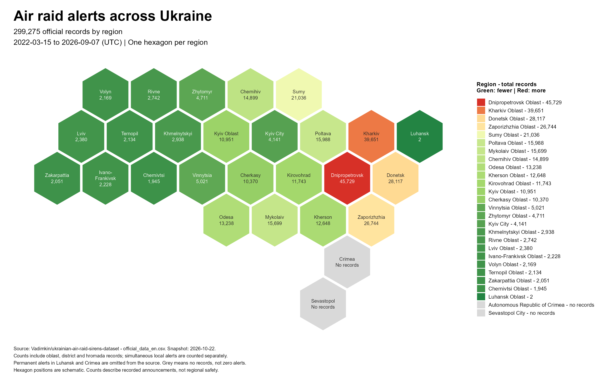

<div align="center">

# 🚨 Air Raid Alerts Across Ukraine

### Exploratory Data Analysis with R

#### CS50R · Week 5: Visualizing Data · Problem Set 5

<br>


<br>

> **A schematic hexbin map exploring the regional distribution of recorded air-raid alert announcements across Ukraine.**

</div>

---

## 📑 Table of Contents

- [About the Assignment](#-about-the-assignment)
- [Project Overview](#-project-overview)
- [Research Question](#-research-question)
- [Dataset](#-dataset)
- [Data Structure](#-data-structure)
- [Methodology](#-methodology)
- [Why a Hexbin Map?](#-why-a-hexbin-map)
- [Visual Encoding](#-visual-encoding)
- [Data Processing Workflow](#-data-processing-workflow)
- [Key Findings](#-key-findings)
- [Interpretation](#-interpretation)
- [Data Limitations](#-data-limitations)
- [Validation](#-validation)
- [Project Structure](#-project-structure)
- [Technologies Used](#-technologies-used)
- [Results and Evidence](#-results-and-evidence)
- [Completion Status](#-completion-status)
- [Skills Demonstrated](#-skills-demonstrated)

---

## 📖 About the Assignment

**Exploratory Data Analysis** is part of **Week 5: Visualizing Data** in Harvard University's **CS50R — Introduction to Programming with R**.

Exploratory data analysis, commonly abbreviated as **EDA**, is the process of examining a dataset to identify patterns, distributions, anomalies, and relationships before conducting more formal statistical analysis.

The assignment requires the creation of:

- a program named `eda.R`;
- inside a directory named `eda`;
- using a dataset selected by the student;
- producing an interesting and meaningful visualization;
- saving the final result as `visualization.png`.

For this project, I selected a dataset containing historical air-raid alert records across Ukraine and created a regional **hexbin map**.

> [!IMPORTANT]
> The purpose of this visualization is analytical and educational. It must not be used as a real-time alert system or as a measure of current regional safety.

---

## 🌍 Project Overview

| Property | Description |
|:--|:--|
| **Project title** | Air Raid Alerts Across Ukraine |
| **Course** | CS50R — Introduction to Programming with R |
| **Week** | Week 5 — Visualizing Data |
| **Assignment** | Exploratory Data Analysis |
| **Programming language** | R |
| **Visualization type** | Schematic hexbin choropleth map |
| **Dataset** | `official_data_en.csv` |
| **Dataset snapshot** | October 22, 2026 |
| **Observed period** | March 15, 2022 – September 7, 2026 |
| **Time standard** | UTC |
| **Records analyzed** | 299,275 |
| **Geographical units displayed** | 27 |
| **Output file** | `visualization.png` |

The project converts regional totals derived from the source dataset into a schematic map where every Ukrainian region is represented by one equally sized hexagon.

The map emphasizes comparison between regions instead of their physical geographical area.

---

## ❓ Research Question

The visualization was created to explore the following question:

> **How are recorded air-raid alert announcements distributed across the regions of Ukraine in the selected dataset snapshot?**

Supporting questions include:

1. Which regions contain the largest number of recorded announcements?
2. Which regions contain comparatively fewer records?
3. Are higher record counts concentrated in particular parts of the country?
4. How can regional differences be displayed without allowing geographical area to dominate the comparison?
5. Which regions have missing data in the source rather than confirmed zero activity?

---

## 🗄️ Dataset

The project is based on the English-language official dataset from the public **Ukrainian Air Raid Sirens Dataset** repository.

### Dataset source

```text
https://raw.githubusercontent.com/Vadimkin/ukrainian-air-raid-sirens-dataset/refs/heads/main/datasets/official_data_en.csv
```

### Repository

```text
https://github.com/Vadimkin/ukrainian-air-raid-sirens-dataset
```

### Dataset summary

| Attribute | Value |
|:--|:--|
| **Filename** | `official_data_en.csv` |
| **Language** | English |
| **Format** | CSV |
| **First recorded date** | March 15, 2022 |
| **Time zone** | UTC |
| **Snapshot used** | October 22, 2026 |
| **Last date in the analyzed snapshot** | September 7, 2026 |
| **Total rows represented** | 299,275 |

The dataset contains records at several administrative levels. Consequently, the visualization represents the number of recorded announcements associated with each oblast, including oblast-, district-, and hromada-level rows.

> [!NOTE]
> This is a snapshot-based visualization. The source dataset may change over time, while the values shown in this project correspond specifically to the snapshot documented above.

---

## 🧾 Data Structure

The source CSV includes fields that describe the administrative location, alert level, time interval, and source of every record.

| Column | Description |
|:--|:--|
| `oblast` | Region or oblast associated with the record |
| `raion` | District-level administrative unit |
| `hromada` | Local territorial community |
| `level` | Administrative level of the announcement |
| `started_at` | Alert start timestamp |
| `finished_at` | Alert end timestamp |
| `source` | Source associated with the record |

For the map, the primary analytical variable is:

```text
Number of dataset records grouped by oblast
```

The prepared regional table used by the visualization follows this structure:

| Column | Purpose |
|:--|:--|
| `oblast` | Region identifier used for joining data |
| `total_alerts` | Total number of records assigned to the region |
| `region_name` | Human-readable English region name |
| `map_name` | Short label displayed inside the hexagon |
| `column` | Horizontal position in the schematic layout |
| `row` | Vertical position in the schematic layout |
| `x` | Calculated horizontal center of a hexagon |
| `y` | Calculated vertical center of a hexagon |
| `fill_colour` | Color assigned from the regional total |
| `text_colour` | Adaptive label color for readability |

---

## 🔬 Methodology

The exploratory analysis consists of five principal stages.

### 1. Source inspection

The dataset was examined to identify:

- the number of records;
- the observed date range;
- the available administrative fields;
- the regional naming convention;
- missing or unavailable regional observations.

### 2. Regional aggregation

Records were grouped according to their `oblast` value.

The resulting totals represent the number of recorded announcements associated with each region.

```text
official_data_en.csv
        │
        ▼
Group records by oblast
        │
        ▼
Count records for every region
```

### 3. Geographic normalization

Dataset region identifiers were matched with standardized English display names.

This step ensures that the regional totals can be joined reliably to the custom hexagon layout.

### 4. Hexagon construction

Each region was assigned a row and column in a schematic grid.

Six vertices were calculated around every regional center to create an individual polygon.

```text
Regional center
      +
Six calculated vertices
      =
One hexagonal region tile
```

### 5. Visual encoding

Each hexagon was colored according to its number of records:

```text
Fewer records → Green → Yellow → Orange → Red → More records
```

Regions without records in the source snapshot were displayed in grey.

---

## ⬡ Why a Hexbin Map?

A conventional geographical map displays regions according to their true physical area. This can cause geographically large regions to appear visually more important, even when the analytical variable is unrelated to land area.

A hexbin map provides every region with an equal visual unit.

### Advantages

- every region receives the same amount of space;
- regional values are easier to compare;
- small regions and cities remain visible;
- labels and numeric totals can fit inside the map;
- the overall geographical arrangement remains recognizable;
- color becomes the primary representation of magnitude.

### Important distinction

The visualization is a **schematic hexbin choropleth map**:

- one hexagon represents one region;
- the position of each hexagon is approximate;
- the hexagons do not reproduce administrative boundaries;
- the color represents the number of source records.

> [!CAUTION]
> Hexagon positions are schematic and must not be interpreted as exact geographical coordinates, distances, or borders.

---

## 🎨 Visual Encoding

| Visual element | Meaning |
|:--|:--|
| **One hexagon** | One Ukrainian region |
| **Green** | Comparatively fewer records |
| **Yellow** | Medium number of records |
| **Orange** | High number of records |
| **Red** | Highest number of records |
| **Grey** | No records available in the source snapshot |
| **Region label** | English display name |
| **Numeric label** | Total number of associated records |
| **Legend order** | Regions sorted from highest to lowest count |

### Color scale

The map uses a continuous five-color scale:

| Relative value | Color | Hex code |
|:--|:--:|:--:|
| Lowest | 🟢 | `#238443` |
| Low to medium | 🟩 | `#A1D76A` |
| Medium | 🟡 | `#FFFFBF` |
| Medium to high | 🟠 | `#FCAE61` |
| Highest | 🔴 | `#D73027` |
| Missing data | ⚪ | `#D9D9D9` |

The label color is selected dynamically based on background brightness:

- white text is used on dark hexagons;
- dark text is used on light hexagons.

This improves readability throughout the map.

---

## 🔄 Data Processing Workflow

```text
┌──────────────────────────────────────┐
│ official_data_en.csv                 │
│ Historical air-raid alert records    │
└──────────────────┬───────────────────┘
                   │
                   ▼
┌──────────────────────────────────────┐
│ Inspect the dataset snapshot         │
│ Dates, regions and admin levels      │
└──────────────────┬───────────────────┘
                   │
                   ▼
┌──────────────────────────────────────┐
│ Aggregate records by oblast          │
│ Calculate regional totals            │
└──────────────────┬───────────────────┘
                   │
                   ▼
┌──────────────────────────────────────┐
│ Standardize regional names           │
│ Match totals to the map layout       │
└──────────────────┬───────────────────┘
                   │
                   ▼
┌──────────────────────────────────────┐
│ Validate the prepared data           │
│ Regions, coordinates and totals      │
└──────────────────┬───────────────────┘
                   │
                   ▼
┌──────────────────────────────────────┐
│ Calculate hexagon geometry           │
│ Six polygon vertices per region      │
└──────────────────┬───────────────────┘
                   │
                   ▼
┌──────────────────────────────────────┐
│ Apply the continuous color scale     │
│ Green → Yellow → Orange → Red        │
└──────────────────┬───────────────────┘
                   │
                   ▼
┌──────────────────────────────────────┐
│ Build the map with ggplot2           │
│ Polygons, labels, legend and caption │
└──────────────────┬───────────────────┘
                   │
                   ▼
┌──────────────────────────────────────┐
│ visualization.png                    │
│ 2560 × 1600 pixel output             │
└──────────────────────────────────────┘
```

---

## 📊 Key Findings

The analyzed snapshot contains:

```text
299,275 recorded announcements
```

The five regions with the largest record totals are:

| Rank | Region | Records |
|:--:|:--|--:|
| 1 | Dnipropetrovsk Oblast | 45,729 |
| 2 | Kharkiv Oblast | 39,651 |
| 3 | Donetsk Oblast | 28,117 |
| 4 | Zaporizhzhia Oblast | 26,744 |
| 5 | Sumy Oblast | 21,036 |

Additional comparatively high totals include:

| Region | Records |
|:--|--:|
| Poltava Oblast | 15,988 |
| Mykolaiv Oblast | 15,699 |
| Chernihiv Oblast | 14,899 |
| Odesa Oblast | 13,238 |
| Kherson Oblast | 12,648 |
| Kirovohrad Oblast | 11,743 |
| Kyiv Oblast | 10,951 |
| Cherkasy Oblast | 10,370 |

The map shows that the highest record totals are concentrated primarily in eastern, southeastern, and some northeastern regions of Ukraine.

Western regions generally appear in darker green, indicating lower totals relative to the rest of the dataset.

> [!WARNING]
> These totals represent dataset records, not necessarily distinct region-wide alert events. Multiple local announcements can occur simultaneously and be stored as separate rows.

---

## 💡 Interpretation

The color pattern reveals a strong regional difference in the number of recorded announcements.

The largest totals appear in:

- Dnipropetrovsk Oblast;
- Kharkiv Oblast;
- Donetsk Oblast;
- Zaporizhzhia Oblast;
- Sumy Oblast.

The result is consistent with a substantially higher number of recorded announcements in parts of eastern and southeastern Ukraine.

However, the map should be interpreted as a visualization of the dataset’s record distribution—not as a direct measurement of:

- attack intensity;
- physical damage;
- casualties;
- present-day danger;
- time spent under alert;
- the number of unique military incidents.

A region can receive multiple district- or hromada-level records during a single period. Therefore, the regional totals describe recorded announcements rather than a standardized measure of regional risk.

---

## ⚠️ Data Limitations

### 1. Different administrative levels

The dataset contains records associated with:

- oblasts;
- raions;
- hromadas.

This means that one wider alert period may be represented by several local records.

### 2. Simultaneous local announcements

Simultaneous alerts in multiple districts or communities are counted separately.

For this reason, the visualization should not be interpreted as a count of unique countrywide alert events.

### 3. Changing reporting practices

The administrative level at which alerts are reported has changed during the dataset’s lifetime.

Comparisons across the entire period may therefore be affected by changes in reporting granularity.

### 4. Permanent alerts

Permanent alerts associated with Luhansk and Crimea are omitted from the source dataset.

Consequently:

- the extremely low displayed value for Luhansk should not be interpreted as an absence of danger;
- missing Crimean data must not be interpreted as zero alerts.

### 5. Missing values

The Autonomous Republic of Crimea and Sevastopol City are displayed in grey and labeled:

```text
No records
```

Grey represents unavailable records in the source snapshot—not zero alerts.

### 6. Snapshot-based results

The source repository is updated over time, but this visualization represents a fixed snapshot dated:

```text
2026-10-22
```

The totals must be regenerated if the project is updated to use a later dataset snapshot.

### 7. Schematic geography

The positions of the hexagons are approximate and intended for visual comparison.

They do not preserve:

- true regional borders;
- physical area;
- exact coordinates;
- geographical distance.

---

## 🧪 Validation

The R program contains several internal checks to protect the visualization from inconsistent input.

The validation process confirms that:

- the layout contains exactly 27 geographical units;
- every unit has a unique identifier;
- no two regions occupy the same grid position;
- every region in the calculated totals exists in the map layout;
- the regional counts sum to 299,275;
- each hexagon contains exactly six polygon vertices;
- the final output file is successfully created.

The map therefore contains:

```text
27 geographical units × 6 vertices = 162 polygon vertices
```

These validation checks help detect:

- missing regions;
- duplicate regions;
- duplicate map coordinates;
- inconsistent totals;
- incomplete layout definitions.

---

## 📁 Project Structure

```text
eda/
│
├── eda.R
│   └── Data preparation, validation and visualization program
│
├── visualization.png
│   └── Final hexbin map generated by eda.R
│
├── assets/
│   ├── check50.png
│   └── submit50.png
│
└── README.md
    └── Project documentation
```

---

## 🛠️ Technologies Used

| Technology | Purpose |
|:--|:--|
| **R** | Main programming language |
| **RStudio** | Development environment |
| **ggplot2** | Map construction and graphical layers |
| **scales** | Continuous regional color interpolation |
| **bbplot** | BBC-inspired visualization theme |
| **grid** | Legend dimension configuration |
| **Base R** | Data frames, joins, validation and geometry |
| **GitHub** | Version control and project presentation |
| **check50** | CS50 automated assignment verification |
| **submit50** | CS50 assignment submission |

### Main visualization components

| R component | Role |
|:--|:--|
| `ggplot()` | Initializes the visualization |
| `geom_polygon()` | Draws the regional hexagons |
| `geom_text()` | Adds names and totals |
| `scale_fill_manual()` | Assigns region-specific colors |
| `scale_colour_identity()` | Applies adaptive text colors |
| `coord_equal()` | Preserves the hexagon proportions |
| `labs()` | Adds the title, subtitle and methodology note |
| `theme()` | Controls typography and presentation |
| `ggsave()` | Exports the completed visualization |

---

# 📸 Results and Evidence

## 1. Hexbin Map of Air Raid Alerts Across Ukraine

The completed visualization displays one equally sized hexagon for each region and uses color to represent the number of records associated with that region.

<p align="center">
  
</p>

<p align="center">
  <em>
    Figure 1 — Regional distribution of 299,275 recorded air-raid alert
    announcements in the analyzed dataset snapshot.
  </em>
</p>

### Visualization details

| Property | Value |
|:--|:--|
| **Output file** | `visualization.png` |
| **Dimensions** | 2560 × 1600 pixels |
| **Aspect ratio** | 16:10 |
| **Resolution** | 160 DPI |
| **Background** | White |
| **Regional units** | 27 hexagons |
| **Color direction** | Green: fewer records · Red: more records |
| **Missing-data color** | Grey |

---

## 2. check50

The following screenshot confirms that the project satisfies the automated CS50 assignment requirements.

<p align="center">
  
</p>

<p align="center">
  <em>Figure 2 — Successful check50 verification.</em>
</p>

> **Screenshot path:** `assets/check50.png`

The project was checked with:

```r
check50("cs50/problems/2024/r/eda")
```

---

## 3. submit50

The following screenshot confirms that the completed project was successfully submitted to CS50.

<p align="center">
  
</p>

<p align="center">
  <em>Figure 3 — Successful submission of the completed EDA project.</em>
</p>

> **Screenshot path:** `assets/submit50.png`

The project was submitted with:

```r
submit50("cs50/problems/2024/r/eda")
```

---

## 🏁 Completion Status

| Component | Status |
|:--|:--:|
| Research topic selected | ✅ |
| Dataset selected and inspected | ✅ |
| Dataset snapshot documented | ✅ |
| Records grouped by region | ✅ |
| Regional names standardized | ✅ |
| Custom hexagon layout created | ✅ |
| Regional totals validated | ✅ |
| Color scale implemented | ✅ |
| Adaptive text colors implemented | ✅ |
| Legend sorted by regional total | ✅ |
| Data limitations documented | ✅ |
| Visualization generated | ✅ |
| `visualization.png` exported | ✅ |
| `check50` completed | ✅ |
| `submit50` completed | ✅ |
| Project documentation completed | ✅ |

---

## 🧠 Skills Demonstrated

This project demonstrates practical experience with:

- exploratory data analysis;
- working with external CSV datasets;
- evaluating dataset structure and provenance;
- aggregating observations by geographical category;
- standardizing geographical identifiers;
- designing a custom schematic map layout;
- calculating polygon coordinates programmatically;
- constructing polygons with `ggplot2`;
- developing a continuous color scale;
- applying conditional colors for accessible labels;
- designing a custom ordered legend;
- validating data before visualization;
- documenting analytical limitations;
- distinguishing missing data from zero values;
- exporting publication-ready graphics;
- presenting data responsibly;
- creating professional GitHub documentation.

---

## 📌 Responsible-Use Notice

This visualization is a historical and educational data-analysis project.

It is not:

- a live warning system;
- an official safety service;
- a military intelligence product;
- a forecast of future attacks;
- a substitute for instructions from Ukrainian authorities.

During an emergency, users should rely exclusively on official Ukrainian alert channels and local authority guidance.

---

<div align="center">

### 🎓 CS50R — Week 5: Visualizing Data

**Exploratory Data Analysis**

<br>

### 🚨 Air Raid Alerts Across Ukraine

*299,275 records transformed into one comparative regional visualization.*

<br>

`R` · `ggplot2` · `Hexbin Map` · `EDA` · `Data Visualization`

</div>