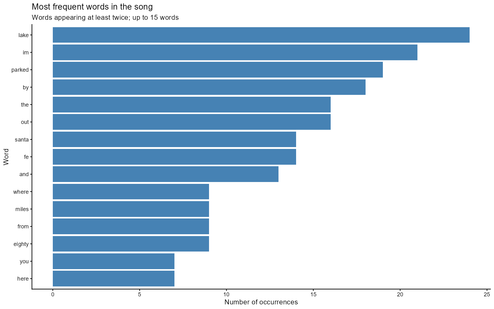
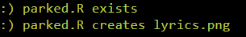
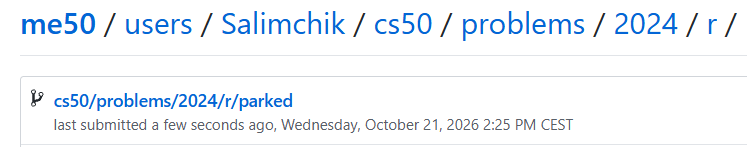

<div align="center">

# 🅿️ Parked Out By The Lake

### CS50R — Introduction to Programming with R

#### Week 5 · Visualizing Data · Problem Set 5

<br>


<br>

> **Transforming song lyrics into a clear and informative word-frequency visualization using R.**

</div>

---

## 📑 Table of Contents

- [About the Assignment](#-about-the-assignment)
- [Project Objective](#-project-objective)
- [Selected Song](#-selected-song)
- [Assignment Requirements](#-assignment-requirements)
- [Data Processing Workflow](#-data-processing-workflow)
- [Text Preparation](#-text-preparation)
- [Word-Frequency Analysis](#-word-frequency-analysis)
- [Visualization Design](#-visualization-design)
- [Expected Result](#-expected-result)
- [Project Structure](#-project-structure)
- [Technologies Used](#-technologies-used)
- [Results and Evidence](#-results-and-evidence)
- [Completion Status](#-completion-status)
- [Skills Demonstrated](#-skills-demonstrated)

---

## 📖 About the Assignment

**Parked Out By The Lake** is the first assignment of **Week 5: Visualizing Data** in Harvard University's **CS50R — Introduction to Programming with R**.

The assignment focuses on converting unstructured textual data into a meaningful graphical representation.

The program reads the lyrics of a selected song, cleans and separates the text into individual words, calculates how frequently each word appears, and visualizes the results using **ggplot2**.

> [!IMPORTANT]
> The final visualization is saved as `lyrics.png` using `ggsave()`.

---

## 🎯 Project Objective

The primary objective of this project is to build a complete text-analysis and visualization pipeline in R.

The completed program must:

1. Read song lyrics from a plain-text file.
2. Clean and normalize the text.
3. Split the lyrics into individual words.
4. Count the number of occurrences of each unique word.
5. Store the results in a structured data frame or tibble.
6. Create a word-frequency diagram with `ggplot2`.
7. Export the completed visualization as `lyrics.png`.

---

## 🎵 Selected Song

For this project, I selected the song associated with the title of the assignment:

| Property | Selection |
|:--|:--|
| **Song** | `Parked Out By The Lake` |
| **Lyrics file** | `lyrics/summerwind.txt` |
| **Input format** | Plain-text file |
| **Analysis type** | Word-frequency analysis |
| **Visualization** | Bar chart |
| **Output file** | `lyrics.png` |

The song is particularly suitable for frequency analysis because its title and several key words are repeated throughout the lyrics.

---

## ✅ Assignment Requirements

The solution is implemented in `parked.R` and performs the following operations:

- [x] Opens a lyrics file from the `lyrics` directory.
- [x] Reads the complete contents of the file.
- [x] Normalizes inconsistent capitalization.
- [x] Removes unnecessary punctuation and special characters.
- [x] Splits the cleaned text into separate words.
- [x] Creates a data frame containing `word` and `count`.
- [x] Calculates the frequency of every unique word.
- [x] Orders the words according to their frequency.
- [x] Removes one-time words from the displayed results where appropriate.
- [x] Produces a readable word-frequency diagram.
- [x] Uses `ggplot2` to create the visualization.
- [x] Saves the final chart as `lyrics.png`.
- [x] Passes the automated `check50` tests.
- [x] Submits the completed assignment with `submit50`.

---

## 🔄 Data Processing Workflow

The project follows a structured text-processing pipeline:

```text
┌─────────────────────────────┐
│  lyrics/summerwind.txt      │
│  Raw song lyrics            │
└──────────────┬──────────────┘
               │
               ▼
┌─────────────────────────────┐
│  Read the complete file     │
│  Import lyrics into R       │
└──────────────┬──────────────┘
               │
               ▼
┌─────────────────────────────┐
│  Normalize the text         │
│  Case and punctuation       │
└──────────────┬──────────────┘
               │
               ▼
┌─────────────────────────────┐
│  Tokenize the lyrics        │
│  Split text into words      │
└──────────────┬──────────────┘
               │
               ▼
┌─────────────────────────────┐
│  Calculate frequencies      │
│  Create word/count table    │
└──────────────┬──────────────┘
               │
               ▼
┌─────────────────────────────┐
│  Build the ggplot2 chart    │
│  Visualize repeated words   │
└──────────────┬──────────────┘
               │
               ▼
┌─────────────────────────────┐
│  lyrics.png                 │
│  Final exported diagram     │
└─────────────────────────────┘
```

---

## 🧹 Text Preparation

Before word frequencies can be calculated, the raw lyrics must be converted into a consistent format.

### 1. Reading the lyrics

The complete text is imported from:

```text
lyrics/summerwind.txt
```

The file is read as one continuous character string so that it can be cleaned and transformed.

### 2. Normalizing capitalization

Words with different capitalization should be treated as the same word.

For example:

```text
Lake
LAKE
lake
```

are normalized to:

```text
lake
```

### 3. Processing punctuation

Punctuation marks and unrelated special characters are removed or normalized so that they do not create separate word categories.

For example:

```text
lake
lake,
lake!
```

must be counted as occurrences of the same word.

### 4. Tokenizing the text

After cleaning, the lyrics are split into individual word tokens:

```text
"parked out by the lake"
```

becomes:

```text
"parked"  "out"  "by"  "the"  "lake"
```

---

## 🔢 Word-Frequency Analysis

After tokenization, the words are organized into a data frame or tibble with two principal columns:

| Column | Description |
|:--|:--|
| `word` | A unique word extracted from the lyrics |
| `count` | The number of times the word appears |

The resulting structure follows this format:

| word | count |
|:--|--:|
| lake | frequency |
| parked | frequency |
| out | frequency |
| by | frequency |
| the | frequency |
| ... | ... |

> [!NOTE]
> The table above demonstrates the structure of the processed data. The complete frequencies are calculated automatically by `parked.R`.

To keep the final diagram readable, words that occur only once can be excluded from the displayed results.

---

## 📊 Visualization Design

The calculated word frequencies are visualized with a **bar chart** created using `ggplot2`.

### Visual encoding

| Chart element | Meaning |
|:--|:--|
| **Words** | Categories extracted from the song |
| **Bar length or height** | Number of occurrences |
| **Bar order** | Frequency ranking |
| **Fill color** | Visual emphasis |
| **Title** | Context for the analyzed song |
| **Axis labels** | Meaning of the displayed values |

### Design decisions

The chart is designed to:

- emphasize the most frequently repeated words;
- arrange words according to their frequency;
- provide clearly readable labels;
- avoid unnecessary visual clutter;
- use a consistent and professional color palette;
- include an informative title and axis descriptions;
- remain readable when displayed on GitHub.

The completed plot is exported with:

```r
ggsave("lyrics.png")
```

---

## 🔍 Expected Result

For the selected song, the visualization should prominently feature words associated with its repeated title.

The most dominant words are expected to include:

| Approximate prominence | Word |
|:--:|:--|
| 1 | `lake` |
| 2 | `i'm` |
| 3 | `parked` |
| 4 | `by` |
| 5 | `out` |
| 6 | `the` |

These repeated words form the central pattern visible in the final frequency diagram.

> [!TIP]
> The exact presentation depends on the chosen text-cleaning rules, particularly how capitalization, apostrophes, and punctuation are processed.

---

## 📁 Project Structure

```text
parked/
│
├── parked.R
│   └── Main R script for processing and visualizing the lyrics
│
├── lyrics/
│   ├── astley.txt
│   ├── beatles.txt
│   ├── chapman.txt
│   ├── robinson.txt
│   ├── summerwind.txt
│   └── swift.txt
│
├── lyrics.png
│   └── Word-frequency visualization generated by parked.R
│
├── assets/
│   ├── frequency-diagram.png
│   ├── check50-result.png
│   └── submit50-result.png
│
└── README.md
    └── Project documentation
```

---

## 🛠️ Technologies Used

| Technology | Purpose |
|:--|:--|
| **R** | Core programming language |
| **RStudio** | Development environment |
| **readr** | Reading the lyrics file |
| **stringr** | Cleaning and transforming text |
| **dplyr** | Grouping, counting, filtering, and sorting |
| **tibble** | Structuring the word-frequency data |
| **ggplot2** | Creating the frequency diagram |
| **ggsave** | Exporting the visualization |
| **check50** | Verifying the correctness of the solution |
| **submit50** | Submitting the completed assignment |
| **GitHub** | Version control and project documentation |

---

# 📸 Results and Evidence

## 1. A Frequency Diagram

The following screenshot demonstrates the completed word-frequency visualization generated from `lyrics/summerwind.txt`.

<p align="center">
  
</p>

<p align="center">
  <em>Figure 1 — Frequency diagram created with ggplot2 and exported as lyrics.png.</em>
</p>

> **Screenshot path:** `assets/frequency-diagram.png`

---

## 2. check50

The following screenshot confirms that the implementation satisfies the automated requirements of the assignment.

<p align="center">
  
</p>

<p align="center">
  <em>Figure 2 — Successful completion of the CS50 automated checks.</em>
</p>

> **Screenshot path:** `assets/check50-result.png`

The assignment was verified with:

```r
check50("cs50/problems/2024/r/parked")
```

---

## 3. submit50

The following screenshot confirms that the completed project was successfully submitted.

<p align="center">
  
</p>

<p align="center">
  <em>Figure 3 — Successful submission of Problem Set 5.</em>
</p>

> **Screenshot path:** `assets/submit50-result.png`

The assignment was submitted with:

```r
submit50("cs50/problems/2024/r/parked")
```

---

## 🏁 Completion Status

| Component | Status |
|:--|:--:|
| Lyrics file imported | ✅ |
| Text normalized | ✅ |
| Lyrics tokenized | ✅ |
| Word frequencies calculated | ✅ |
| Data frame created | ✅ |
| Frequency diagram generated | ✅ |
| Visualization exported as `lyrics.png` | ✅ |
| `check50` completed | ✅ |
| `submit50` completed | ✅ |
| Documentation completed | ✅ |

---

## 🧠 Skills Demonstrated

This project demonstrates practical experience with:

- importing unstructured text data into R;
- cleaning and normalizing character strings;
- tokenizing continuous text into individual words;
- converting text into structured tabular data;
- grouping and counting categorical observations;
- sorting and filtering frequency data;
- creating informative visualizations with `ggplot2`;
- customizing titles, labels, colors, and themes;
- exporting plots as image files;
- documenting analytical projects for GitHub;
- validating and submitting CS50 assignments.

---

<div align="center">

### 🎓 CS50R — Week 5: Visualizing Data

**Problem Set 5 · Parked Out By The Lake**

<br>

*From raw lyrics to meaningful visual insight.*

<br>

`R` · `stringr` · `dplyr` · `ggplot2` · `Data Visualization`

</div>